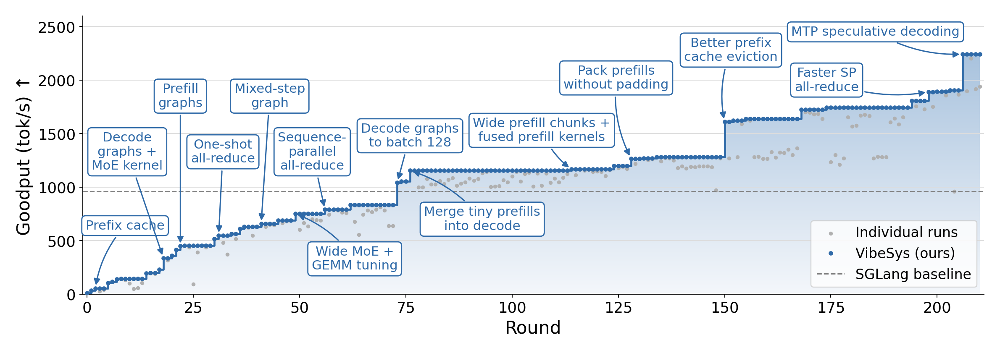
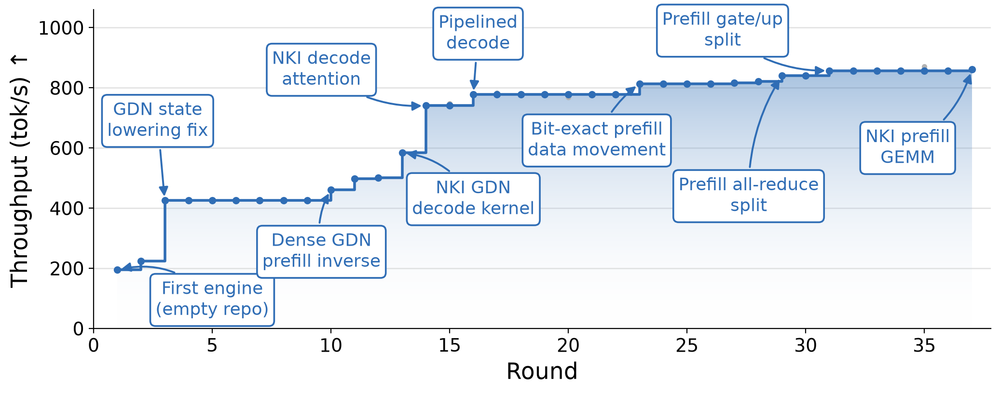
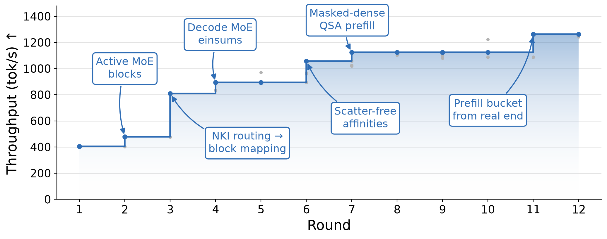

# VibeSys: Generating Bespoke Systems with AI Agents

[](https://arxiv.org/abs/2605.06068)

**An agentic framework that generates bespoke systems from application requirements, workload characteristics, and the underlying hardware.**

## News

- **2026-11-04** — [VibeSys on Trainium](https://syfi.cs.washington.edu/blog/2026-11-04-vibesys-trainium/): agents build and tune Qwen3.8 serving engines on AWS Trainium2.
- **2026-10-08** — [VibeSys on AMD MI300A](https://syfi.cs.washington.edu/blog/2026-10-08-qwen35-mi300a/): an agent-built Qwen3.5-397B engine achieves 2.3× the goodput of tuned SGLang.
- **2026-05-12** — [Introducing VibeServe](https://syfi.cs.washington.edu/blog/2026-05-12-introducing-vibeserve/): let AI agents write your serving stack. [Paper](https://arxiv.org/abs/2605.06068).

## About VibeSys

Today's systems software is built for generality. A serving engine, operating
system, or database supports many workloads and hardware platforms, but its
shared abstractions can leave opportunities in any one deployment unexploited.
Specialization can recover large gains; building and maintaining a separate
system for each deployment has rarely justified the engineering cost. Coding
agents are beginning to change that calculation.

**VibeSys uses AI agents to build and optimize bespoke systems for a specific
application, workload, and hardware target.** You provide the requirements,
correctness checks, and performance benchmark. Agents explore system designs,
implement candidates, and use measurements to guide the next change. Persistent
search history and independent review let that process continue across many
experiments, while domain skills supply the knowledge needed for serving
engines, databases, microservices, and kernels. VibeSys can start from an existing
codebase or build a system from scratch.

[**VibeServe**](https://arxiv.org/abs/2605.06068) demonstrated this approach for
LLM serving: agents generated complete serving systems that exploit deployment
knowledge across scheduling, memory management, and kernels. On predicted-output
code editing, a generated system achieved up to **5.95× the speed of vLLM's
standard decoding**. VibeSys extends this approach to systems software more
broadly, with each task defining what must remain correct and what to optimize.

<p align="center">
  
</p>

## Quickstart

VibeSys is available as a plugin for Claude Code and Codex. In Claude Code, for example:

```bash
claude plugin marketplace add uw-syfi/vibesys
claude plugin install vibesys@vibesys
# Install additional plugins for domain-specific knowledge
claude plugin install vibesys-llm-serving@vibesys
```

Then ask your agent to create a task describing your optimization goal and correctnes criteria, and start the optimization:

```text
/vibesys:create-task
/vibesys:optimize <task>
```

See the [skills installation guide](skills/README.md#install) for Codex,
`npx skills`, and domain plugins for databases, microservices, native command-line tools, and kernels.

To run managed optimizations with `vibesys-client` instead, see
[Install for managed runs](orchestrator/README.md#install-for-managed-runs). To remove it, see
[Removing VibeSys](orchestrator/README.md#removing-vibesys).

## Performance highlights

Below are some recent optimization results from running VibeSys. Click on the images to see blog posts detailing the results.

<table>
  <tr>
    <td colspan="2" align="center">
      <a href="https://syfi.cs.washington.edu/blog/2026-10-08-qwen35-mi300a/">
        
      </a>
      <br><strong>Qwen3.5-397B · 4× AMD MI300A</strong><br>
      2,242 tok/s goodput · <strong>2.3× tuned SGLang</strong>
    </td>
  </tr>
  <tr>
    <td width="50%" align="center">
      <a href="https://syfi.cs.washington.edu/blog/2026-11-04-vibesys-trainium/">
        
      </a>
      <br><strong>Qwen3.8-27B · 1× Trainium2</strong><br>
      195 → 861 tok/s · <strong>4.4× the first working engine</strong>
    </td>
    <td width="50%" align="center">
      <a href="https://syfi.cs.washington.edu/blog/2026-11-04-vibesys-trainium/">
        
      </a>
      <br><strong>Qwen3.8-Flash-Next · 16× Trainium2</strong><br>
      <strong>3.1× the starting engine</strong>
    </td>
  </tr>
</table>

## Architecture

<p align="center">
  
</p>

The framework factors the work along two axes:

- **Outer loop** — a fresh designer selects one falsifiable causal hypothesis
  from git history, profiling evidence, and durable roadmap/progress memory, then
  hands it off until it is proven, disproven, or otherwise terminated.
- **Inner loop** — a hypothesis-scoped implementer session edits the candidate,
  chooses targeted experiments and parameter ranges, and reports whether to
  continue or nominate the result.
- **Independent judge** — a fresh, read-only reviewer checks the implementation,
  activation evidence, invariants, and reward-hacking risks at a sparse cadence.
  After a PASS, the framework—not an agent—runs and records the canonical
  accuracy and benchmark commands.
- **Performance evaluator** — profiles the implementation (Nsight Systems,
  PyTorch profiler) and feeds bottleneck hints into future design decisions.
- **Skills library** — Agent Skills entries distilled from existing serving engines and research literature (continuous batching, paged-KV, FlashInfer/FlashAttention, MLX, hybrid-cache management, …). New model families, hardware platforms, and optimization techniques are added by writing a skill, not by modifying the framework.
- **Execution environment**: an isolated runtime view where candidate source
  is writable while evaluator-owned inputs and framework metadata are read-only
  and integrity-checked. It exposes the target hardware (local CUDA, Modal,
  Docker, or Apple Silicon) plus profilers.

Each round is recorded in git and a framework-owned audit. Provisional rounds
remain explicitly unreviewed; only judge-approved candidates receive official
accuracy and performance results.

## Citation

If you use the VibeServe initiative in your research, please cite:

```bibtex
@misc{kamahori2026vibeserveaiagentsbuild,
      title={VibeServe: Can AI Agents Build Bespoke LLM Serving Systems?},
      author={Keisuke Kamahori and Shihang Li and Simon Peter and Baris Kasikci},
      year={2026},
      eprint={2605.06068},
      archivePrefix={arXiv},
      primaryClass={cs.AI},
      url={https://arxiv.org/abs/2605.06068},
}
```
