# Architecture: Python module graph

[`tach.toml`](https://github.com/uw-syfi/vibesys/blob/main/tach.toml) freezes
the Python module graph, and CI runs `uv run python scripts/check_tach.py`. An import between
modules that is not a declared `depends_on` edge fails the check. Modules cover
`src/` (`entrypoints`, `launch`, `headless`, `vibesys.*`) and every `libs/*/src`.
Run it through the wrapper, not `tach check` directly: tach treats a library with
its own `pyproject.toml` (a uv workspace member) as a separate package and stops
checking its edges and interfaces, and the wrapper runs tach on a copy of the
source roots without those files.

The graph below is generated from `tach.toml` by `tach show --mermaid`. CI
fails when it is stale. To refresh after editing `tach.toml`:

```bash
uv run python scripts/check_tach_graph.py --write
```

A package-level overview with submodules collapsed to their top-level package.
The graph is acyclic and `tach.toml` forbids cycles.

Every direct subfolder of `src/vibesys/orchestration/` is one orchestration
strategy: `dynamic`, `evolve`, `issue_queue`, `multi`, or `single`. Shared
policy and resources (`domains`, `hypothesis`, `profile_focus`,
`prompts`, and `metrics`) live beside `orchestration` under `src/vibesys/` and
never import it. Domain templates live in their domain package; strategy
templates live in their strategy package. The shared `prompts` package owns
only shared rendering and templates. A strategy may exclusively own a run shell
when every source consumer of that shell belongs to the strategy. Shared run
composition and peer strategies cannot import such a shell. Its downward policy
interfaces and library dependencies remain declared in Tach. Top-level orchestration modules remain
shared policy helpers; they are not strategy packages.

A strategy written as a flow (today `dynamic`) has this layout inside its folder:

- `search/`: the `@search` root flow, its `Role` declarations beside it, its config, prompt
  contexts and the pure helpers its flows share. `search/api.py` is the only public surface;
  other modules start with an underscore and nothing outside the package imports them. Code here
  reaches `vs_core` only through `vs_core.api.search`.
- `core_policy/`: host-side policy that reads the wider `vs_core.api` (evidence requirements,
  prompt variables, the projection of the published `RunSnapshot`), with the prompt templates.
- `launch.py` and `models.py`: the options an operator writes (the search config plus the
  task's inputs) and the reply models.

What a task fixes (gates, metric space, stage limits) is `vs_core.api.TaskTerms` on the run's
facts, not search config. The old `strategy/` state-machine package is gone for `dynamic`; the
other strategies keep it until they are ported. See [orchestration-runtime.md](orchestration-runtime.md)
and [flows.md](flows.md); `tests/architecture/test_search_packages.py` enforces the rules.

`src/vibesys/` holds strategies, domain resources, prompts, and thin wiring.
The generic pure lifecycle lives in `vs_core`, published only through
`vs_core.api`: immutable state, events, requests, strategy contracts and projections.
The `vs_runtime` async shell calls strategy decisions and core transitions
separately, persists intent before I/O, and returns typed observations.
`vs_core` has no I/O-library dependencies. Infrastructure mechanisms belong in
`vs_runtime` and its libraries. Placement
test: "Would another product built on vs_runtime need this mechanism, with no
VibeSys policy in it? Then it belongs in a library, not src/vibesys."

Design stateful systems as a pure core that emits requests and a thin async
shell that calls I/O interfaces and returns typed outcomes as events. Each
owning library declares its interface in its `.api` and holds interchangeable
implementations inside it or in smaller libraries it depends on. The shell
imports the core and owning libraries; the core imports no I/O library. Follow
the software-design rule
[Functional core, interfaces and implementations](https://github.com/uw-syfi/vibesys/blob/main/.agents/skills/software-design/references/functional-core.md)
for durable intent, recovery, and tests.

Execution environments, command runners, and agent confinement have separate
owners; see [Sandboxing and confinement](sandboxing.md).

Long-running work writes its output to `vs_logs`, which keeps each stream under a typed
owner for humans to read. `vs_logs` sits in the tach layer `logs`, above every library, so
no library imports it. The product writes logs; `vs_logs.read` currently has only library-test consumers. See [Log streams](logs.md).

The TypeScript clients under `clients/` have their own package graph, layers, and
build model; see [Clients architecture](clients-architecture.md).

`vibesys.orchestration` owns built-in orchestration policy. Explicit plugins,
including the issue queue, live under the singular
`vibesys.orchestration.<plugin>` namespace; `launch` assembles their built-in
catalog from individual registrations exposed by `vibesys.api.catalog`.
`vibesys.plugin_catalog` retains the explicit registry contract.
Agent roles, plan and reply schemas, prompts, and pure strategy decisions
live with their owning orchestration; generic lifecycle and recovery decisions
belong in the pure core. For example, the
hypothesis planner's skill-selection and title rules are public through
`vibesys.hypothesis`, not a top-level schema catch-all. Generic
run roles live in `vibesys.api`: `Runs` starts and resumes independent
`RunHandle` tasks, which publish semantic events, accept stop requests, and
return results. `launch.default_runs` selects VibeSys implementations;
`vs-runtime` owns the generic task and event-stream mechanism. Only
entrypoints, tests and scripts import `launch`. Headless receives one started
handle. The transitional `vibesys.api.session`
contract retains queries, readiness and auxiliary-agent access;
workspace, persistence, and sandbox mechanisms live in the runtime libraries.
The `vibesys.api` package root is policy-neutral. Applications opt into a
built-in policy through a named facade such as `vibesys.api.hypothesis` or
`vibesys.api.evolve`; the generic facade does not re-export those contracts.
Tach records each dependency. `vs_project` owns generic project layout and
persistence operations. Hypothesis-search history and its serialization belong
to `vibesys.hypothesis`; they are policy contracts, not generic lifecycle types.
The v5 manifest separates policy-specific descriptor options from the generic
`execution` record. The latter is derived from `RunRequest` and resolved host
settings, including the concrete profiler. Resume checks it before setup.
Trusted evaluator execution and package mechanics live in the runtime and
sandbox libraries. Orchestration owns gate cadence and result interpretation.

Libraries are converted to uv workspace members bottom-up (a library converts
once every library it imports is a member). A member's `pyproject.toml` declares
exactly the third-party packages its `src/` imports, and reaches other members
through `[tool.uv.sources] <name> = { workspace = true }`.
`scripts/check_member_dependencies.py` fails CI on an undeclared or unused
dependency, an undeclared member edge, or an import of a root-distribution
package. The `vibesys` wheel still bundles every library's source, so each
member dependency must also appear in the root `dependencies` with the same
version constraint.

The strategy and plugin contract is in
[orchestration-runtime.md](orchestration-runtime.md).

What happens to a run when its process stops, and how the next process continues, is in
[run-recovery.md](run-recovery.md): the log is the truth, a step with no result runs again after
a `clear`, and the prove-or-block layer is being removed.

A search is `@search(name, config=Model)` over a flow (straight-line `async` code that the
runtime journals and replays). It follows [flows.md](flows.md): the `ctx` vocabulary (agents,
workspaces, evaluation, groups), the rule for flow code, how core ends the run from the winner
the flow chose, and how to test it.

## Host composition

The host process only composes typed services. It holds no product logic: it
parses flags, opens a listener, and registers services that other packages own.
The command is a thin entry point that hands control to a composition package.
The composition package uses transport and lifecycle services, the schema hash,
and the orchestrator host surface. Service packages own their behavior. The
gateway archcheck enforces the command shape and composition boundary.
Unenforced: product decisions through allowed imports still need human review.

## Talking to daemons

A **daemon** here is a long-lived local process that owns some state and that
another process (the caller) reads and commands over a socket: the CLI daemon
that owns each task's job store, and the sidecar that owns an agent session.
The host daemon `vibesys-host` is the caller of both. Every link from a caller to a
daemon follows the ten rules below, so that a new link is a variation on a
known one and not a new protocol. "Callee" is the daemon and "caller" is the
process that dials it.

| Term | Meaning |
| --- | --- |
| `vibesys-host` | The host process composing typed services |
| `vibesysd` | The CLI daemon process name after the CLI rename |
| `HostService` | The host wire API |
| host | The machine running the host process |

Each rule names its enforcement. "Unenforced" gives the reason.

1. **The callee owns the contract.** The contract is a `.proto` under
   `proto/vibesys/<callee>/v<N>/`. The caller generates its stubs from it and
   writes no mirror of a message. A Go module generates a given proto package
   once, and no build links two copies, because two copies of one package
   panic at registration.
   Enforced: stubs and messages are regenerated and diffed by the `proto`
   check group; the one-copy rule by the proto-copy check. Unenforced: a hand-written mirror of a callee's message cannot be
   told from a new message without a reader.
2. **Transport is gRPC over a Unix socket in a private directory.** The
   directory is a real directory (not a link) owned by the user with mode
   `0700`, not on a network file system, and the socket path is at most 100
   bytes. The caller checks the directory before it dials, so a directory
   someone else created in advance cannot answer as the daemon.
   Enforced: for the CLI daemon, by the tests of its runtime-directory package;
   for the caller's check, by the `Locate` tests.
   Unenforced: for a new daemon, the choice of transport is a design decision.
3. **Discovery is a documented rule.** The callee's README says how a caller
   finds the socket, and a golden file pins the rule: the callee and every
   caller read the same golden in their tests. A caller never guesses, scans
   for sockets, or reads pid files.
   Enforced: by the golden tests for the CLI daemon.
   Enforced: cross-component file reads by `fs-reads`. Unenforced: for a
   new daemon nothing requires a golden.
4. **The first call is `Hello`.** It carries the caller's component and the
   protocol versions, and the answer is `COMPATIBLE`, `CLIENT_TOO_OLD` or
   `DAEMON_TOO_OLD`. A missing, incompatible or failed daemon is an unreadable
   state with a typed reason, never an empty list.
   Enforced: for the CLI daemon, by its contract suite and the conformance
   scenarios. Unenforced: across daemons, which call
   is a link's first call is not visible to a check.
5. **A read is a stream that starts with a reset.** The reset is the whole
   state. Keyed facts follow, each tagged `(epoch, sequence)`. The caller
   buffers a reset and applies it whole at its end marker, and records its
   resume token there and never earlier. A daemon that cannot honor a resume
   token sends a reset. A daemon whose state is a log may let the caller
   resume by offset. Nobody polls a daemon for state.
   Enforced: the reset and resume behavior by the shared transcript corpus and
   the property tests of the caller's session type.
   Unenforced: "nobody polls" needs a reader, because a loop that polls is not
   told apart from any other loop.
6. **A write is a bounded unary command.** It carries an id the callee
   deduplicates, so repeating it is safe, and the caller sets a deadline.
   Unenforced: whether an operation is idempotent needs a reader; the
   `software-design` skill's boundary rules cover it.
7. **Identity travels in the message.** The caller's repository, task, run and
   agent travel in `CallContext`. Environment variables carry identity only
   into a process that cannot take a message (an agent's shell), and each name
   is declared once, in a golden in the callee's contract.
   Enforced: the golden, and the tests that the carrier sets exactly its names
   and that the reader reads exactly them.
8. **Lifetime has one owner.** A process starts and stops the daemons it owns.
   A shared daemon is started only by the callee's own start command, when
   dialing finds none or an old one, and the caller never stops it.
   Enforced: that only listed files may start a process, by the `exec-confined`
   rule. Unenforced: who may start or stop a given
   daemon is a design decision.
9. **One Fake per service, beside the client.** One contract suite runs
   against the Fake and the real daemon. When the Fake and the daemon live in
   different modules, a shared transcript corpus ties them without either
   importing the other.
   Enforced: for the CLI daemon, by the corpus runners. Unenforced: that every Fake is registered in a contract suite needs a
   reader; the `testing` skill states the rule.
10. **Import and capability rules hold the pattern.** The orchestrator's
    `archcheck` limits which packages may import a callee's generated
    contract, which may build its client, which may run a process or dial a
    socket, and which may read another component's files.
    Enforced: the process limit by `confinement`; the import and client rules
    (`cli-contract-importers`, `cli-stub`), the process list (`exec-confined`)
    and the file-read rule (`fs-reads`).

Where the sidecar link stands today: it follows rules 1, 2, 5 (its output is a
log read by offset) and 6, and it departs from rules 3, 4, 8 and 9. Its layout
is documented only in code, there is no `Hello`, `vibesys-host` reads the
sidecar's pid file, process-group file and log, and it polls for readiness
every 50 milliseconds, and no contract suite runs both a Fake and a real
sidecar. Those reads stay in `fs-reads` as listed entries with reasons, and the
rule admits no new read of another component's files, enforced by `fs-reads`.

A free-text field must not carry a fact. A fact that a caller acts on is a
typed field, and text such as a handoff's prose is shown to a person and never
parsed. Unenforced: it needs a reader that can tell a fact from prose; the
typed-field checks above are the part a check can hold.

[//]: # (tach-graph:start)
## Architecture overview

Submodules such as `vibesys.orchestration` and `vibesys.api` are collapsed into their top-level package.

```mermaid
graph TD
    entrypoints --> headless
    entrypoints --> launch
    entrypoints --> vibesys
    entrypoints --> vs_agent
    entrypoints --> vs_decode
    entrypoints --> vs_github
    entrypoints --> vs_issue_tracker
    entrypoints --> vs_logs
    entrypoints --> vs_mcp
    entrypoints --> vs_project
    entrypoints --> vs_proto
    entrypoints --> vs_runlog
    entrypoints --> vs_runtime
    entrypoints --> vs_sandbox
    entrypoints --> vs_sim
    entrypoints --> vs_slurm
    headless --> vibesys
    launch --> vibesys
    launch --> vs_agent
    launch --> vs_evaluation
    launch --> vs_github
    launch --> vs_mcp
    launch --> vs_project
    launch --> vs_runtime
    launch --> vs_sandbox
    launch --> vs_sim
    launch --> vs_slurm
    vibesys --> vs_agent
    vibesys --> vs_core
    vibesys --> vs_decode
    vibesys --> vs_evaluation
    vibesys --> vs_evaluator_protocol
    vibesys --> vs_github
    vibesys --> vs_issue_tracker
    vibesys --> vs_logs
    vibesys --> vs_mcp
    vibesys --> vs_project
    vibesys --> vs_prompts
    vibesys --> vs_proto
    vibesys --> vs_redaction
    vibesys --> vs_runlog
    vibesys --> vs_runtime
    vibesys --> vs_sandbox
    vibesys --> vs_sim
    vibesys --> vs_slurm
    vs_agent --> vs_decode
    vs_agent --> vs_faults
    vs_agent --> vs_mcp
    vs_agent --> vs_project
    vs_agent --> vs_prompts
    vs_agent --> vs_sandbox
    vs_agent --> vs_sim
    vs_async_ops --> vs_sim
    vs_core --> vs_decode
    vs_core --> vs_proto
    vs_dst --> vs_core
    vs_dst --> vs_project
    vs_dst --> vs_proto
    vs_dst --> vs_runlog
    vs_dst --> vs_runtime
    vs_dst --> vs_sim
    vs_evaluation --> vs_decode
    vs_evaluation --> vs_evaluator_protocol
    vs_evaluation --> vs_mcp
    vs_evaluation --> vs_project
    vs_evaluation --> vs_sim
    vs_evaluator_protocol --> vs_decode
    vs_faults --> vs_decode
    vs_faults --> vs_sim
    vs_github --> vs_decode
    vs_github --> vs_sim
    vs_issue_tracker --> vs_core
    vs_issue_tracker --> vs_decode
    vs_issue_tracker --> vs_github
    vs_issue_tracker --> vs_sim
    vs_logs --> vs_decode
    vs_logs --> vs_sim
    vs_project --> vs_decode
    vs_project --> vs_proto
    vs_project --> vs_sim
    vs_runlog --> vs_proto
    vs_runlog --> vs_sim
    vs_runtime --> vs_agent
    vs_runtime --> vs_async_ops
    vs_runtime --> vs_core
    vs_runtime --> vs_decode
    vs_runtime --> vs_evaluation
    vs_runtime --> vs_evaluator_protocol
    vs_runtime --> vs_github
    vs_runtime --> vs_issue_tracker
    vs_runtime --> vs_mcp
    vs_runtime --> vs_project
    vs_runtime --> vs_prompts
    vs_runtime --> vs_proto
    vs_runtime --> vs_redaction
    vs_runtime --> vs_runlog
    vs_runtime --> vs_sandbox
    vs_runtime --> vs_sim
    vs_runtime --> vs_slurm
    vs_sandbox --> vs_decode
    vs_sandbox --> vs_evaluation
    vs_sandbox --> vs_project
    vs_sandbox --> vs_redaction
    vs_sandbox --> vs_sim
    vs_sandbox --> vs_slurm
    vs_slurm --> vs_decode
    vs_slurm --> vs_sim
```


[//]: # (tach-graph:end)
