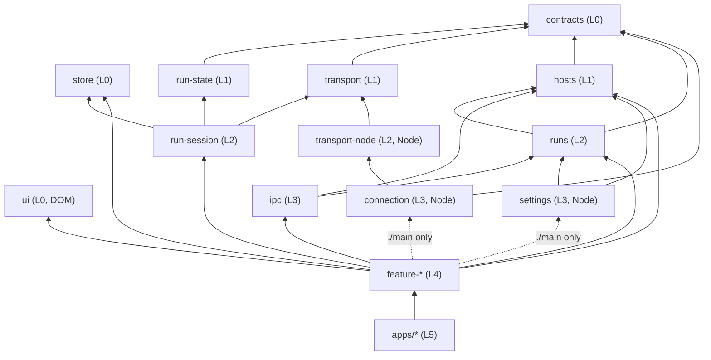

# Clients architecture: TypeScript package graph

This document owns the structure of the TypeScript clients under `clients/`: which packages exist,
which way they may depend on each other, what each entry point may use from its runtime, and how
the workspace builds, checks, and tests them. It is the design of record. Packages that do not
exist yet are marked in the [migration status](#migration-status) table, with the item that
creates each one.

It builds on, and does not restate:

- [`architecture.md`](architecture.md): the Python module graph and the placement rule. The same
  principles (deep modules, one-way dependencies, a pure core with a thin shell) apply here.
- [`desktop-connection.md`](desktop-connection.md): what the desktop main process, the host helper,
  and the screen stores do. This document says which package each of those lives in.
- [`wire-protocol.md`](wire-protocol.md): the run protocol that `@vibesys/contracts` types.
- [`web-development.md`](web-development.md): how to run the web UI and the desktop app.

`clients/tui` is deprecated. It keeps building and its checks stay green, but it is not migrated
into this graph; it consumes the packages below through their public entry points like any other
app, and is deleted when the desktop app replaces it.

## Why

`clients/web` and `clients/desktop` grew as two large packages with layering rules enforced inside
each (`state/` pure, `ui/` free of I/O, `effects/` never importing `ui/`). Those rules hold inside a
package but say nothing about which feature may reach which, or which runtime a module may use.
A feature that imports another feature's internals, or renderer code that imports a Node module,
type-checks today and is caught, if at all, by review.

The fix is the same one the Python side uses with `tach`: make every boundary a package boundary,
declare the edges, and let tooling refuse the rest. A package is used only through its `exports`
map; each entry point is compiled with exactly the runtime library it may use; and one checker
validates the graph from the manifests. Per-feature packages make each feature small enough to
read whole, and the build model below keeps a graph of thirty packages as fast as the current five.

## The package graph

```text
clients/
  contracts/        @vibesys/contracts        generated message types + the one runtime validator
  ui/               @vibesys/ui               domain-free React primitives + design tokens
  store/            @vibesys/store            domain-free reducer kernel + fold model-test kit
  run-state/        @vibesys/run-state        pure fold of run events; ./rounds, ./performance,
                                              ./transcript projections -> contracts
  transport/        @vibesys/transport        framing, redial, persistent stream -> contracts
  hosts/            @vibesys/hosts            host identity, listing, connection status,
                                              checkout path rules              -> contracts
  runs/             @vibesys/runs             run identity, recent status, resume and stop
                                                                                 -> contracts, hosts
  run-session/      @vibesys/run-session      one live run: runStep, the session lifecycle, its
                                              ports, connectRun, WebSession    -> run-state, transport, store
  transport-node/   @vibesys/transport-node   stdio / unix socket / ssh channel  -> transport
  ipc/              @vibesys/ipc              typed main <-> renderer messages   -> hosts, runs
  connection/       @vibesys/connection       host connection manager            -> contracts, transport-node
  settings/         @vibesys/settings         settings store, atomic files       -> hosts, runs
  features/<x>/     @vibesys/feature-<x>      run-view, gateway-connect, replay, hosts,
                                              start-run, run-control, recent-runs
  apps/desktop-main      @vibesys/app-desktop-main      composition only (Electron main)
  apps/desktop-renderer  @vibesys/app-desktop-renderer  composition only (Electron renderer)
  apps/web               @vibesys/app-web               composition only (browser, and the
                                                        desktop shell's run page)
```



### Layers

Every package declares its layer in `package.json` (`"vibesys": {"layer": ...}`). A package may
depend only on packages in a strictly lower layer. That one rule gives the direction, rules out
cycles, and forbids feature-to-feature and app-to-app edges, because peers share a layer.

| Layer | Rank | Packages | May depend on |
| --- | --- | --- | --- |
| `foundation` | 0 | `contracts`, `ui`, `store` | nothing in the workspace |
| `core` | 1 | `run-state`, `transport`, `hosts` | foundation |
| `domain` | 2 | `runs`, `run-session`, `transport-node` | foundation, core |
| `service` | 3 | `ipc`, `connection`, `settings` | foundation, core, domain |
| `feature` | 4 | `feature-*` | anything below |
| `app` | 5 | `apps/*` (and the legacy `desktop` and `tui`) | anything below |

This refines the sketch in the brief in three places. `ui` and `store` sit in `foundation`: rank 0
is the mechanical form of "no domain dependencies", so the layer rule enforces rule 6 for them with
no special case. `transport-node`, `connection`, and `settings` get ranks of their own (`domain` and
`service`) because each depends on another package the sketch places at the same level
(`connection` on `transport-node`, `settings` and `ipc` on `hosts` and `runs`). And `hosts` sits in
`core`, one rank below `runs`, because a run names the host it runs on (a recent run's status reads
its host's listing; the stop flow is keyed by host) while a host never names a run's model.

### Packages are named for one concept

A package is named for the concept it owns, never for a place to put things. `@vibesys/core-state`
and `@vibesys/entities` were split for this reason: the first held both the generic store kernel
and the run fold, the second every domain model the views shared, and each name invited the next
unrelated addition. The split gave `store` (generic, domain-free like `ui`), `run-state` (the run
fold, its round, performance, and transcript projections as separate entries), `hosts`, `runs`, and
`run-session` (the live session below the UI, out of `feature-run-view`, which keeps only its
interaction state, banner copy, and UI). A helper used by one feature lives in that feature
(`shellWords` is `@vibesys/feature-start-run/state`'s). The `bucket-names` rule keeps foundation,
core, and domain packages from being named `entities`, `core`, `common`, `utils`, `shared`,
`helpers`, or `misc`.

### Entry points and runtimes

Every entry in a package's `exports` map declares the runtime it may use, in the same
`"vibesys"` block:

| Runtime | Compiler `lib` | Compiler `types` | Who may import it |
| --- | --- | --- | --- |
| `neutral` | `ES2022` | none | any entry |
| `dom` | `ES2022`, `DOM`, `DOM.Iterable` | none (`vite/client` for apps) | `dom` entries |
| `node` | `ES2022` | `node` (and `electron` where needed) | `node` entries |

An entry may import an entry of another package only when the target is `neutral` or has the same
runtime. A feature package has up to three entries:

- `./state` (`neutral`): the pure reducer, selectors, and the interfaces its effects need (for
  example `RunControl`). No React, no I/O.
- `./renderer` (`dom`): state plus `ui/` components plus `effects/`, which call the injected
  interfaces. It depends on `@vibesys/ui`, never on a platform package.
- `./main` (`node`): the main-process controller that implements the interfaces with
  `@vibesys/connection`, `@vibesys/settings`, and `@vibesys/transport-node`.

A feature publishes only the entries it has. Its pure core is `./state` when it needs nothing
beyond `ES2022`; a core that needs a DOM global (`@vibesys/feature-gateway-connect` parses with
the WHATWG `URL`) stays pure but lives in `renderer/state/`, and the feature publishes `./renderer`
alone. Effects reach the platform only through the interfaces `./state` declares, which the app
implements. A domain package that owns effects declares its ports the same way:
`@vibesys/run-session` declares `RunConnection`'s control transport and `BrowserLifecycle`, and
`apps/web` implements them with its backend adapter and lifecycle.

Node-only packages (`transport-node`, `connection`, `settings`) therefore reach the renderer
through no path: only `node` entries may import them, and only `desktop-main` and features'
`./main` entries are `node`.

### Rules and what enforces them

| # | Rule | Enforced by (rule id in `check_package_graph.mjs`) |
| --- | --- | --- |
| 1 | Layer direction; Node-only packages reachable only from `node` entries | `layer-direction`, `runtime-reachability` |
| 2 | No feature depends on another feature; cross-feature flows are composed in apps | `layer-direction` (peers share a layer) |
| 3 | A package is used only through its `exports` map; every import of a workspace package is a declared dependency | `imports-use-exports`, `imports-are-declared`, `imports-are-workspace-packages`, `workspace-protocol`; `.dependency-cruiser.mjs` for relative paths into another package |
| 4 | Each entry is compiled with the `lib` and `types` of its runtime, so importing a Node module from a renderer entry is a type error | `entry-projects`, `entry-capability`; `tsc -b` then enforces it |
| 5 | Inside a package: `state/` pure, `ui/` free of I/O, `effects/` never import `ui/`, effects depend on injected interfaces | `lint-rules/*.grit` (Biome) and `.dependency-cruiser.mjs` |
| 6 | `@vibesys/ui` and `@vibesys/store` have no domain dependencies and name no domain concept; helpers live in the lowest package that needs them, with no shared junk drawer | `layer-direction` (both are rank 0), `domain-free` (no word of `DOMAIN_WORDS`, or an inflection of one, in their production source or stylesheet); review |
| 7 | A foundation, core, or domain package is named for the concept it owns, not for a bucket | `bucket-names` (no segment of its name in `BUCKET_NAMES`) |

All package-graph rules, and the tables they read, live in one module,
[`clients/scripts/check_package_graph.mjs`](https://github.com/uw-syfi/vibesys/blob/main/clients/scripts/check_package_graph.mjs),
run by `pnpm check:ts-architecture`. Its tests build a valid fixture workspace and break it once
per rule, and a meta-test fails when a rule has no failing fixture. `.dependency-cruiser.mjs` keeps
the rules about modules inside a package and about how imports resolve.

### How dependencies are managed

**One declaration.** A package's `package.json` is the single source of truth for its place in the
graph:

```json
"vibesys": {"layer": "feature", "entries": {"./state": "neutral", "./renderer": "dom", "./main": "node"}}
```

The checker, the scaffold (which writes one `tsconfig.<entry>.json` per entry from it), Knip's
policy, and this document all read that block. An export whose source is a stylesheet
(`@vibesys/ui`'s `./tokens.css`) is a `dom` asset: it has no tsconfig project, and Vite resolves
it through the same source condition. Unknown keys, layers, and runtimes are rejected by
name (`declarations`), and the entries must be exactly the `exports` keys
(`entries-match-exports`).

**Workspace dependencies** are declared as `workspace:*` in the section the code needs
(`dependencies` for production code; test code may also use `devDependencies`), point to a lower
layer, and are mirrored by tsconfig project `references`. The references must equal the declared
workspace dependencies, no more and no fewer (`references-match-dependencies`): a missing
reference is not a compiler error, because the import still resolves to the dependency's source.

**Third-party dependencies** are confined by runtime and layer through one allowlist table in the
checker (`EXTERNAL_DEPENDENCIES`, rule `external-dependencies`):

| Import | Allowed in |
| --- | --- |
| `react`, `react-dom` (and subpaths) | `dom` entries: `ui`, features' `./renderer`, browser and renderer apps |
| `electron` | `node` entries of features (`./main`) and apps (`desktop-main`) |
| `@opentui/core` | `node` entries of apps (the deprecated `tui`) |
| Node builtins (`node:*` and bare names) | `node` entries |

A package that declares one of them in `dependencies` must have an entry allowed to use it. Knip
(`pnpm check:knip`) composes with this: it reports dependencies declared but never imported and
imports of packages not declared, so between the two a dependency is declared exactly when it is
used, and used only where its runtime allows.

**Legacy packages.** `desktop` and `tui` predate the per-entry layout,
so `LEGACY_EXEMPTIONS` in the checker lets them skip the per-entry project rules. Every other rule
applies to them. Desktop now holds only the Electron main process and its preloads, and declares
an entry per process: `.` is the `node` main process, and `./preload/run` and `./preload/welcome`
the `node` sandboxed preloads (each a single file), so runtime reachability and the third-party
allowlist hold on each side. A preload imports only `@vibesys/ipc` and Electron
(`desktop-preloads-import-only-ipc-and-electron` in `.dependency-cruiser.mjs`), and no package's
shipping code imports another package's `testing/` or `test-support/`
(`production-code-does-not-import-other-packages-test-support`). It keeps its exemption until `apps/desktop-main` replaces it: the
main process and both preloads compile in one project (`tsconfig.main.json`, emitting the
`dist/` that Electron loads by path), and a preload subpath names no per-entry project file. The
table only shrinks as the migration items move them.

## Build model

The workspace stays fast as the package count grows because nothing waits on a build it does not
need, and nothing repeats work whose inputs did not change.

**Source condition.** Every export carries a custom condition that points at its TypeScript source:

```json
"exports": {
  "./state": {
    "@vibesys/source": "./src/state/index.ts",
    "types": "./dist/state/index.d.ts",
    "default": "./dist/state/index.js"
  }
}
```

Vite (`resolve.conditions`), the Bun test runner (`--conditions`), and `tsc`
(`customConditions` in `clients/tsconfig.base.json`) all resolve that condition, so the dev
server, tests, and type checks read dependencies from source and never need a prebuilt `dist/`.
Node and Electron at runtime do not set the condition and load `dist/`. There are no `paths`
aliases and no `pre*` "build dependencies first" scripts.

**Project references.** Each entry is a `composite`, `incremental` TypeScript project; the
package's `tsconfig.json` is a solution file that references its entry projects and its test
project, and each entry project references the entry projects of the packages it imports.
`tsc -b` then type-checks and emits declarations per project, skipping every project whose inputs
are unchanged, and checks a dependent against its dependencies' declarations instead of their
source.

**Task runner.** [Turborepo](https://turborepo.com) runs `build`, `check`, and `test` across the
workspace in dependency order, in parallel, with a local content-hash cache in `.turbo/cache` at
the repository root (shared by the git worktrees of one clone; CI keeps none between runs). A task
whose inputs (the package's tracked files, its dependencies' hashes, and the shared
configuration) match a previous run replays its output instead of running. `test` depends on a
`transit` task rather than on `^build`, so tests start at once while still being invalidated
when a dependency's source changes. Turborepo was chosen over Nx because it needs one
`turbo.json` and the existing `package.json` scripts, with no plugins, generators, or project
files per package; Nx's extra capabilities (code generators, module-boundary lint) are covered
here by the scaffold and the graph checker.

| Command (from `clients/`) | What it runs |
| --- | --- |
| `pnpm check:clients` | `turbo run check`: `tsc -b` in every package |
| `pnpm test:clients` | the script tests, then `turbo run test` |
| `pnpm build:clients` | `turbo run build` |
| `pnpm turbo run test --filter @vibesys/<package>` | one package, building only what it needs |

## Adding a package

```bash
cd clients
pnpm new:package <layer> <name> [--runtime neutral|dom|node]   # pnpm new:package domain runs
pnpm new:package feature <name>                                  # pnpm new:package feature stop-run
pnpm install
```

`scripts/new_package.mjs` writes the `vibesys` block first and derives everything else from it:
the `exports` map with the source condition, one composite `tsconfig.<entry>.json` per entry with
its runtime's `lib` and `types`, the test project and solution `tsconfig.json`, the `build`,
`check`, and `test` scripts, a passing smoke test per entry, and the entries in
`tsconfig.architecture.json` that dependency-cruiser resolves. Knip derives its policy from the
exports, and Biome and Turborepo cover the package by glob. A feature lands in
`features/<name>` as `@vibesys/feature-<name>` with `./state`, `./renderer`, and `./main`; an app
in `apps/<name>` as `@vibesys/app-<name>`; any other layer in `<name>` with one `.` entry
(`neutral` unless `--runtime` says otherwise). Its test scaffolds one package of each shape and
requires the graph checker, the workspace declarations, `tsc -b`, and the package's own tests to
pass, and a Node import in a scaffolded renderer entry to fail compilation.

Add a workspace dependency with `pnpm --filter <package> add @vibesys/<dependency>@workspace:*` and
a matching project reference in the entry project that imports it; `pnpm check:ts-architecture`
names a missing or extra one.

## Migration status

| Package | Layer | Status | Item that creates or moves it |
| --- | --- | --- | --- |
| `@vibesys/contracts` | foundation | exists (pilot: generated run-protocol and host-helper types, the one schema walker, error taxonomy, `./host-helper` validation, `./testing` fixtures) | foundation item (#1869) |
| `@vibesys/ui` | foundation | exists: `Button`, `Combobox`, `Dialog`, `StatusChip` (`.`, `dom`) and the design tokens (`./tokens.css`); the desktop and web features render them | domain packages (phase 5 of #1878) |
| `@vibesys/store` | foundation | exists: `Step`, `Reducer`, `only`, `createStore` (`.`) and the fold model-test kit (`./testing`: `checkModel`, `Seeded`, `SEEDS`); domain-free | domain split (#1949) |
| `@vibesys/run-state` | core | exists: the run event fold (`.`), with `./rounds`, `./performance`, and `./transcript` projections; depends on `contracts` only | domain split (#1949) |
| `@vibesys/core-state` | core | deleted: split into `store` and `run-state` | domain split (#1949) |
| `@vibesys/transport` | core | exists: `.` and `./testing` (the shared `FakeClock`) are `neutral`, `./websocket` is `dom` | backend-client split (#1910) |
| `@vibesys/transport-node` | domain | exists: the Unix-socket `ServerClient`; desktop's ssh and local-host links join it with the connection manager | backend-client split (#1910) |
| `@vibesys/hosts` | core | exists: host identity and keys, labels, the checkout and project path rules (`HostValidationError`), a host's listed runs with their phase text (`instancePhaseText`), and what the window shows about a connection; depends on `contracts` | domain split (#1949) |
| `@vibesys/runs` | domain | exists: run, task, and instance ids, a recent run's status from its host's listing, the exact-resume policy, the stop flow; depends on `contracts`, `hosts` | domain split (#1949) |
| `@vibesys/run-session` | domain | exists: the run fold's wiring (`runStep`), the session lifecycle (`sessionStep`), its ports, the run connection over a control transport (`connectRun`), and `WebSession`, with `./testing` (an in-memory control transport and page lifecycle, and `sessionWith`) | domain split (#1949) |
| `@vibesys/entities` | domain | deleted: split into `hosts` and `runs`; task arguments (`shellWords`) moved into `@vibesys/feature-start-run` | domain split (#1949) |
| `@vibesys/ipc` | service | exists: the run page's bridge (port messages, their validation, the preload contract web's desktop shell reads) and the welcome view's channels, events, and payloads, with `./testing` (random window states for store models); depends on `hosts`, `runs` | domain packages (phase 5 of #1878) |
| `@vibesys/connection` | service | planned (desktop's connection manager) | desktop main/renderer split |
| `@vibesys/settings` | service | planned (desktop's settings store) | desktop main/renderer split |
| `@vibesys/feature-run-view`, `@vibesys/feature-gateway-connect`, `@vibesys/feature-replay` | feature | exist: the run page's transcript, rounds, status, and banners (`./state`, `./renderer`; the live session is `@vibesys/run-session`); the browser's gateway connect form (`./renderer`); the recorded-run load (`./state`, `./renderer`) | feature packages (phase 6 of #1878) |
| `@vibesys/feature-hosts`, `@vibesys/feature-start-run`, `@vibesys/feature-run-control`, `@vibesys/feature-recent-runs` | feature | exist, renderer side (`./state`, `./renderer`): the host panel, checkout form, sign-in, "Connect to host", and path completion; the "Start a run" sheet; the title strip, stop, force stop, resume, and the banner; Recent. Each feature's effects call only the slice of `@vibesys/ipc`'s welcome bridge its `./state` declares. Their main-process controllers (`./main`) are still in `@vibesys/desktop` | desktop renderer (phase 7 of #1878); `./main` with the main-process split (phase 8) |
| `apps/web` | app | exists: composition only, on the per-entry layout (one `dom` entry, no exports): the browser entry and boot decision, the desktop shell's run page (`desktop-main.tsx` and the bridge transport), the one backend adapter, storage and lifecycle. Its run connection (`connectRun`) is now `@vibesys/run-session`'s; the desktop run page stays here until the run page's stylesheet is the features' own (`./styles.css`) rather than this app's, so moving it to `apps/desktop-renderer` copies nothing | feature packages (phase 6 of #1878) |
| `apps/desktop-renderer` | app | exists: composition only (one `dom` entry, no exports): the welcome view's entry, its stores wired to the welcome preload's bridge, and the view composed from the desktop features | desktop renderer (phase 7 of #1878) |
| `apps/desktop-main` | app | planned | desktop main process (phase 8 of #1878) |
| `@vibesys/backend-client` | core | deleted: split into `transport` and `transport-node` | backend-client split (#1910) |
| `@vibesys/desktop` | app | exists: the Electron main process and the preloads; the welcome view moved to `apps/desktop-renderer` and the desktop features. Emptied into features and `apps/desktop-main`, then deleted | desktop main process (phase 8 of #1878) |
| `@vibesys/web` | app | moved: features into `features/*`, the composition into `apps/web` | feature packages (phase 6 of #1878) |
| `@vibesys/tui` | app | deprecated; kept building, not migrated | none |

Roadmap [#1878](https://github.com/uw-syfi/vibesys/issues/1878) tracks this migration; each item gets
a sub-issue there when it starts.
