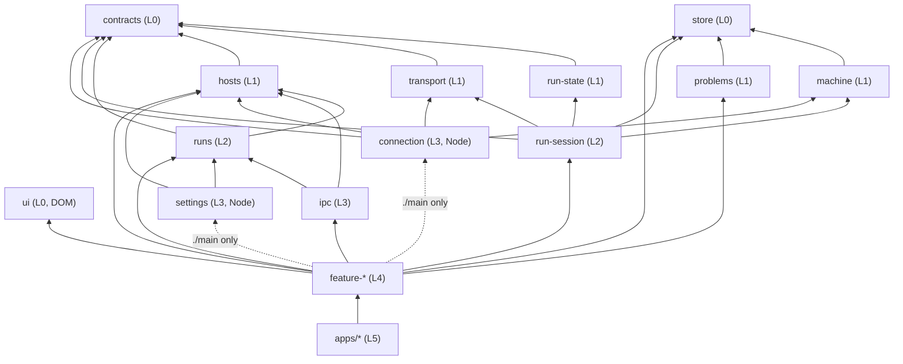

# Clients architecture: TypeScript package graph

This document owns the structure of the TypeScript clients under `clients/`: which packages exist,
which way they may depend on each other, what each entry point may use from its runtime, and how
the workspace builds, checks, and tests them. It is the design of record. Packages that do not
exist yet are marked in the [migration status](#migration-status) table, with the item that
creates each one.

It builds on, and does not restate:

- [`architecture.md`](architecture.md): the Python module graph and the placement rule. The same
  principles (deep modules, one-way dependencies, a pure core with a thin shell) apply here.
- [`desktop-connection.md`](desktop-connection.md): what the desktop main process, the host helper,
  and the screen stores do. This document says which package each of those lives in.
- [`wire-protocol.md`](wire-protocol.md): the run protocol that `@vibesys/contracts` types.
- [`desktop-development.md`](desktop-development.md): how to run the desktop app.

## Why

`clients/web` and `clients/desktop` grew as two large packages with layering rules enforced inside
each (`state/` pure, `ui/` free of I/O, `effects/` never importing `ui/`). Those rules hold inside a
package but say nothing about which feature may reach which, or which runtime a module may use.
A feature that imports another feature's internals, or renderer code that imports a Node module,
type-checks today and is caught, if at all, by review.

The fix is the same one the Python side uses with `tach`: make every boundary a package boundary,
declare the edges, and let tooling refuse the rest. A package is used only through its `exports`
map; each entry point is compiled with exactly the runtime library it may use; and one checker
validates the graph from the manifests. Per-feature packages make each feature small enough to
read whole, and the build model below keeps a graph of thirty packages as fast as the current five.

## The package graph

```text
clients/
  libs/request-identity/ @vibesys/request-identity  UUID request identities across clients and restarts
  libs/contracts/   @vibesys/contracts        generated message types + the one runtime validator
  libs/ui/          @vibesys/ui               the design system: domain-free components + design tokens
  libs/store/       @vibesys/store            domain-free reducer kernel + fold model-test kit
  libs/machine/     @vibesys/machine          domain-free machine glue + machine model-test kit
                                                                                 -> store
  libs/problems/    @vibesys/problems         what is wrong right now as data with a stable identity,
                                              and the board that turns it into toasts -> store
  libs/run-state/   @vibesys/run-state        pure fold of run events; ./rounds, ./performance,
                                              ./transcript projections -> contracts
  libs/transport/   @vibesys/transport        framing, redial, persistent stream -> contracts
  libs/hosts/       @vibesys/hosts            host identity, listing, connection status,
                                              checkout path rules              -> contracts
  libs/runs/        @vibesys/runs             run identity, launch profiles, recent status,
                                              resume and stop
                                                                                 -> contracts, hosts
  libs/run-session/ @vibesys/run-session      one live run: runStep, the session machine, its
                                              ports, connectRun, WebSession    -> contracts, run-state,
                                                                       transport, store, machine
  libs/run-fixtures/ @vibesys/run-fixtures   replayable run fixtures (recorded, scrubbed of hosts,
                                              paths and user names, or synthetic) for e2e harnesses
                                              and screen checks; dev only            -> contracts
  libs/run-history/ @vibesys/run-history      main-process store of ended runs' recorded events,
                                              one copy for every window (node; no workspace deps;
                                              the app injects the host as its source)
  libs/ipc/         @vibesys/ipc              typed main <-> renderer messages, the shell's
                                              requests' parsers per feature      -> hosts, runs
  libs/connection/  @vibesys/connection       host connection manager            -> contracts, transport, hosts,
                                                                                    machine
  libs/settings/    @vibesys/settings         settings store, atomic files       -> hosts, runs
  features/<x>/     @vibesys/feature-<x>      hosts, run-control (main process only), app-shell,
                                              settings, machines, new-run, run-page, usage
  apps/desktop-main      @vibesys/app-desktop-main      composition only (Electron main), and the
                                                        sandboxed preloads
  apps/desktop-shell     @vibesys/app-desktop-shell     composition only: the desktop
                                                        window (`shell.html`), the only renderer
  apps/ui-gallery        @vibesys/app-ui-gallery        development only, never shipped: every
                                                        component in every theme, screenshot-tested
                                                        in Ink
  tools/            scripts/ (checkers, scaffold), lint-rules/ (Biome plugins), and the shared
                    tsconfig.base.json, tsconfig.architecture.json, knip.config.ts
```

The folder a package sits in mirrors its layer: `libs/` holds the `foundation`, `core`, `domain`,
and `service` packages, `features/` the `feature` packages, and `apps/` the `app` packages. The
manifest's `vibesys.layer` stays the one source of truth; the `layer-matches-folder` rule fails a
package filed under the wrong folder. Imports are by package name, so moving a package between
folders changes no source. Files a tool requires at the workspace root stay there: `package.json`,
`pnpm-workspace.yaml`, `pnpm-lock.yaml`, `turbo.json`, `biome.json` and `biome.warnings.json`
(Biome resolves a config's plugin paths against the config that extends it, so the warnings
config sits beside `biome.json`), and `.dependency-cruiser.mjs`.



### Layers

Every package declares its layer in `package.json` (`"vibesys": {"layer": ...}`). A package may
depend only on packages in a strictly lower layer. That one rule gives the direction, rules out
cycles, and forbids feature-to-feature and app-to-app edges, because peers share a layer.

| Layer | Rank | Packages | May depend on |
| --- | --- | --- | --- |
| `foundation` | 0 | `contracts`, `ui`, `store`, `request-identity` | nothing in the workspace |
| `core` | 1 | `run-state`, `transport`, `hosts`, `machine`, `problems` | foundation |
| `domain` | 2 | `runs`, `run-session`, `run-history`, `run-fixtures` | foundation, core |
| `service` | 3 | `ipc`, `connection`, `settings` | foundation, core, domain |
| `feature` | 4 | `feature-*` | anything below |
| `app` | 5 | `apps/*` | anything below |

This refines the sketch in the brief in three places. `ui` and `store` sit in `foundation`: rank 0
is the mechanical form of "no domain dependencies", so the layer rule enforces rule 6 for them with
no special case. `connection` and `settings` get a rank of their own (`service`) because each
depends on another package the sketch places at the same level (`connection` on `transport`, `hosts`, and `machine`, `settings` and `ipc` on
`hosts` and `runs`). And `hosts` sits in
`core`, one rank below `runs`, because a run names the host it runs on (a recent run's status reads
its host's listing; the stop flow is keyed by host) while a host never names a run's model.

### Packages are named for one concept

A package is named for the concept it owns, never for a place to put things. `@vibesys/core-state`
and `@vibesys/entities` were split for this reason: the first held both the generic store kernel
and the run fold, the second every domain model the views shared, and each name invited the next
unrelated addition. The split gave `store` (generic, domain-free like `ui`), `run-state` (the run
fold, its round, performance, and transcript projections as separate entries), `hosts`, `runs`, and
`run-session` (the live session below the UI). A helper used by one feature lives in that feature;
shared run-domain behavior such as `shellWords` belongs to `@vibesys/runs`. The `bucket-names` rule keeps foundation,
core, and domain packages from being named `entities`, `core`, `common`, `utils`, `shared`,
`helpers`, or `misc`.

### Entry points and runtimes

Every entry in a package's `exports` map declares the runtime it may use, in the same
`"vibesys"` block:

| Runtime | Compiler `lib` | Compiler `types` | Who may import it |
| --- | --- | --- | --- |
| `neutral` | `ES2022` | none | any entry |
| `dom` | `ES2022`, `DOM`, `DOM.Iterable` | none (`vite/client` for apps) | `dom` entries |
| `node` | `ES2022` | `node` (and `electron` where needed) | `node` entries |
| `preload` | `ES2022`, `DOM` | `node` (Electron's renderer API types need Node's) | `preload` entries |

A `preload` is an Electron sandboxed preload: it runs in a page's renderer process before the page,
with the DOM and Electron's renderer APIs. The sandbox gives it a `require` that reaches `electron`
and nothing else, so it may import a workspace package only as a type (`import type`,
`typeof import(...)`, which the compiler erases), no Node builtin, and no `node` entry. Each preload
is one file and one entry, which the main process loads by path into a page.

An entry may import an entry of another package only when the target is `neutral` or has the same
runtime. A feature package has up to three entries:

- `./state` (`neutral`): the pure reducer, selectors, and the interfaces its effects need (for
  example `RunControl`). No React, no I/O.
- `./renderer` (`dom`): state plus `ui/` components plus `effects/`, which call the injected
  interfaces. It depends on `@vibesys/ui`, never on a platform package.
- `./main` (`node`): the main-process controller that answers the feature's requests with
  `@vibesys/connection` and `@vibesys/settings` (`Hosts`, `RunControl`). `apps/desktop-main` routes
  each request `@vibesys/ipc` parsed to the controller of the feature that owns it.

Features and apps ship no stylesheets. They build their views from `@vibesys/ui` components and
tokens; the desktop shell imports the design system's stylesheets once.

A feature publishes only the entries it has. Its pure core is `./state` when it needs nothing
beyond `ES2022`. Effects reach the platform only through the interfaces `./state` declares, which
the app implements. A domain package that owns effects declares its ports the same way:
`@vibesys/run-session` declares its run connection's control transport and page lifecycle.

Node-only packages (`connection`, `settings`) therefore reach the renderer
through no path: only `node` entries may import them, and only `desktop-main` and features'
`./main` entries are `node`. A preload is not `node` either, so it reaches none of them.

### Rules and what enforces them

| # | Rule | Enforced by (rule id in `check_package_graph.mjs`) |
| --- | --- | --- |
| 1 | Layer direction; Node-only packages reachable only from `node` entries | `layer-direction`, `runtime-reachability` |
| 2 | No feature depends on another feature; cross-feature flows are composed in apps | `layer-direction` (peers share a layer) |
| 3 | A package is used only through its `exports` map; every import of a workspace package is a declared dependency | `imports-use-exports`, `imports-are-declared`, `imports-are-workspace-packages`, `workspace-protocol`; `.dependency-cruiser.mjs` for relative paths into another package |
| 4 | Each entry is compiled with the `lib` and `types` of its runtime, so importing a Node module from a renderer entry is a type error | `entry-projects`, `entry-capability`; `tsc -b` then enforces it |
| 5 | Inside a package: `state/` pure, `ui/` free of I/O, `effects/` never import `ui/`, effects depend on injected interfaces | `tools/lint-rules/*.grit` (Biome) and `.dependency-cruiser.mjs` |
| 6 | `@vibesys/ui` and `@vibesys/store` have no domain dependencies and name no domain concept; helpers live in the lowest package that needs them, with no shared junk drawer | `layer-direction` (both are rank 0), `domain-free` (no word of `DOMAIN_WORDS`, or an inflection of one, in their production source or stylesheet); review |
| 7 | A foundation, core, or domain package is named for the concept it owns, not for a bucket | `bucket-names` (no segment of its name in `BUCKET_NAMES`) |
| 8 | A sandboxed preload loads only Electron at run time; every workspace import in it is erased | `preload-sandbox` (what the entry's emitted CommonJS still requires); `.dependency-cruiser.mjs` keeps a preload's imports to `@vibesys/ipc` and Electron |
| 9 | Control state is an XState machine; data folds are plain reducers (see [State](#state)) | `external-dependencies` (`xstate` only in features' `./state` and `./renderer` and `MACHINE_PACKAGES`); `tools/lint-rules/features-no-hand-rolled-control.grit`, `tools/lint-rules/control-state-no-store-kernel.grit` |
| 10 | A package's folder matches the layer its manifest declares: `libs/*` is foundation, core, domain, or service; `features/*` is feature; `apps/*` is app; nothing else | `layer-matches-folder` |
| 11 | Every feature and app builds UI only from `@vibesys/ui` (see [Design system enforcement](#design-system-enforcement)) | `strict-no-stylesheets`, `strict-imports`; `tools/lint-rules/strict-*.grit` through `biome.json` |

All package-graph rules, and the tables they read, live in one module,
[`clients/tools/scripts/check_package_graph.mjs`](https://github.com/uw-syfi/vibesys/blob/main/clients/tools/scripts/check_package_graph.mjs),
run by `pnpm check:ts-architecture`. Its tests build a valid fixture workspace and break it once
per rule, and a meta-test fails when a rule has no failing fixture. `.dependency-cruiser.mjs` keeps
the rules about modules inside a package and about how imports resolve.

### How dependencies are managed

**One declaration.** A package's `package.json` is the single source of truth for its place in the
graph:

```json
"vibesys": {"layer": "feature", "entries": {"./state": "neutral", "./renderer": "dom", "./main": "node"}}
```

The checker, the scaffold (which writes one `tsconfig.<entry>.json` per entry from it), Knip's
policy, and this document all read that block. An export whose source is a stylesheet
(`@vibesys/ui`'s `./tokens.css`) is a `dom` asset: it has no tsconfig project, and Vite resolves
it through the same source condition. Unknown keys, layers, and runtimes are rejected by
name (`declarations`), and the entries must be exactly the `exports` keys
(`entries-match-exports`). Feature and app packages are always subject to the
[design system rules](#design-system-enforcement). The obsolete `design` marker is an unknown key
and fails `declarations`.

**Workspace dependencies** are declared as `workspace:*` in the section the code needs
(`dependencies` for production code; test code may also use `devDependencies`), point to a lower
layer, and are mirrored by tsconfig project `references`. The references must equal the declared
workspace dependencies, no more and no fewer (`references-match-dependencies`): a missing
reference is not a compiler error, because the import still resolves to the dependency's source.

**Third-party dependencies** are confined by runtime and layer through one allowlist table in the
checker (`EXTERNAL_DEPENDENCIES`, rule `external-dependencies`):

| Import | Allowed in |
| --- | --- |
| `react`, `react-dom` (and subpaths) | `dom` entries: `ui`, features' `./renderer`, browser and renderer apps |
| `electron` | `node` and `preload` entries of features (`./main`) and apps (`desktop-main`) |
| `xstate` | features' `./state` and `./renderer`; `MACHINE_PACKAGES`: `machine`, `connection` (its host connection machine), and `run-session` (its session machine). Never `store`, `run-state`, `hosts`, `runs`, `ui`, `contracts`, `transport`, or `ipc` |
| Node builtins (`node:*` and bare names) | `node` entries |

A package that declares one of them in `dependencies` must have an entry allowed to use it. Knip
(`pnpm check:knip`) composes with this: it reports dependencies declared but never imported and
imports of packages not declared, so between the two a dependency is declared exactly when it is
used, and used only where its runtime allows.

## Design tokens and themes

`@vibesys/ui` publishes its design tokens as typed data and as CSS. One table is the source of
truth for each fact; everything else is derived from it.

| Entry | Runtime | Contents |
| --- | --- | --- |
| `.` | `dom` | The components (see [Components](#components)), `applyTheme`, and the token types (`ThemeName`, `ColorRole`, `SpaceToken`, `TextStyle`, ...). |
| `./legacy` | `dom` | Unused older primitives retained temporarily as library migration debt; feature and app imports of this entry fail `strict-imports`. |
| `./tokens` | `neutral` | `THEMES`, `DEFAULT_THEMES`, `SPACE`, `TYPE`, `SIZE`, `RADIUS`, `ELEVATION`, `MOTION`, `CONTRAST_PAIRS`, `contrastRatio`, and `renderTokensCss`. No DOM, so tests and tools import it. |
| `./tokens.css` | `dom` asset | Generated from `./tokens`; never edited by hand. |
| `./components.css` | `dom` asset | The components' styles, hand-written from token variables only. |
| `./fonts.css` | `dom` asset | `@font-face` for Schibsted Grotesk and JetBrains Mono (weights 400, 500, 600, and JetBrains Mono 700 for the wordmark) from the woff2 files in `src/fonts/`, with their SIL OFL texts. Nothing is fetched at runtime. |

A theme is `{mode, colors}` where `colors` is a `Record<ColorRole, Hex>`, so a missing role is a
compile error. The six themes are `paper`, `mist`, `sand` (light) and `ink`, `midnight`,
`terminal` (dark); `DEFAULT_THEMES` names `paper` and `ink`. `ThemeName` is the `data-theme` value.

`src/tokens.css` is written by `pnpm --dir clients/libs/ui generate:tokens` from the tables and
`src/primitives.css` (the hand-written styles of the primitives, appended verbatim). It has the
scales and derived values (`color-mix` fills for selection, chips and banners) on `:root`, one
`:root[data-theme="<name>"]` block per theme, the zeroing of every motion duration under
`prefers-reduced-motion: reduce`, and aliases for the variable names the stylesheet had before the
roles (`LEGACY_ALIASES`), which stay until their consumers move. The defaults sit on a bare
`:root` (paper, and ink under `prefers-color-scheme: dark`) and the named blocks override them, so a
`data-theme` outside `ThemeName` (another app sets its own names) or none at all follows the OS
between the two default themes and every role stays defined.

`applyTheme(name, target = document.documentElement)` sets `data-theme`; it takes the element so a
test can pass a fake. The selectors name `:root`, so `target` only works as the root element.

## Design system enforcement

Every package under `features/` or `apps/` builds UI only from `@vibesys/ui`'s public
components and tokens. The package graph checker applies S2 and S6 by folder. Biome applies S3
and S4 to all feature and app source with `features/**` and `apps/**` globs, excluding tests.
There is no per-package opt-in or frozen-package list.

| # | Rule | Enforced by |
| --- | --- | --- |
| S2 | A feature or app ships no stylesheet: no `*.css` export and no `.css`, `.scss`, `.sass`, `.less`, `.styl` or `.pcss` file in the package | `check_package_graph.mjs` rule `strict-no-stylesheets` |
| S3 | Feature and app code renders no raw interactive or styled elements: JSX `button`, `a`, `input`, `select`, `textarea`, `label`, `dialog`, `details`, `summary`, `form`, `table`, `svg` and `pre`, and the `style`, `className` and `dangerouslySetInnerHTML` props on any element, are errors. Plain `div` and `span` stay for grouping text inside slots | Grit rule `tools/lint-rules/strict-no-raw-elements.grit` |
| S4 | Feature and app code contains no raw colors or lengths: a string or template literal with a hex color, `rgb(`, `rgba(`, `hsl(`, `hsla(`, `oklch(`, `color-mix(`, or a `px`, `rem`, `em`, `vh` or `vw` length is an error | Grit rule `tools/lint-rules/strict-no-raw-values.grit` |
| S6 | Feature and app packages import UI only from `@vibesys/ui`'s `.` and `./tokens`. Their other workspace imports are the non-UI libraries in `STRICT_WORKSPACE_IMPORTS` and feature packages composed by apps; third-party imports are `react`, `react-dom` and `xstate` (`STRICT_THIRD_PARTY`; Electron and Node builtins stay confined by `external-dependencies`). Test code is exempt. An app may also import `@vibesys/ui/tokens.css`, `@vibesys/ui/fonts.css` and `@vibesys/ui/components.css` in its entry wiring. Deep imports are refused by `imports-use-exports` and `.dependency-cruiser.mjs`, feature-to-feature imports by `layer-direction` | `check_package_graph.mjs` rule `strict-imports` |
| S8 | `@vibesys/ui` itself uses tokens: `strict-no-raw-values.grit` also runs on `libs/ui/src` except the token table (`src/tokens/`) and tests, and `tools/lint-rules/ui-no-raw-css-values.grit` bans raw colors and lengths in the declarations of `libs/ui/src/*.css` except the generated `tokens.css`. Lengths in `@media` conditions are not declarations and stay | the two Grit rules, wired by `biome.json` |

`biome.json` excludes `libs/ui/src/primitives.css` from the stylesheet rule: the old primitives'
pixel values (`10px`, `5px`, `14px`, ...) have no token to read, and a token would change what they
draw. The components that replace them delete the file and the exclusion.

Every failure names the file and line (or the manifest key), the rule id and the fix, for example
"a raw `<button>` ... Use `<Button>` from `@vibesys/ui`". The rules cannot see through a spread
(`<Card {...props} />` can carry a `className`); the components take no `className` or `style`
prop (rule S1, with the component API), which closes that path. Unenforced: whether a screen
matches its design needs a reader; the checks hold the parts it is built from.

## Components

The redesigned screens are built only from the components of `@vibesys/ui`'s `.` entry, with no
CSS of their own. An app imports `./tokens.css`, `./fonts.css` and `./components.css` once.

- **Props are data and callbacks.** Variants are token names or small closed unions (`gap:
  SpaceToken`, `variant: TextStyle`, `tone: StatusTone`); no component accepts `className` or
  `style`, so a raw value cannot reach one (rule S1 of #2827, held by the types).
- **Styles use tokens only.** `src/components.css` reads token variables (`--space-3`,
  `--control`, `--radius-lg`, `--text-body-size`, ...) and writes no color or length (rule S8);
  its classes are `vs-` prefixed so they never meet the legacy primitives' global selectors.
- **Accessible by type.** `StatusDot` requires `label`; `Button` requires visible `text` or an
  icon with `label` (its `aria-label`). Status is never color alone: a `live` dot differs from
  `ok` by a ring. A disabled `Button`, `Checkbox` or `Switch` takes `disabledReason`, shown as
  help text it is described by. The focus ring (2 px `accent`, 1 px offset) is drawn here only.
- **Fields wire their control.** `TextInput`, `PathInput` and `Select` render only inside a
  `Field`, which gives them their label, help and error; outside one they throw.

| Component | Props |
| --- | --- |
| `Page` | `width?: 'content' \| 'wide' \| 'narrow'`; the scrolling `<main>` with the page gutter |
| `Stack`, `Row` | `gap?: SpaceToken`, `align?`, `justify?: 'start' \| 'center' \| 'end' \| 'between'`, `wrap?`, `grow?` |
| `Split` | `main`, `aside`, `gap?`; the aside wraps under the main column when narrow |
| `Dock` | `label`, `side` (a panel node or null), the screen as children; the panel sits full height at the right edge and the screen narrows |
| `Grid` | `min: 'field' \| 'tile' \| 'swatch'`, `gap?`; auto-fit columns |
| `Text` | `variant?: TextStyle` (not `style`, which strict code may not pass), `tone?: 'default' \| 'muted' \| 'ok' \| 'warn' \| 'err'`, `as?` (element), `id?` |
| `Wordmark` | `art` (the caller's ASCII art; the app's one copy is `VIBESYS_WORDMARK` in new-run), `label?` (decorative without one), `align?: 'start' \| 'center'`, `tone?: 'accent' \| 'gradient'`, `size?: 'hero' \| 'compact'`; bold and solid, `hero` sized to its container's width, `compact` a fixed 40px tall |
| `Icon` | `name: IconName` (closed set, `ICON_NAMES`), `label?` (decorative without one) |
| `Button` | `text` or `icon` + `label`; one of `press`, `href` (renders `<a>`) or `submit`; `variant?: 'primary' \| 'secondary' \| 'quiet' \| 'danger'`, `size?: 'sm' \| 'md'`, `full?`, `disabledReason?`, `expanded?` |
| `SegmentedControl` | `label`, `options: {value, label}[]`, `value`, `change`, `size?`; native radios, so one tab stop and arrow keys |
| `Select` | `value`, `options: {value, label, disabledReason?}[]`, `change`, `mono?` |
| `Field` | `label`, `help?`, `error?`, one control as children |
| `TextInput` | `value`, `change?`, `placeholder?`, `mono?`, `readOnly?`, `rows?` (above one: a multi-line box), `submit?` (Enter; Shift+Enter is a new line) |
| `PathInput` | `value`, `change`, `completions: {value, detail?}[]`, `placeholder?`; the ARIA combobox pattern |
| `Checkbox`, `Switch` | `label`, `checked`, `change`, `disabledReason?` |
| `Chip` | `label`, `tone?: StatusTone`, `dot?` |
| `StatusDot` | `tone: 'neutral' \| 'live' \| 'ok' \| 'warn' \| 'err'`, `label` |
| `Card` | `section?` (a titled region), `flush?` |
| `Banner` | `title`, `tone?: 'neutral' \| 'ok' \| 'warn' \| 'failed'`, `body?`, `hint?`, `actions?`; a state the screen is in, on one line, its actions beside it and `body` then `hint` behind a details button; there is no `err` tone (see "Toasts and banners") |
| `Toast`, `ToastStack` | `Toast`: `tone: 'warn' \| 'err'`, `title`, `detail?`, `open`, `toggle(open)`, `dismiss()`. `ToastStack`: `label`, `toasts: {id, tone, title, detail?, open}[]` (newest first), `toggle(id, open)`, `dismiss(id)`; fixed at the top right below the title bar, a labelled live region (an error is an `alert`, a warning a `status`); holds no state |
| `Menu` | the trigger's `text` or `icon` + `label`, `items: {id, label, press \| href, danger?}[]`, `variant?`, `size?`; raised, keyboard navigable, closes on Esc, a choice or the focus leaving |
| `Dialog` | `open`, `title`, `dismiss`, children, `actions?`; the native modal `<dialog>` at the `overlay` elevation |
| `Table` | `label`, `columns: {key, header, cell(row), mono?, align?}[]`, `rows`, `rowKey`, `selected?`, `select?`; sticky header, scrolls sideways in its own focusable box |
| `Tabs` | `label`, `tabs: {value, label}[]`, `value`, `change`, the panel as children; arrows move and choose |
| `Tree`, `TreeRow` | `Tree`: `label`, `selected?`. `TreeRow`: `id`, `depth`, `title`, `subtitle?`, `state?: {tone, label}`, `chips?`, `expanded?` + `toggle?` for a group, `select`; up, down, left, right, Home, End |
| `KeyValue` | `items: {key, value, mono?}[]` |
| `CheckList` | `items: {id, state: 'ok' \| 'warn' \| 'fail' \| 'pending', label, detail?, fix?: {text, press}}[]`; each state has its own icon and word |
| `Timeline` | `stages: {id, state: 'done' \| 'active' \| 'waiting' \| 'failed', label, elapsed?, quietFor?, body?}[]`; a body discloses, open at first for an active or failed stage |
| `LogPane` | `label`, `lines: {text, stream?: 'out' \| 'err'}[]`, `size?`; follows the tail while at the bottom, offers "Jump to latest" when scrolled up; text only |
| `Collapsible` | `label`, `summary?`, `leading?`, `mono?`, `open`, `toggle(open)`, children; the caller owns whether it is open, so a list that unmounts blocks keeps them open |
| `Message` | `author`, `variant: 'reply' \| 'reasoning' \| 'prompt' \| 'note'`, `tone?: 'default' \| 'ok' \| 'err'`, `text`, `notice?`, `open`, `toggle`; plain text, closed it previews its first line |
| `ToolCall` | `name`, `state: 'pending' \| 'ok' \| 'failed'`, `summary?`, `meta?`, `input: string \| null`, `output: string \| null`, `open`, `toggle`; closed it is one line (name, summary, meta), open it shows input and output, a long output cut with "Show more" |
| `StructuredReply` | `author`, `title`, `fields: ReplyField[]` (`prose`, `badge`, `fact`, `list`, or `group` of fields), `raw`, `open`, `toggle`; badges sit on the title line, text is text, groups open on request, a "Raw" button shows the JSON |
| `TurnResult` | `label`, `author`, `headline?`, `chips?`, `context?` (`prefix`, `label`, `press?`), `sections` and `more` (`ReplyField`s), `raw`; what a turn ends with: a large headline, a line saying what it builds on, the body's text in full, and the rest behind "Show all fields" |
| `Thread` | `label`, `items: ({kind: 'heading'} \| {kind: 'message'} \| {kind: 'tool'} \| {kind: 'reply'} \| {kind: 'node'})[]` (each with a unique `id`); windowed over measured row heights, so any length costs a screenful; follows the tail, "Jump to latest" when scrolled up; keeps each block as the reader left it; give it a `key` per thread |
| `Scrubber` | `label`, `value`, `last`, `position` (words), `live`, `pastLabel`, `ticks?`, `change`, `backToLive` |
| `Stat` | `label`, `value`, `sub?` |
| `Chart` | `label`, `points: {x, y, filled}[]`, `steps?`, `reference?: {y, label}`, `playhead?`, `xTicks?`, `yTicks?`, `xTitle?`; SVG in `accent`, `muted` and `grid` |
| `SidebarItem` | `label`, `href` or `press`, `icon?`, `status?: {tone, label}`, `count?`, `detail?`, `active?`, `menu?` |
| `SidebarSection` | `title`, children, `showAll?: {label, href \| press}` |
| `EmptyState` | `title`, `body?`, `action?` |
| `AppFrame` | `label`, `nav`, `footer?`, the main area as children; the window's sidebar column and main area, each scrolling |
| `ThemeSwatch` | `theme`, `label`, `selected`, `press`; a preview drawn in that theme's colors from the token table |

Time-dependent values (elapsed, "quiet for", a scrubber position) are props the caller formats;
no component reads a clock. Standard error in `LogPane` is drawn in `--log-err`, `err` mixed into
`log-text` (`LOG_ERR_MIX` in `./tokens`), because a light theme's `err` does not read on the log
pane's dark background; a token test checks it in every theme.

### Toasts and banners

A message on a screen is one of two things, and each has one form.

- **A failure or warning the person passes through is a toast.** "Could not save the change", "The
  machines could not be read", "The run did not take the command": an event, with no action
  beside it. It is a *problem*: data with a stable `id`, a tone (`warn` or `err`), a short title
  and a detail. Toasts sit at the top right of the window, below the title bar, collapsed to the
  title and a tone dot, with the detail behind a details button, and stay until the person
  dismisses them or the problem clears. They never hide on a timer.
- **A state the screen is in, or a message that holds actions, is a banner.** The run ended, the
  run's history is not available, a machine needs an update, a reading failed with Try again
  beside it. It stays on the page as one line, its actions beside it and its detail behind the
  same details button. A banner's `failed` tone is a failure the screen *holds*; a passing
  failure has no banner tone.

The data flow is one-way. A feature's `./state` derives its problems from its state with a pure
function (`settingsProblems`, `machineSettingsProblems`, `machinesProblems`, `runPageProblems`).
The app reports them to its window's one board (`@vibesys/problems`; `reportProblems` follows a
store, `useReportedProblems` follows a mounted screen) under a source name. The board is a plain
reducer: it keeps one entry per identity, so repeats collapse; orders them newest first; drops a
problem when no source reports it; and forgets a dismissal or an open toast when the problem
clears, so one that recurs is shown again. `ProblemHost` renders the board's toasts once, at the
root of each window (the main window and a run window), so no screen holds a toast list or a
timer of its own.

Enforced: `BannerTone` has no `err`, so `<Banner tone="err">` is a type error
(`toast.dom.test.tsx` holds the type), and a feature's `./state` is the only place a problem's
words are written. Unenforced: whether a message is a passing event or a held state needs a
reader; a state that holds an action is a banner.

### The gallery and its screenshots

`apps/ui-gallery` renders every state of every component, one page per theme (`?theme=<name>`),
with fixed content: no clock, randomness or network, and the bundled fonts. Its registry is typed
over the entry's component exports, and `test_gallery_covers_every_public_component` fails a
component with no gallery entry. Run it with `pnpm --filter @vibesys/app-ui-gallery dev`.
The gallery is an app package, so it shows that a page built only from `@vibesys/ui` passes the
strict rules.

Its Playwright suite (in the `clients_e2e` group) runs in one theme, Ink: it fails on any axe
violation and compares each component's screenshot against `e2e/__screenshots__/ink-<Component>.png`
under reduced motion at a fixed 1280 by 900 viewport. The other themes are not screenshot-tested;
the token test still holds every theme to the contrast floors. The baselines are Chromium on Linux, the
`clients_e2e` job's browser and OS, so they are written in Playwright's Linux image, never on macOS:

```bash
pnpm --filter @vibesys/app-ui-gallery update:screenshots   # rewrite the baselines (needs Docker)
pnpm --filter @vibesys/app-ui-gallery test:e2e:linux       # compare against them locally
```

A baseline update rewrites only the screens whose rendering changed: the suite launches
Chromium with the flags in `DETERMINISTIC_RENDERING` (`playwright.config.ts`), which fix the
rasterizer's per-run choices (LCD text, hinting, SIMD variants, raster threads) that otherwise
made two consecutive runs differ in a few pixels per screen.
The suite shoots each entry with every other entry hidden: Chromium's antialiasing of a few shapes
depends on where an element sits on the page, so a change to the height of one entry used to
shift later baselines. The comparison is exact (`threshold` and `maxDiffPixels` are 0), so a
baseline that is stale fails the job instead of passing within the default tolerance.
`pnpm --filter @vibesys/app-ui-gallery check:deterministic` runs the update twice and fails on
any difference; `scripts/check_clients.sh` runs it (see "Client checks before a push" in
[development.md](development.md)).

When the job fails on a screenshot, it uploads the actual and the diff as the
`ui-gallery-test-results-1` artifact.

## Where a Run screen change goes

The Run screen is `clients/features/run-page`. Paths below are relative to its `src/`; a
quality test (`test_run_page_ownership_map`) fails when a listed path does not exist. Pick the
row by what the change is about, and edit only that module and its tests, because several agents
change this screen at the same time.

| Change | Owner |
| --- | --- |
| What a number, word or row says (data folds and selectors) | `state/`, one module per concern, below |
| How the screen is laid out and what sits where | `renderer/ui/run-screen.tsx` (the frame), `renderer/ui/levels.tsx`, `renderer/ui/run-level.tsx`, `renderer/ui/hero.tsx` |
| What one face or level draws inside its pane | one folder of `renderer/ui/views/` |
| The run's summary read model and its seeding | `state/run-summary.ts` |
| Talking to the app, the host or the live session | `renderer/effects/` |

The per-host transport-v2 setting selects an additive reader. `@vibesys/run-skeleton` owns
Skeleton and Tail loading, local history lookup, content caching and log following. The pure
`@vibesys/run-state/skeleton` adapter translates sought store values into the existing screen's
span, measurement and usage values. `state/skeleton-projection.ts` builds the shared `RunModel`;
`state/gateway-machine.ts` owns the reader's setting, content requests and selected log stream.
The desktop shell injects the generic Electron byte bridge. With the setting off, the existing
run session and screen store remain the read path.

A run opens by painting from the first Skeleton that holds an epoch; the history follows into the
same fold. The loader reads each run's log once: record rows and intent outcomes subscribe to its
Skeleton and Tail records (`recordsFanout`) and never open a Tail of their own. Its first Tail
reaches back `RECORD_WINDOW` records past a keyframe for the record log. A refusal by the gateway
(NotFound, DataLoss and the like) is final and typed; any other failure backs off (1 s doubling to
30 s) for six tries, resumes a cut Tail from its cursor, and then waits for the person to retry.
The gateway's gRPC status crosses the Electron bridge as `status` on the rejection.

Data folds and selectors, all pure and under `state/`:

- `state/run-page.ts`: the store, a reducer over the host's record of the run and the user's
  actions. `state/views.ts` holds the selectors the header, banners and logs read.
- `state/run-model.ts`: the run at one sequence (trace, overview, candidates, agents). Every
  view reads the run through it. `state/live.ts` holds the data slice it reads, and
  `state/scrub.ts` the scrubber's positions over it.
- `state/run-level.ts` (the performance row, Now, `resolveZoom`), `state/performance.ts` (the
  chart's fold), `state/ideas-view.ts` and `state/ideas-tree.ts` (the Ideas list and tree),
  `state/timeline-rows.ts` (the Gantt rows), `state/agent-tree.ts` (the Agents rows).
- `state/step-narrative.ts`, `state/turn-transcript.ts` and `state/turn-result.ts`: an opened
  step and the card its turn ends with.
- `state/zoom.ts`: the route machine (run, idea or agent, step, item).
- Words: `state/end-words.ts`, `state/history-words.ts`, `state/idea-words.ts`,
  `state/span-words.ts`, `state/token-words.ts`, `state/metric-words.ts` and `state/names.ts`.
  User-visible wording is written in these, not in a component.
- History and summary: `state/history-pager.ts` reads an ended run's journal in pages;
  `state/run-summary.ts` takes the host's `runs.summary` fold in its place.

Components, under `renderer/ui/`:

- The frame (`renderer/ui/run-screen.tsx`) decides which view shows where; views never read the
  route. `renderer/ui/hero.tsx` is drawn at every level, so navigating moves
  nothing in it.
- `renderer/ui/views/timeline/`, `renderer/ui/views/agents/`, `renderer/ui/views/logs/`,
  `renderer/ui/views/usage/`, `renderer/ui/views/step/` and `renderer/ui/views/idea/`: one folder
  per view, each owned on its own. A view gets its props from `renderer/ui/views/props.ts` and reads the run only through
  them and the selectors in `state/`. Its pane header goes through
  `renderer/ui/views/headers.ts`.
- Layout that must hold is checked by the desktop screen checks
  (`clients/apps/desktop-shell/e2e/checks/`), not by a component test.

To see a change on a recorded run with hot reload, use the fixture dev app
(`pnpm --filter @vibesys/app-desktop-shell dev:fixture`, see the `verify-desktop-ui` skill).

## Display names

A screen never shows an id a program matches on (`judge`, `perf-evaluator`, `claude`, a model's
vendor id). Each vocabulary has one owner of its names:

- an agent role's name is the `title` its search declares on its `Role`; `vibesys.api.display_catalog`
  gathers them and `pnpm generate:protocol` writes `display-names.generated.ts` from it, which
  `@vibesys/contracts` serves as `roleName`. The `clients_quality` group regenerates it and fails on a
  diff; the role `title` pattern and `test_every_role_name_reads_as_words` fail a role with no
  readable name. A role a plugin declares reads as the words of its id. No client source spells a
  role's name: the `no-role-words` Biome rule fails a string, template or JSX text that does, and
  `check_role_words.test.mjs` fails when the rule lacks a name the catalog declares. A reply
  kind that leads with its role's old name (`JudgeResponse`) reads as the catalog's name for the
  turn's role;
- harness and model names are agentshim's, served by the backend. A client renders the field it
  receives and never maps or prettifies those ids.

`CODE_IDS` (generated beside the names) lists the harness, model and role ids, so the desktop's
screen checks fail on any a screen draws as text outside a `data-mono-id` element.

## State

Client state comes in two kinds, and each has one form.

**Control state is an XState v5 machine.** Control state is a mode with effects: it starts work,
waits for it, retries, times out, cancels, and decides what a late answer means. The live run
session (start-up, then the stream; single-flight recovery), the run-control banner (the latest
command wins), the desktop connection manager (dial, back off, redial on wake), and a sheet that
loads, submits, and cancels are all control state. Each is written as
`setup({types, actors, actions, guards, delays}).createMachine(...)`:

- every operation is an invoked actor with an explicit `id`, declared with a placeholder
  (`unprovided` from `@vibesys/machine`) and provided by the shell with `machine.provide`, so the
  machine stays pure and the operation stays injectable;
- a delay is an `after` transition, with the clock injected through `createActor`'s `clock`
  option (`clockFrom` adapts a `ScheduleTimeout`, so tests drive it with a fake clock);
- cancellation is leaving the state that owns the work: the operation stops, its delay is
  cancelled, and a stopped operation never reports, so there is no reply token to compare;
- the view reads the actor through `actorStore`, which notifies only when the view changes.

**A data fold is a plain reducer.** A data fold turns ordered inputs into a value and has no mode:
the run event fold (`@vibesys/run-state`), a host's listing, recent runs. It is a pure
`(state, action) -> state` on `@vibesys/store`, tested with `checkModel`. A package that owns
control state keeps its folds in their own modules and uses `createStore` nowhere else.

**Resources.** XState drops a late output but cannot stop the work that produces it: a
`fromPromise` body keeps running after its actor stops. So an operation that opens a resource
returns it, and the machine installs it in that operation's `onDone` action, from where leaving the
state disposes it. An operation that holds a resource only while it runs either reads its `signal`
and disposes what it opened when that is aborted, or leaves teardown to the owner of the
connection it ran on, which tears down whatever they left open when the shell closes it.

**Failures.** Every invoke has an `onError` as well as an `onDone`. The shell's operations report
expected failures as output (a snapshot load resolves to `{ok: false, error}`), and
`onError` handles a rejection the same way, so an unexpected throw ends the flight instead of
leaving its region waiting. An action can throw too (a fold or a connection method), which stops
the actor; the shell observes that with an `error` observer and releases what it holds.

**Tests.** A machine is tested three ways, all scaffolded by `pnpm new:package feature <name>`:
pure transitions through `getNextSnapshot` (or `transition`, which also returns the actions);
`checkMachine` from `@vibesys/machine/testing`, which folds seeded random events (plain events,
and the done, error, and fire outcomes of whatever is live) and checks after every step that each
live operation and armed delay belongs to an active state, that no delay is armed twice or
cancelled while not armed, that a final state holds nothing, and the model's own invariants; and,
for stale replies, a live actor whose operations the test settles in a chosen order. Migrating a
reducer to a machine keeps its seeded invariants (ported through the kit) and its shell's
behavioral tests, changed only where an operation's reply now lands a step later (a test then
waits for the published state instead of reading it at once), and deletes the reducer in the same
change.

**Why.** Hand-rolled control state kept producing the same bugs: a reply token compared against the
wrong slot, a timer not cleared on one exit path, an abort controller that outlived its owner.
Each fix added bookkeeping that the next change missed. A machine makes "this work belongs to
this state" structural, and the kit checks it over every seeded interleaving.

**Rejected alternatives.**

- *Effect.ts.* Its fibers and scopes solve cancellation, but the model-based tests that are the
  core of this codebase's testing cannot enumerate or step a fiber: the seeded invariant harness
  would not port. XState keeps the transition pure (`transition` is a function), so it does.
- *No library.* Reducers with reply tokens plus hand-written timer and abort bookkeeping in the
  shell were what we had. Cancellation and timing lived in the shell, outside the tested core,
  and kept regressing.
- *XState for folds too.* A fold has no transitions to model: wrapping it in a one-state machine
  adds a runtime and an indirection and checks nothing more than `checkModel` does.

**Pitfalls.** Inside `setup`, `enqueueActions` does not type-check under
`exactOptionalPropertyTypes`; use `assign` and parameterized actions. Actions in one transition see
each other's `assign`s in order, so an action that must read the previous context runs before the
`assign`. A placeholder actor typed differently from the real one makes `provide` reject it; type
the placeholder with the operation's input and output. `always` guards should read context, not
the event. Every invoke gets an explicit `id` (the kit requires it). In a parallel state, handle an
event at one level only: a region's own transition for an event replaces its parent's, and regions
coordinate through events they `raise`, which every region takes in the next step, with guards that
read the state before it. A `reenter` transition declared on a region exits the whole parallel
state, so re-enter a region's child from the child itself. An actor notifies its observers on
every event, also one that changed nothing, so a shell that publishes changes compares snapshots
by identity. An outcome can go stale between the operation's end and the machine taking it (a
channel the operation opened ends in between): guard `onDone` with a guard the shell provides, and
give it a fallback transition whose action hands the resource back, as `@vibesys/connection`'s
`current` guard and `discard` action do. A `fromPromise` signal aborts when its actor stops before
its outcome was delivered, so an operation disposes what it opened on that abort. The pure
`transition` keeps taking events in a final state, which the live actor does not: a model stops
generating events once the snapshot's `status` is `done`.

**Where XState may appear** is rule 9: the `external-dependencies` table confines the import, and
two GritQL rules (wired in `biome.json`) keep features' `state/` and `effects/` (and
`connection`'s `state/`) free of `setTimeout`, `setInterval`, and `AbortController`, and keep
migrated control-state packages (`run-control`, `connection`, `run-session`) off `createStore`
(except their fold modules, such as `run-session`'s `run.ts`). The features still on the reducer
kernel are migrated one per change. The remaining exception for `hosts`' path completion is listed in `biome.json`; its migration
is tracked in #1969.

| Control state | Form | Status |
| --- | --- | --- |
| `run-session`'s session lifecycle (`sessionMachine`, `WebSession`) | machine | migrated (#2071) |
| `feature-run-control`'s commands and banner | machine | migrated (#1950) |
| `@vibesys/connection`'s `HostConnection` | machine | migrated (phase 8) |

## Build model

The workspace stays fast as the package count grows because nothing waits on a build it does not
need, and nothing repeats work whose inputs did not change.

**Source condition.** Every export carries a custom condition that points at its TypeScript source:

```json
"exports": {
  "./state": {
    "@vibesys/source": "./src/state/index.ts",
    "types": "./dist/state/index.d.ts",
    "default": "./dist/state/index.js"
  }
}
```

Vite (`resolve.conditions`), the Bun test runner (`--conditions`), and `tsc`
(`customConditions` in `clients/tools/tsconfig.base.json`) all resolve that condition, so the dev
server, tests, and type checks read dependencies from source and never need a prebuilt `dist/`.
Node and Electron at runtime do not set the condition and load `dist/`. There are no `paths`
aliases and no `pre*` "build dependencies first" scripts.

**Project references.** Each entry is a `composite`, `incremental` TypeScript project; the
package's `tsconfig.json` is a solution file that references its entry projects and its test
project, and each entry project references the entry projects of the packages it imports.
`tsc -b` then type-checks and emits declarations per project, skipping every project whose inputs
are unchanged, and checks a dependent against its dependencies' declarations instead of their
source.

**Task runner.** [Turborepo](https://turborepo.com) runs `build`, `check`, and `test` across the
workspace in dependency order, in parallel, with a local content-hash cache in `.turbo/cache` at
the repository root (shared by the git worktrees of one clone; CI keeps none between runs). A task
whose inputs (the package's tracked files, its dependencies' hashes, and the shared
configuration) match a previous run replays its output instead of running. `test` depends on a
`transit` task rather than on `^build`, so tests start at once while still being invalidated
when a dependency's source changes. Turborepo was chosen over Nx because it needs one
`turbo.json` and the existing `package.json` scripts, with no plugins, generators, or project
files per package; Nx's extra capabilities (code generators, module-boundary lint) are covered
here by the scaffold and the graph checker.

| Command (from `clients/`) | What it runs |
| --- | --- |
| `pnpm check:clients` | `turbo run check`: `tsc -b` in every package |
| `pnpm test:clients` | the script tests, then `turbo run test` |
| `pnpm build:clients` | `turbo run build` |
| `pnpm turbo run test --filter @vibesys/<package>` | one package, building only what it needs |

## Adding a package

```bash
cd clients
pnpm new:package <layer> <name> [--runtime neutral|dom|node]   # pnpm new:package domain runs
pnpm new:package feature <name>                                  # pnpm new:package feature stop-run
pnpm install
```

`tools/scripts/new_package.mjs` writes the `vibesys` block first and derives everything else from it:
the `exports` map with the source condition, one composite `tsconfig.<entry>.json` per entry with
its runtime's `lib` and `types`, the test project and solution `tsconfig.json`, the `build`,
`check`, and `test` scripts, a passing smoke test per entry, and the entries in
`tools/tsconfig.architecture.json` that dependency-cruiser resolves. Knip derives its policy from the
exports, and Biome and Turborepo cover the package by glob. A feature lands in
`features/<name>` as `@vibesys/feature-<name>` with `./state`, `./renderer`, and `./main`; an app
in `apps/<name>` as `@vibesys/app-<name>`; a feature's `./state` also starts from a
control-state machine skeleton, its pure-transition test, and its `checkMachine` model (see
[State](#state)); any other layer (a library) in `libs/<name>` as `@vibesys/<name>` with one `.` entry
(`neutral` unless `--runtime` says otherwise). Its test scaffolds one package of each shape and
requires the graph checker, the workspace declarations, `tsc -b`, and the package's own tests to
pass, and a Node import in a scaffolded renderer entry to fail compilation.

Add a workspace dependency with `pnpm --filter <package> add @vibesys/<dependency>@workspace:*` and
a matching project reference in the entry project that imports it; `pnpm check:ts-architecture`
names a missing or extra one.

## Migration status

| Package | Layer | Status | Item that creates or moves it |
| --- | --- | --- | --- |
| `@vibesys/contracts` | foundation | exists (pilot: generated run-protocol and host-helper types, the one schema walker, error taxonomy, `./host-helper` validation, `./testing` fixtures) | foundation item (#1869) |
| `@vibesys/ui` | foundation | exists: the batch 1 components (`.`, `dom`; see [Components](#components)), the legacy primitives (`./legacy`, unused) and the design tokens (`./tokens`, `./tokens.css`, `./fonts.css`, and the components' `./components.css`; see [Design tokens and themes](#design-tokens-and-themes)); desktop features use the public components | domain packages (phase 5 of #1878) |
| `@vibesys/store` | foundation | exists: `Step`, `Reducer`, `only`, `createStore` (`.`) and the fold model-test kit (`./testing`: `checkModel`, `Seeded`, `SEEDS`); domain-free | domain split (#1949) |
| `@vibesys/run-state` | core | exists: the run event fold (`.`), with `./rounds`, `./performance`, and `./transcript` projections (the run's transcript, and `transcriptBySpan`, which reads it by the span id the server stamped on each event); depends on `contracts` only | domain split (#1949) |
| `@vibesys/core-state` | core | deleted: split into `store` and `run-state` | domain split (#1949) |
| `@vibesys/transport` | core | exists: `.` and `./testing` (the shared `FakeClock`) are `neutral`, `./websocket` is `dom` | backend-client split (#1910) |
| `@vibesys/transport-node` | domain | deleted: its Unix-socket `ServerClient` lost its last importer with the terminal client (#3156), and it presented no operator key | #3158 |
| `@vibesys/hosts` | core | exists: host identity and keys, labels, the checkout and project path rules (`HostValidationError`), a host's listed runs with their phase text (`instancePhaseText`), path completion for host path fields (`completionStep`, moved down from `feature-hosts`), and what the window shows about a connection; depends on `contracts`, `store` | domain split (#1949) |
| `@vibesys/runs` | domain | exists: run, task, and instance ids, bounded launch-profile values and optimistic mutations, a recent run's status from its host's listing, the exact-resume policy, the stop flow; depends on `contracts`, `hosts` | domain split (#1949), launch profiles (#2718) |
| `@vibesys/machine` | core | exists: `actorStore`, `clockFrom`, `unprovided` (`.`) and `checkMachine` (`./testing`); domain-free | state architecture (#1950) |
| `@vibesys/run-session` | domain | exists: the run fold's wiring (`runStep`), the session lifecycle (`sessionMachine`, three parallel regions: start-up, recovery, and the fenced replacement snapshot), its ports, the run connection over a control transport (`connectRun`), and `WebSession`, with `./testing` (an in-memory control transport and page lifecycle, and `sessionWith`) | domain split (#1949) |
| `@vibesys/entities` | domain | deleted: split into `hosts` and `runs`; task arguments (`shellWords`) lived in `@vibesys/feature-start-run`, deleted with the Start sheet, and are now owned by `runs` | domain split (#1949), launch profiles (#2718) |
| `@vibesys/ipc` | service | exists: the run connection's port messages and their validation, and the shell's channels, events, and payloads, with each feature's requests (channels, bridge slice, and the parser the main process runs) in `welcome/<feature>.ts` (the surface's historical name); depends on `hosts`, `runs` | domain packages (phase 5 of #1878); per-feature parsers with phase 8 |
| `@vibesys/connection` | service | exists (`.`, `node`): the connection manager (`ConnectionManager`, `HostConnection`: an XState machine in `state/` and a `shell/` owning the links, channels, and the machine's clock), the ssh and local links, the bootstrap, and `connectionStatus`, with `./testing` (`FakeHelper`, `FakeLink`, and the `HostConnection` contract suite); depends on `contracts`, `transport`, `hosts` | desktop main process (phase 8 of #1878) |
| `@vibesys/settings` | service | exists (`.`, `node`): the settings store (`hosts.json`, `recent.json`, `preferences.json` with the appearance, notifications and archived runs; one writer, atomic replace), with `./testing` (`FakeSettingsFilesystem`); depends on `hosts`, `runs` | desktop main process (phase 8 of #1878) |
| `@vibesys/feature-hosts`, `@vibesys/feature-run-control` | feature | exist, main process only (`./main`): `Hosts` (the host connections' leases, checkout changes, sign-in, path completion, a run's logs and recorded history) and `RunControl` (attach, start, resume, stop, with its relay and stop flow). Their renderers (the host panel, the Start sheet, the title strip, Recent) and `@vibesys/feature-start-run` and `@vibesys/feature-recent-runs` were deleted with the welcome view at the cutover (#2850) | desktop renderer (phase 7 of #1878); `./main` with the main-process split (phase 8) |
| `apps/desktop-renderer` | app | deleted at the cutover (#2850): the welcome view. `apps/desktop-shell` is the one desktop renderer | desktop renderer (phase 7 of #1878) |
| `@vibesys/feature-app-shell` | feature | exists: the sidebar store (Live, Recent with the last 20 and Show all, Machines, the selected screen) over the hosts' listings, Recent and archived runs, with seeded-sequence invariant tests; the shell layout, the All runs screen (every run of the projects the app has met on each connected machine, grouped by machine) and the placeholder screens (`./renderer`); the run notices a listing calls for, raised by `./main` when Settings enables them | redesign (#2842) |
| `@vibesys/feature-settings` | feature | exists: the Settings store (appearance and notifications, saved under tokens) and screen; `./main` answers the preference requests and keeps Electron's `nativeTheme` on the appearance's mode | redesign (#2842) |
| `@vibesys/feature-machines` | feature | exists: the Machines store (the saved machines, each one's status a selector over its last report: Ready, Checkout not found, Sign in, or Can't connect; the Add form and the checkout form, whose path suggestions carry each checkout's version), with seeded-sequence invariant tests, and the screen (`./renderer`); `./main` lists the machines from `hosts.json`, reports a machine's facts from its connection's state and `machine.describe`, inspects paths (`checkout.inspect`) and removes a machine. Adding a machine or changing its checkout is `feature-hosts`' checked `setCheckout` | redesign (#2843) |
| `@vibesys/feature-new-run` | feature | exists: New run as a guided form, one question to a page (`./state`: the answers and the steps they ask as a plain fold, the example catalogue's questions, the inputs a run starts with and their key, the draft a window keeps) and its machine (parallel regions loading what the machine offers, the project's tasks and the debounced "Ready to start" checks, with model tests); the pages and its store (`./renderer`); `./main` answers its requests with one host helper method each and records a started run in Recent | redesign (#2844) |
| `@vibesys/feature-run-chat` | feature | exists: a run's chat panel. `./state`: the panel machine (open or closed, the thread shown, the harness choice, the composer, creating a thread and asking it), the steer card machine (draft, send, withdraw) with its delivery fold (`foldDelivery`; `deliveriesOf` is the one place the server's `steer_delivery` steps become card events), and selectors over the run fold for threads and items. `./renderer`: `useRunChat` over injected ports (the live session's chat and controls, the host's harness catalogue) and the panel UI. `run-page` hosts only the Chat button and the dock slot; `apps/desktop-shell` composes the two | chat panel (#3224) |
| `apps/desktop-shell` | app | exists: the desktop window's composition (`shell.html`), the one page every window loads (a run window adds its run to the query); its Playwright journeys run against a Fake of the bridge | redesign (#2842); the only renderer since the cutover (#2850) |
| `apps/ui-gallery` | app | exists: development only, never shipped (one `dom` entry, no exports): the component gallery and its screenshot and axe suite (see [The gallery and its screenshots](#the-gallery-and-its-screenshots)) | none |
| `apps/desktop-main` | app | exists: composition only (Electron main, `.`, `node`): the lifecycle, page confinement, the windows, launch arguments, and the shell's requests routed to the features' `./main` controllers; and the sandboxed preload (`./preload-welcome`, `preload`; the name is the surface's historical one). Its build copies the shell's bundle into `dist/ui` | desktop main process (phase 8 of #1878) |
| `@vibesys/backend-client` | core | deleted: split into `transport` and `transport-node` | backend-client split (#1910) |
| `@vibesys/desktop` | app | deleted: emptied into `connection`, `settings`, the features' `./main`, and `apps/desktop-main` | desktop main process (phase 8 of #1878) |
| `@vibesys/web` | app | deleted with the browser client; desktop shell is the renderer | desktop cutover (#2850) |

Roadmap [#1878](https://github.com/uw-syfi/vibesys/issues/1878) tracks this migration; each item gets
a sub-issue there when it starts.
