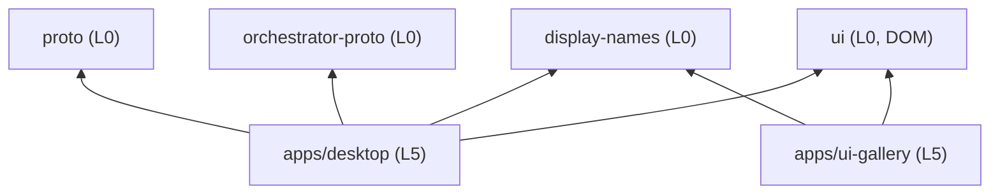

# Clients architecture: TypeScript package graph

This document owns the structure of the TypeScript clients under `clients/`: which packages exist,
which way they may depend on each other, what each entry point may use from its runtime, and how
the workspace builds, checks, and tests them. It is the design of record. Packages that do not
exist yet are marked in the [migration status](#migration-status) table, with the item that
creates each one.

It builds on, and does not restate:

- [`architecture.md`](architecture.md): the Python module graph and the placement rule. The same
  principles (deep modules, one-way dependencies, a pure core with a thin shell) apply here.
- [`desktop-connection.md`](desktop-connection.md): what the desktop main process, the host helper,
  and the screen stores do. This document says which package each of those lives in.
- [`wire-protocol.md`](wire-protocol.md): the run protocol.
- [`desktop-development.md`](desktop-development.md): how to run the desktop app.

## Why

`clients/web` and `clients/desktop` grew as two large packages with layering rules enforced inside
each (`state/` pure, `ui/` free of I/O, `effects/` never importing `ui/`). Those rules hold inside a
package but say nothing about which feature may reach which, or which runtime a module may use.
A feature that imports another feature's internals, or renderer code that imports a Node module,
type-checks today and is caught, if at all, by review.

The fix is the same one the Python side uses with `tach`: make every boundary a package boundary,
declare the edges, and let tooling refuse the rest. A package is used only through its `exports`
map; each entry point is compiled with exactly the runtime library it may use; and one checker
validates the graph from the manifests. Per-feature packages make each feature small enough to
read whole, and the build model below keeps a graph of thirty packages as fast as the current five.

## The package graph

```text
clients/
  libs/proto/       @vibesys/proto            generated protocol bindings (store records, host API)
  libs/display-names/ @vibesys/display-names  the names a person reads for roles, generated from the
                                              one Python catalog (`vibesys.api.display_catalog`)
  libs/orchestrator-proto/ @vibesys/orchestrator-proto  generated orchestrator protocol bindings
  libs/ui/          @vibesys/ui               the design system: domain-free components + design tokens
  apps/desktop           @vibesys/desktop               the Effect desktop app, one package with a
                                                        folder per role (see "The Effect desktop app")
  apps/ui-gallery        @vibesys/app-ui-gallery        development only, never shipped: every
                                                        component in every theme, screenshot-tested
                                                        in Ink
  tools/            scripts/ (checkers), lint-rules/ (Biome plugins), and the shared
                    tsconfig.base.json, tsconfig.architecture.json, knip.config.ts
```

The four libraries are the ones the desktop app still needs as clean typed dependencies. `proto` and
`orchestrator-proto` are generated from `.proto` files and carry no hand-written logic. `display-names`
is one generated table and a lookup. `ui` is the design system. The app talks to `vibesysd` only
through the generated bindings; it uses no type generated from Python besides the display-name table,
and no library of hand-written client logic.

The folder a package sits in mirrors its layer: `libs/` holds the `foundation`, `core`, `domain`,
and `service` packages and `apps/` the `app` packages (`features/` holds the `feature` packages,
of which there are none today). The
manifest's `vibesys.layer` stays the one source of truth; the `layer-matches-folder` rule fails a
package filed under the wrong folder. Imports are by package name, so moving a package between
folders changes no source. Files a tool requires at the workspace root stay there: `package.json`,
`pnpm-workspace.yaml`, `pnpm-lock.yaml`, `turbo.json`, `biome.json` and `biome.warnings.json`
(Biome resolves a config's plugin paths against the config that extends it, so the warnings
config sits beside `biome.json`), and `.dependency-cruiser.mjs`.



### Layers

Every package declares its layer in `package.json` (`"vibesys": {"layer": ...}`). A package may
depend only on packages in a strictly lower layer. That one rule gives the direction, rules out
cycles, and forbids feature-to-feature and app-to-app edges, because peers share a layer.

| Layer | Rank | Packages | May depend on |
| --- | --- | --- | --- |
| `foundation` | 0 | `proto`, `orchestrator-proto`, `display-names`, `ui` | nothing in the workspace |
| `core` | 1 | none today | foundation |
| `domain` | 2 | none today | foundation, core |
| `service` | 3 | none today | foundation, core, domain |
| `feature` | 4 | none today | anything below |
| `app` | 5 | `apps/*` | anything below |

The layers above `foundation` stay in the checker so a package can be added later without a new
rule; none is needed while the app keeps its parts as folders (see
[The Effect desktop app](#the-effect-desktop-app)).

### Packages are named for one concept

A package is named for the concept it owns, never for a place to put things. A helper used by one
app lives in that app. The `bucket-names` rule keeps foundation,
core, and domain packages from being named `entities`, `core`, `common`, `utils`, `shared`,
`helpers`, or `misc`.

### Entry points and runtimes

Every entry in a package's `exports` map declares the runtime it may use, in the same
`"vibesys"` block:

| Runtime | Compiler `lib` | Compiler `types` | Who may import it |
| --- | --- | --- | --- |
| `neutral` | `ES2022` | none | any entry |
| `dom` | `ES2022`, `DOM`, `DOM.Iterable` | none (`vite/client` for apps) | `dom` entries |
| `node` | `ES2022` | `node` (and `electron` where needed) | `node` entries |
| `preload` | `ES2022`, `DOM` | `node` (Electron's renderer API types need Node's) | `preload` entries |

A `preload` is an Electron sandboxed preload: it runs in a page's renderer process before the page,
with the DOM and Electron's renderer APIs. The sandbox gives it a `require` that reaches `electron`
and nothing else, so it may import a workspace package only as a type (`import type`,
`typeof import(...)`, which the compiler erases), no Node builtin, and no `node` entry. Each preload
is one file and one entry, which the main process loads by path into a page.

An entry may import an entry of another package only when the target is `neutral` or has the same
runtime. A `feature`-layer package (the layer exists; no package uses it today) has up to three
entries, `./state` (`neutral`), `./renderer` (`dom`) and `./main` (`node`), which the
`feature-entries` rule holds.

Apps ship no stylesheets of their own. They build their views from `@vibesys/ui` components and
tokens; the desktop page imports the design system's stylesheets once.

A Node-only package would reach the renderer through no path: only `node` entries may import it,
and `apps/desktop`'s `./main` entry is `node`. A preload is not `node` either, so it reaches none
of them.

### Rules and what enforces them

| # | Rule | Enforced by (rule id in `check_package_graph.mjs`) |
| --- | --- | --- |
| 1 | Layer direction; Node-only packages reachable only from `node` entries | `layer-direction`, `runtime-reachability` |
| 2 | No package depends on a peer in its own layer; flows between peers are composed in apps | `layer-direction` (peers share a layer) |
| 3 | A package is used only through its `exports` map; every import of a workspace package is a declared dependency | `imports-use-exports`, `imports-are-declared`, `imports-are-workspace-packages`, `workspace-protocol`; `.dependency-cruiser.mjs` for relative paths into another package |
| 4 | Each entry is compiled with the `lib` and `types` of its runtime, so importing a Node module from a renderer entry is a type error | `entry-projects`, `entry-capability`; `tsc -b` then enforces it |
| 5 | Inside a package: `state/` pure, `ui/` free of I/O, `effects/` never import `ui/`, effects depend on injected interfaces | `tools/lint-rules/*.grit` (Biome) and `.dependency-cruiser.mjs` |
| 6 | `@vibesys/ui` has no domain dependencies and names no domain concept; helpers live in the lowest package that needs them, with no shared junk drawer | `layer-direction` (it is rank 0), `domain-free` (no word of `DOMAIN_WORDS`, or an inflection of one, in their production source or stylesheet); review |
| 7 | A foundation, core, or domain package is named for the concept it owns, not for a bucket | `bucket-names` (no segment of its name in `BUCKET_NAMES`) |
| 8 | A sandboxed preload loads only Electron at run time; every workspace import in it is erased | `preload-sandbox` (what the entry's emitted CommonJS still requires); `.dependency-cruiser.mjs` keeps a preload's imports to Electron and erased types |
| 9 | In `apps/desktop`, control state is Effect services and atoms and data folds are plain reducers; no package uses XState (see [State](#state)) | `external-dependencies` (`effect` only in the app's `./core`, `./ui` and `./main` entries; `xstate` is allowed nowhere); the app's folder rules in `.dependency-cruiser.mjs` and the `tools/lint-rules/effect-*.grit` rules |
| 10 | A package's folder matches the layer its manifest declares: `libs/*` is foundation, core, domain, or service; `features/*` is feature; `apps/*` is app; nothing else | `layer-matches-folder` |
| 11 | Every app builds UI only from `@vibesys/ui` (see [Design system enforcement](#design-system-enforcement)) | `strict-no-stylesheets`, `strict-imports`; `tools/lint-rules/strict-*.grit` through `biome.json` |

All package-graph rules, and the tables they read, live in one module,
[`clients/tools/scripts/check_package_graph.mjs`](https://github.com/uw-syfi/vibesys/blob/main/clients/tools/scripts/check_package_graph.mjs),
run by `pnpm check:ts-architecture`. Its tests build a valid fixture workspace and break it once
per rule, and a meta-test fails when a rule has no failing fixture. `.dependency-cruiser.mjs` keeps
the rules about modules inside a package and about how imports resolve.

### How dependencies are managed

**One declaration.** A package's `package.json` is the single source of truth for its place in the
graph:

```json
"vibesys": {"layer": "app", "entries": {"./core": "neutral", "./ui": "dom", "./main": "node"}}
```

The checker, Knip's policy, and this document all read that block. An export whose source is a stylesheet
(`@vibesys/ui`'s `./tokens.css`) is a `dom` asset: it has no tsconfig project, and Vite resolves
it through the same source condition. Unknown keys, layers, and runtimes are rejected by
name (`declarations`), and the entries must be exactly the `exports` keys
(`entries-match-exports`). App packages are always subject to the
[design system rules](#design-system-enforcement). The obsolete `design` marker is an unknown key
and fails `declarations`.

**Workspace dependencies** are declared as `workspace:*` in the section the code needs
(`dependencies` for production code; test code may also use `devDependencies`), point to a lower
layer, and are mirrored by tsconfig project `references`. The references must equal the declared
workspace dependencies, no more and no fewer (`references-match-dependencies`): a missing
reference is not a compiler error, because the import still resolves to the dependency's source.

**Third-party dependencies** are confined by runtime and layer through one allowlist table in the
checker (`EXTERNAL_DEPENDENCIES`, rule `external-dependencies`):

| Import | Allowed in |
| --- | --- |
| `react`, `react-dom` (and subpaths) | `dom` entries: `ui`, `apps/desktop`'s `./ui` and the gallery |
| `electron` | `node` and `preload` entries of apps (`apps/desktop`'s `./main` and `./preload`) |
| `effect`, `@effect/atom-react` | `@vibesys/desktop`'s `./core`, `./ui` and `./main` entries (`EFFECT_PACKAGES`). Never its `./state` folds or its sandboxed preload, and no other package |
| Node builtins (`node:*` and bare names) | `node` entries |

A package that declares one of them in `dependencies` must have an entry allowed to use it. Knip
(`pnpm check:knip`) composes with this: it reports dependencies declared but never imported and
imports of packages not declared, so between the two a dependency is declared exactly when it is
used, and used only where its runtime allows.

## The Effect desktop app

`apps/desktop` (`@vibesys/desktop`) is the rebuild of the desktop app on the skills and
orchestrator path. It is an `app`-layer package with five entries, each compiled by its own
`tsconfig.<entry>.json` with its runtime's `lib` and `types`: `./main` (`node`), `./preload`
(`preload`), `./core` and `./state` (`neutral`) and `./ui` (`dom`). It may depend on `@vibesys/ui`,
`@vibesys/proto`, `@vibesys/orchestrator-proto` and `@vibesys/display-names`; a dependency is declared
when the first file imports it. The [State](#state) section holds its rules.

It is one package on purpose. A new package is justified later only by a second real consumer,
generated code, or a measured build problem; until one of those exists, the folder rules and the
entries give the same isolation without a manifest, a build step and a graph edge per folder.

## Design tokens and themes

`@vibesys/ui` publishes its design tokens as typed data and as CSS. One table is the source of
truth for each fact; everything else is derived from it.

| Entry | Runtime | Contents |
| --- | --- | --- |
| `.` | `dom` | The components (see [Components](#components)), `applyTheme`, and the token types (`ThemeName`, `ColorRole`, `SpaceToken`, `TextStyle`, ...). |
| `./legacy` | `dom` | Unused older primitives retained temporarily as library migration debt; feature and app imports of this entry fail `strict-imports`. |
| `./tokens` | `neutral` | `THEMES`, `DEFAULT_THEMES`, `SPACE`, `TYPE`, `SIZE`, `RADIUS`, `ELEVATION`, `MOTION`, `CONTRAST_PAIRS`, `contrastRatio`, and `renderTokensCss`. No DOM, so tests and tools import it. |
| `./tokens.css` | `dom` asset | Generated from `./tokens`; never edited by hand. |
| `./components.css` | `dom` asset | The components' styles, hand-written from token variables only. |
| `./fonts.css` | `dom` asset | `@font-face` for Schibsted Grotesk and JetBrains Mono (weights 400, 500, 600, and JetBrains Mono 700 for the wordmark) from the woff2 files in `src/fonts/`, with their SIL OFL texts. Nothing is fetched at runtime. |

A theme is `{mode, colors}` where `colors` is a `Record<ColorRole, Hex>`, so a missing role is a
compile error. The six themes are `paper`, `mist`, `sand` (light) and `ink`, `midnight`,
`terminal` (dark); `DEFAULT_THEMES` names `paper` and `ink`. `ThemeName` is the `data-theme` value.

`src/tokens.css` is written by `pnpm --dir clients/libs/ui generate:tokens` from the tables and
`src/primitives.css` (the hand-written styles of the primitives, appended verbatim). It has the
scales and derived values (`color-mix` fills for selection, chips and toasts) on `:root`, one
`:root[data-theme="<name>"]` block per theme, the zeroing of every motion duration under
`prefers-reduced-motion: reduce`, and aliases for the variable names the stylesheet had before the
roles (`LEGACY_ALIASES`), which stay until their consumers move. The defaults sit on a bare
`:root` (paper, and ink under `prefers-color-scheme: dark`) and the named blocks override them, so a
`data-theme` outside `ThemeName` (another app sets its own names) or none at all follows the OS
between the two default themes and every role stays defined.

`applyTheme(name, target = document.documentElement)` sets `data-theme`; it takes the element so a
test can pass a fake. The selectors name `:root`, so `target` only works as the root element.

## Design system enforcement

Every package under `features/` or `apps/` builds UI only from `@vibesys/ui`'s public
components and tokens. The package graph checker applies S2 and S6 by folder. Biome applies S3
and S4 to all feature and app source with `features/**` and `apps/**` globs, excluding tests.
There is no per-package opt-in or frozen-package list.

| # | Rule | Enforced by |
| --- | --- | --- |
| S2 | A feature or app ships no stylesheet: no `*.css` export and no `.css`, `.scss`, `.sass`, `.less`, `.styl` or `.pcss` file in the package | `check_package_graph.mjs` rule `strict-no-stylesheets` |
| S3 | Feature and app code renders no raw interactive or styled elements: JSX `button`, `a`, `input`, `select`, `textarea`, `label`, `dialog`, `details`, `summary`, `form`, `table`, `svg` and `pre`, and the `style`, `className` and `dangerouslySetInnerHTML` props on any element, are errors. Plain `div` and `span` stay for grouping text inside slots | Grit rule `tools/lint-rules/strict-no-raw-elements.grit` |
| S4 | Feature and app code contains no raw colors or lengths: a string or template literal with a hex color, `rgb(`, `rgba(`, `hsl(`, `hsla(`, `oklch(`, `color-mix(`, or a `px`, `rem`, `em`, `vh` or `vw` length is an error | Grit rule `tools/lint-rules/strict-no-raw-values.grit` |
| S6 | Feature and app packages import UI only from `@vibesys/ui`'s `.` and `./tokens`. Their other workspace imports are the non-UI libraries in `STRICT_WORKSPACE_IMPORTS` and feature packages composed by apps; third-party imports are `react`, `react-dom`, `effect` and `@effect/atom-react` (`STRICT_THIRD_PARTY`; Electron and Node builtins stay confined by `external-dependencies`). Test code is exempt. An app may also import `@vibesys/ui/tokens.css`, `@vibesys/ui/fonts.css` and `@vibesys/ui/components.css` in its entry wiring. Deep imports are refused by `imports-use-exports` and `.dependency-cruiser.mjs`, feature-to-feature imports by `layer-direction` | `check_package_graph.mjs` rule `strict-imports` |
| S8 | `@vibesys/ui` itself uses tokens: `strict-no-raw-values.grit` also runs on `libs/ui/src` except the token table (`src/tokens/`) and tests, and `tools/lint-rules/ui-no-raw-css-values.grit` bans raw colors and lengths in the declarations of `libs/ui/src/*.css` except the generated `tokens.css`. Lengths in `@media` conditions are not declarations and stay | the two Grit rules, wired by `biome.json` |
| S10 | Every `var(--name)` without a fallback in a stylesheet or TypeScript source names a custom property that a stylesheet declares or a TypeScript style sets (a `'--name':` key or `setProperty('--name', ...)`). A deleted token whose last reader is in another change otherwise builds, merges and leaves the declaration invalid at runtime. The scan is by name, not scope. A property set under a computed name cannot be found, so a `var()` on it needs a fallback | `check_css_custom_properties.mjs`, run by `pnpm check:ts-architecture` |

`biome.json` excludes `libs/ui/src/primitives.css` from the stylesheet rule: the old primitives'
pixel values (`10px`, `5px`, `14px`, ...) have no token to read, and a token would change what they
draw. The components that replace them delete the file and the exclusion.

Every failure names the file and line (or the manifest key), the rule id and the fix, for example
"a raw `<button>` ... Use `<Button>` from `@vibesys/ui`". The rules cannot see through a spread
(`<Card {...props} />` can carry a `className`); the components take no `className` or `style`
prop (rule S1, with the component API), which closes that path. Unenforced: whether a screen
matches its design needs a reader; the checks hold the parts it is built from.

## Components

The redesigned screens are built only from the components of `@vibesys/ui`'s `.` entry, with no
CSS of their own. An app imports `./tokens.css`, `./fonts.css` and `./components.css` once.

- **Props are data and callbacks.** Variants are token names or small closed unions (`gap:
  SpaceToken`, `variant: TextStyle`, `tone: StatusTone`); no component accepts `className` or
  `style`, so a raw value cannot reach one (rule S1 of #2827, held by the types).
- **Styles use tokens only.** `src/components.css` reads token variables (`--space-3`,
  `--control`, `--radius-lg`, `--text-body-size`, ...) and writes no color or length (rule S8);
  its classes are `vs-` prefixed so they never meet the legacy primitives' global selectors.
- **Accessible by type.** `StatusDot` requires `label`; `Button` requires visible `text` or an
  icon with `label` (its `aria-label`). Status is never color alone: a `live` dot differs from
  `ok` by a ring. A disabled `Button`, `Checkbox` or `Switch` takes `disabledReason`, shown as
  help text it is described by. The focus ring (2 px `accent`, 1 px offset) is drawn here only.
- **Fields wire their control.** `TextInput`, `PathInput` and `Select` render only inside a
  `Field`, which gives them their label, help and error; outside one they throw.

| Component | Props |
| --- | --- |
| `Page` | `width?: 'content' \| 'wide' \| 'narrow'`, `header?`, `footer?`; the scrolling `<main>` with the page gutter; a `header` stays in view above a body that scrolls, and is where the window's toasts hang |
| `Stack`, `Row` | `gap?: SpaceToken`, `align?`, `justify?: 'start' \| 'center' \| 'end' \| 'between'`, `wrap?`, `grow?` |
| `Split` | `main`, `aside`, `gap?`; the aside wraps under the main column when narrow |
| `Dock` | `label`, `side` (a panel node or null), the screen as children; the panel sits full height at the right edge and the screen narrows |
| `Grid` | `min: 'field' \| 'tile' \| 'swatch'`, `gap?`; auto-fit columns |
| `Text` | `variant?: TextStyle` (not `style`, which strict code may not pass), `tone?: 'default' \| 'muted' \| 'ok' \| 'warn' \| 'err'`, `as?` (element), `id?` |
| `Wordmark` | `art` (the caller's ASCII art; the app's one copy is `VIBESYS_WORDMARK` in new-run), `label?` (decorative without one), `align?: 'start' \| 'center'`, `tone?: 'accent' \| 'gradient'`, `size?: 'hero' \| 'compact'`; bold and solid, `hero` sized to its container's width, `compact` a fixed 40px tall |
| `Icon` | `name: IconName` (closed set, `ICON_NAMES`), `label?` (decorative without one) |
| `Button` | `text` or `icon` + `label`; one of `press`, `href` (renders `<a>`) or `submit`; `variant?: 'primary' \| 'secondary' \| 'quiet' \| 'danger'`, `size?: 'sm' \| 'md'`, `full?`, `disabledReason?`, `expanded?` |
| `SegmentedControl` | `label`, `options: {value, label, mark?: {tone, label}}[]` (a `mark` is a dot in the segment's corner, named by its label and on the pointer, taking no room), `value`, `change`, `size?`; native radios, so one tab stop and arrow keys |
| `Select` | `value`, `options: {value, label, disabledReason?}[]`, `change`, `mono?` |
| `Field` | `label`, `help?`, `error?`, one control as children |
| `TextInput` | `value`, `change?`, `placeholder?`, `mono?`, `readOnly?`, `rows?` (above one: a multi-line box), `submit?` (Enter; Shift+Enter is a new line) |
| `PathInput` | `value`, `change`, `completions: {value, detail?}[]`, `placeholder?`; the ARIA combobox pattern |
| `Checkbox`, `Switch` | `label`, `checked`, `change`, `disabledReason?` |
| `Chip` | `label`, `tone?: StatusTone`, `dot?`, `mono?` (the label is an identifier, set in the code face), `hint?` (the longer account: the chip's accessible description, a tab stop drawn under the chip on hover and on keyboard focus; a path in it is shown by its last name) |
| `StatusDot` | `tone: 'neutral' \| 'live' \| 'ok' \| 'warn' \| 'err'`, `label` |
| `Card` | `section?` (a titled region), `flush?` |
| `Toast`, `ToastStack` | `Toast`: `tone: 'warn' \| 'err'`, `title`, `detail?`, `open`, `toggle(open)`, `dismiss()`. `ToastStack`: `label`, `toasts: {id, tone, title, detail?, open}[]` (newest first), `toggle(id, open)`, `dismiss(id)`; fixed at the top right, a small gap below the header row of the `Page` or `Screen` on show (the window's end strip where there is none), a labelled live region (an error is an `alert`, a warning a `status`); holds no state |
| `Menu` | the trigger's `text` or `icon` + `label`, `items: {id, label, press \| href, danger?}[]`, `variant?`, `size?`; raised, keyboard navigable, closes on Esc, a choice or the focus leaving |
| `Dialog` | `open`, `title`, `dismiss`, children, `actions?`; the native modal `<dialog>` at the `overlay` elevation |
| `Table` | `label`, `columns: {key, header, cell(row), mono?, align?}[]`, `rows`, `rowKey`, `selected?`, `select?`; sticky header, scrolls sideways in its own focusable box |
| `Tabs` | `label`, `tabs: {value, label}[]`, `value`, `change`, the panel as children; arrows move and choose |
| `Tree`, `TreeRow` | `Tree`: `label`, `selected?`. `TreeRow`: `id`, `depth`, `title`, `subtitle?`, `state?: {tone, label}`, `chips?`, `expanded?` + `toggle?` for a group, `select`; up, down, left, right, Home, End |
| `KeyValue` | `items: {key, value, mono?}[]` |
| `CheckList` | `items: {id, state: 'ok' \| 'warn' \| 'fail' \| 'pending', label, detail?, fix?: {text, press}}[]`; each state has its own icon and word |
| `Timeline` | `stages: {id, state: 'done' \| 'active' \| 'waiting' \| 'failed', label, elapsed?, quietFor?, body?}[]`; a body discloses, open at first for an active or failed stage |
| `LogPane` | `label`, `lines: {text, stream?: 'out' \| 'err'}[]`, `size?`; follows the tail while at the bottom, offers "Jump to latest" when scrolled up; text only |
| `Collapsible` | `label`, `summary?`, `leading?`, `mono?`, `open`, `toggle(open)`, children; the caller owns whether it is open, so a list that unmounts blocks keeps them open |
| `Message` | `author`, `variant: 'reply' \| 'reasoning' \| 'prompt' \| 'note'`, `tone?: 'default' \| 'ok' \| 'err'`, `text`, `notice?`, `open`, `toggle`; plain text, closed it previews its first line |
| `ToolCall` | `name`, `state: 'pending' \| 'ok' \| 'failed'`, `summary?`, `meta?`, `input: string \| null`, `output: string \| null`, `open`, `toggle`; closed it is one line (name, summary, meta), open it shows input and output, a long output cut with "Show more" |
| `StructuredReply` | `author`, `title`, `fields: ReplyField[]` (`prose`, `badge`, `fact`, `list`, or `group` of fields), `raw`, `open`, `toggle`; badges sit on the title line, text is text, groups open on request, a "Raw" button shows the JSON |
| `TurnResult` | `label`, `author`, `headline?`, `chips?`, `context?` (`prefix`, `label`, `press?`), `sections` and `more` (`ReplyField`s), `raw`; what a turn ends with: a large headline, a line saying what it builds on, the body's text in full, and the rest behind "Show all fields" |
| `Thread` | `label`, `items: ({kind: 'heading'} \| {kind: 'message'} \| {kind: 'tool'} \| {kind: 'reply'} \| {kind: 'node'})[]` (each with a unique `id`); windowed over measured row heights, so any length costs a screenful; follows the tail, "Jump to latest" when scrolled up; keeps each block as the reader left it; give it a `key` per thread |
| `Scrubber` | `label`, `value`, `last`, `position` (words), `live`, `pastLabel`, `ticks?`, `change`, `backToLive` |
| `Stat` | `label`, `value`, `sub?` |
| `Chart` | `label`, `points: {x, y, filled}[]`, `steps?`, `reference?: {y, label}`, `playhead?`, `xTicks?`, `yTicks?`, `xTitle?`; SVG in `accent`, `muted` and `grid` |
| `SidebarItem` | `label`, `href` or `press`, `icon?`, `status?: {tone, label}`, `count?`, `detail?`, `active?`, `menu?` |
| `SidebarSection` | `title`, children, `showAll?: {label, href \| press}` |
| `EmptyState` | `title`, `body?`, `action?` |
| `AppFrame` | `label`, `nav`, `footer?`, the main area as children; the window's sidebar column and main area, each scrolling |
| `ThemeSwatch` | `theme`, `label`, `selected`, `press`; a preview drawn in that theme's colors from the token table |

Time-dependent values (elapsed, "quiet for", a scrubber position) are props the caller formats;
no component reads a clock. Standard error in `LogPane` is drawn in `--log-err`, `err` mixed into
`log-text` (`LOG_ERR_MIX` in `./tokens`), because a light theme's `err` does not read on the log
pane's dark background; a token test checks it in every theme.

### Toasts and inline status

The app draws no banner: no full-width strip, tinted or not, for any state, error or warning. A
message is one of three things, and each has one form.

- **A failure or warning the person passes through is a toast.** "Could not save the change", "The
  machines could not be read", "The run did not take the command": an event, with no action
  beside it. It is a *problem*: data with a stable `id`, a tone (`warn` or `err`), a short title
  and a detail. Toasts sit at the top right of the window, a small gap below the screen's header row (a
  `Page`'s or `Screen`'s `header`, whatever its height), collapsed to the title and a tone dot, with the detail behind a details button, and stay until the person
  dismisses them or the problem clears. They never hide on a timer.
- **A problem with one thing is a status word at that thing.** A login, a machine, a section that
  could not be read, a step's transcript: a `Chip` in the thing's own row or header (`Not read`,
  `Needs an update`, `Transcript unavailable`), the detail on its `hint`, and its action, if it
  has one, beside it. A hint is the chip's accessible description, so it is read on hover, on
  keyboard focus and by a screen reader; what a person must read to act (a login's link and code,
  a start that may have happened) is text on the page, never only a hint. A run's state is the
  header's status chip (a Resume on its way reads `Resuming`) with a few words of why beside it
  and the whole account as its hint; Resume and Run again sit beside the other header actions. A
  diagnostic is a row of the Logs, with a dot on the Logs tab.
- **Anything else is not said.** A fact the screen already shows is not repeated in a message.

Enforced: `@vibesys/ui` has no `Banner`, and no stylesheet rule paints a panel with the tone fills
(`--banner-*-bg`, `--chip-*-bg`, or a mix of a status color) unless it is on the allow-list of
`tone-fills.test.ts`. Unenforced: whether a message is a passing event or a problem with a thing
needs a reader. The board that collected a screen's problems into one set of toasts
(`@vibesys/problems`) was deleted with the legacy desktop app; the Effect desktop app has no toast
host yet and shows a problem as a status word at the thing it concerns (a connection note above
the list it makes out of date).

### The gallery and its screenshots

`apps/ui-gallery` renders every state of every component, one page per theme (`?theme=<name>`),
with fixed content: no clock, randomness or network, and the bundled fonts. Its registry is typed
over the entry's component exports, and `test_gallery_covers_every_public_component` fails a
component with no gallery entry. Run it with `pnpm --filter @vibesys/app-ui-gallery dev`.
The gallery is an app package, so it shows that a page built only from `@vibesys/ui` passes the
strict rules.

Its Playwright suite (in the `clients_e2e` group) runs in one theme, Ink: it fails on any axe
violation and compares each component's screenshot against `e2e/__screenshots__/ink-<Component>.png`
under reduced motion at a fixed 1280 by 900 viewport. The other themes are not screenshot-tested;
the token test still holds every theme to the contrast floors. The baselines are Chromium on Linux, the
`clients_e2e` job's browser and OS, so they are written in Playwright's Linux image, never on macOS:

```bash
pnpm --filter @vibesys/app-ui-gallery update:screenshots   # rewrite the baselines (needs Docker)
pnpm --filter @vibesys/app-ui-gallery test:e2e:linux       # compare against them locally
```

`./scripts/regenerate_goldens.sh` does not rewrite these baselines: they need Docker and follow the UI, not
the schema. Run `update:screenshots` yourself after a change that moves a rendering.

A baseline update rewrites only the screens whose rendering changed: the suite launches
Chromium with the flags in `DETERMINISTIC_RENDERING` (`playwright.config.ts`), which fix the
rasterizer's per-run choices (LCD text, hinting, SIMD variants, raster threads) that otherwise
made two consecutive runs differ in a few pixels per screen.
The suite shoots each entry with every other entry hidden: Chromium's antialiasing of a few shapes
depends on where an element sits on the page, so a change to the height of one entry used to
shift later baselines. The comparison is exact (`threshold` and `maxDiffPixels` are 0), so a
baseline that is stale fails the job instead of passing within the default tolerance.
`pnpm --filter @vibesys/app-ui-gallery check:deterministic` runs the update twice and fails on
any difference; `scripts/check_clients.sh` runs it (see "Client checks before a push" in
[development.md](development.md)).

When the job fails on a screenshot, it uploads the actual and the diff as the
`ui-gallery-test-results-1` artifact.

Every glyph the UI draws comes from a bundled font. The body face has no check mark, bullet or
cross, so a symbol set in it is drawn by whatever font the machine falls back to, and the same
screen differs between operating systems (the gallery's baselines are the one place it showed
first). Set a symbol in `var(--font-mono)`, whose bundled face has it, or use an icon. Enforced:
the gallery's `every glyph the gallery draws comes from a bundled font` test asks Chromium which
font drew each text (`CSS.getPlatformFontsForNode`) and fails on any family `fonts.css` does not
declare.

## Where a desktop test goes

`apps/desktop` tests live beside the module they test and use only that module's public interface.
The doubles they share are in `src/testing/`, which only tests import (the
`desktop-production-code-does-not-import-testing` rule).

- **A fold or a view** (`src/state/`) is a plain function: a unit or property test calls it with
  events from `testing/orchestrator` (`generateScenario`) and compares data.
- **A service** (`src/core/`) is an Effect service: a test provides the fake transport
  (`testing/transport`) and the `TestClock`, runs the service and reads the atoms. No test reads a
  real clock.
- **A screen** (`src/ui/`) renders from fixture state with `renderToStaticMarkup`: the same
  scenarios, no transport. A screen's observer hooks (the stable names a later browser observer
  looks up) are asserted there.
- **The whole window** over a fake daemon runs in a browser: `pnpm --filter @vibesys/desktop
  build:fixture` builds `src/testing/page`, which serves a scripted fake daemon to the real
  screens, and the `verify-desktop-ui` skill drives it. A Playwright spec against the real Electron
  app belongs under `apps/desktop/e2e/`, where the client end-to-end job picks it up.

## Display names

A screen never shows an id a program matches on (`judge`, `perf-evaluator`, `claude`, a model's
vendor id). Each vocabulary has one owner of its names:

- an agent role's name is the `title` its search declares on its `Role`; `vibesys.api.display_catalog`
  gathers them and `pnpm --dir libs/display-names generate` writes `display-names.generated.ts` from
  it, which `@vibesys/display-names` serves as `roleName`. The `clients_quality` group regenerates it and fails on a
  diff; the role `title` pattern and `test_every_role_name_reads_as_words` fail a role with no
  readable name. A role a plugin declares reads as the words of its id. No client source spells a
  role's name: the `no-role-words` Biome rule fails a string, template or JSX text that does, and
  `check_role_words.test.mjs` fails when the rule lacks a name the catalog declares. A reply
  kind that leads with its role's old name (`JudgeResponse`) reads as the catalog's name for the
  turn's role;
- harness and model names are agentshim's, served by the backend. A client renders the field it
  receives and never maps or prettifies those ids.

`CODE_IDS` (generated beside the names) lists the harness, model and role ids, so a screen check
can fail on any a screen draws as text outside a `data-mono-id` element.

## State

Client state comes in two kinds, and each has one form. The new desktop app (`apps/desktop`,
`@vibesys/desktop`) is built on Effect 4 (`effect`, pinned exactly; `@effect/atom-react` joins with
the first screen). No package uses XState.

**Control state is Effect services and atoms.** Control state is a mode with effects: it starts
work, waits for it, retries, times out, cancels, and decides what a late answer means. In the
app it is written once, in `core/`:

- a *service* is a `Context.Service` class named for its role, with one `Layer` per implementation
  (the real one and a Fake). A caller `yield*`s the service and never names an implementation;
  the layers are wired once, in the entry files. A service is a dependency with interchangeable
  implementations, one for the whole app (the gateway transport, ids). What exists once per host
  (its connection, store, views and commands) is a plain record built by a `make…` function in a
  `Scope`, and `HostSession` hands the screens that record: a tag would allow one per context,
  and a second host would need a second context;
- an operation is `Effect.fn("Service.op")`, so it carries a span and a stack trace, and its
  failures are typed: `Data.TaggedError` values in the error channel, handled with
  `Effect.catchTag`. A defect is a bug and is not caught;
- a subscription is a `Stream`. Cancellation is interruption: ending the fiber or scope that
  consumes it stops the stream, cancels its delays and runs its finalizers, so there are no abort
  controllers, reply tokens or hand-written timers;
- time, randomness and ids are services (`Clock`, `Random`, an id service), so a wait is
  `Effect.sleep` or a `Schedule` and a test controls it;
- a view reads state through atoms (`effect/reactivity/Atom`), which `@effect/atom-react` binds to
  React; the atom registry runs the effects behind them;
- an Effect program is a value. It runs only in the entry files (`Effect.runFork` and the other
  `run*` calls), which build the layers and start the first fiber.

**A data fold is a plain reducer.** A data fold turns ordered inputs into a value and has no mode:
the run event fold, a host's listing, recent runs. In the app it lives in `state/` as a pure
`(state, action) -> state` that imports no Effect, so any test calls it directly and a seeded
property test covers it.

**Folders.** One package, a folder per role, because the parts share one set of services and one
release. A new package is justified later only by a second real consumer, generated code, or a
measured build problem; until then a folder boundary is cheaper than a package boundary and the
rules below hold it.

| Folder | Runtime | Holds | May import | Enforced by |
| --- | --- | --- | --- | --- |
| `state/` | `neutral` | plain folds and views | itself; other modules' types only; never `effect` | `desktop-state-imports-nothing-outside-itself`, `desktop-state-never-imports-effect`, `external-dependencies` |
| `core/` | `neutral` | services, transport, atoms | `state/`, `effect` | `desktop-core-does-not-reach-the-shells`, `effect-core-no-promises` |
| `ui/` | `dom` | React screens | `core/`, `state/` | `desktop-ui-does-not-reach-main-or-preload`, and the existing `ui-no-*` rules |
| `main/`, `preload/` | `node`, `preload` | Electron main, the sandboxed typed bridge | `core/`, `state/`; a preload loads only Electron | `desktop-main-and-preload-do-not-import-ui`, `desktop-main-does-not-import-the-preload`, `desktop-preload-loads-only-electron`, `preload-sandbox` |
| `testing/` | `neutral` | Fakes at process, network, clock, id and filesystem boundaries | `core/`, `state/`; only tests import it | `desktop-production-code-does-not-import-testing` |

**The main process shell.** `main/` is the only place the app starts a process or opens a socket
(`desktop-main-starts-processes-only-in-process-ts`, `desktop-main-opens-sockets-only-in-local-host-ts`).
It is Effect services over those two seams, in the order a call meets them: `ProcessSpawner` (every
child is spawned in a scope and retired with a bounded signal ladder), `SshLink` (one OpenSSH master
per host; every channel is an exec session with `BatchMode=yes`), `LinkPool`, `GatewayDialers`
(the gateway on this machine, or over the host's ssh link; the gateway binary is uploaded when the
host lacks the right one), `GatewayConnection` (one HTTP/2 gRPC session, its Hello check and the
reconnect policy in `state/gateway-policy.ts`) and `GatewayCalls` (the window's calls). The window
reaches them through `main/gateway.ts`, which serves one `MessagePort` per call; the wire form is
`core/gateway-codec.ts` and the preload only moves its bytes. Every fake is in `testing/main/`
(`fake-process.ts`, `fake-gateway.ts`, `fake-local-host.ts`), so the shell is tested with no real
ssh, socket or child. An ssh host that wants a password or an unknown host key fails as `auth` with
ssh's own words: the app never prompts, and the user fixes it in their terminal.

The Biome rules (`tools/lint-rules/effect-*.grit`, wired in `biome.json`) hold the style:
`effect-namespace-imports` (modules are imported as namespaces from their subpath, as in
`import * as Effect from 'effect/Effect'`), `effect-no-ambient-time-random` (no `Date.now`,
`setTimeout`, `Math.random` or `crypto.randomUUID` in `core/`, `state/` or `ui/`),
`effect-run-only-in-entries` (`Effect.run*` only in `main/index.ts`, `ui/main.tsx` and the browser
fixture page `testing/page/main.tsx`),
`effect-core-no-promises` (no `async`, `await`, `Promise` or `AbortController` in `core/`; wrap a
Promise API once with `Effect.tryPromise`), and `effect-tests-no-real-time`. A suppression needs
a comment that says why each alternative is worse.

**Tests.** A test is `it.effect` from `@effect/vitest`, which runs on `TestClock`: the test advances
time with `TestClock.adjust` and asserts the state after each step, so it never waits, polls,
retries or sets a timeout, and its result cannot depend on timing (`effect-tests-no-real-time`).
Randomness is `Random.withSeed`. A Fake exists only at a process, network, clock, id or filesystem
boundary, as a `Layer` in `testing/`; everything above it runs for real. `pnpm test` in the app
runs them through `tools/scripts/run_vitest.mjs`, which owns the hang guard like the Bun and Node
runners (`test-runner-policy`).

**Why.** Hand-rolled control state kept producing the same bugs: a reply token compared against the
wrong slot, a timer not cleared on one exit path, an abort controller that outlived its owner.
Fibers and scopes make "this work belongs to this owner" structural, and a clock that is a service
makes every wait a step a test takes. The app has no machines to step; its folds, where the seeded model tests
belong, are plain functions.

## Build model

The workspace stays fast as the package count grows because nothing waits on a build it does not
need, and nothing repeats work whose inputs did not change.

**Source condition.** Every export carries a custom condition that points at its TypeScript source:

```json
"exports": {
  "./state": {
    "@vibesys/source": "./src/state/index.ts",
    "types": "./dist/state/index.d.ts",
    "default": "./dist/state/index.js"
  }
}
```

Vite (`resolve.conditions`), the Bun test runner (`--conditions`), and `tsc`
(`customConditions` in `clients/tools/tsconfig.base.json`) all resolve that condition, so the dev
server, tests, and type checks read dependencies from source and never need a prebuilt `dist/`.
Node and Electron at runtime do not set the condition and load `dist/`. There are no `paths`
aliases and no `pre*` "build dependencies first" scripts.

**Project references.** Each entry is a `composite`, `incremental` TypeScript project; the
package's `tsconfig.json` is a solution file that references its entry projects and its test
project, and each entry project references the entry projects of the packages it imports.
`tsc -b` then type-checks and emits declarations per project, skipping every project whose inputs
are unchanged, and checks a dependent against its dependencies' declarations instead of their
source.

**Task runner.** [Turborepo](https://turborepo.com) runs `build`, `check`, and `test` across the
workspace in dependency order, in parallel, with a local content-hash cache in `.turbo/cache` at
the repository root (shared by the git worktrees of one clone; CI keeps none between runs). A task
whose inputs (the package's tracked files, its dependencies' hashes, and the shared
configuration) match a previous run replays its output instead of running. `test` depends on a
`transit` task rather than on `^build`, so tests start at once while still being invalidated
when a dependency's source changes. Turborepo was chosen over Nx because it needs one
`turbo.json` and the existing `package.json` scripts, with no plugins, generators, or project
files per package; Nx's extra capabilities (code generators, module-boundary lint) are covered
here by the scaffold and the graph checker.

| Command (from `clients/`) | What it runs |
| --- | --- |
| `pnpm check:clients` | `turbo run check`: `tsc -b` in every package |
| `pnpm test:clients` | the script tests, then `turbo run test` |
| `pnpm build:clients` | `turbo run build` |
| `pnpm turbo run test --filter @vibesys/<package>` | one package, building only what it needs |

## Adding a package

Packages are rare here: the desktop app keeps its parts as folders, and a new package needs a second
real consumer, generated code, or a measured build problem. When one is justified, copy the nearest
existing package (`libs/display-names` for a small generated library, `libs/ui` for a DOM one) and
change it:

1. Write the `vibesys` block in `package.json` first (`layer`, and a runtime per `exports` key). The
   checker derives the rest from it.
2. Give every export the `@vibesys/source` condition, one composite `tsconfig.<entry>.json` per
   entry with its runtime's `lib` and `types`, a test project, and a solution `tsconfig.json`, as the
   copied package does.
3. Add the package to `tools/tsconfig.architecture.json` so dependency-cruiser resolves it, then run
   `pnpm install`.

Add a workspace dependency with `pnpm --filter <package> add @vibesys/<dependency>@workspace:*` and
a matching project reference in the entry project that imports it; `pnpm check:ts-architecture`
names a missing or extra one, and the Knip and Biome globs cover the new package without edits.

## Migration status

| Package | Layer | Status |
| --- | --- | --- |
| `@vibesys/proto` | foundation | exists: the generated store-record and host API bindings the app speaks to `vibesysd` |
| `@vibesys/orchestrator-proto` | foundation | exists: the generated orchestrator bindings |
| `@vibesys/display-names` | foundation | exists: the generated role-name table and its lookup |
| `@vibesys/ui` | foundation | exists: the components (`.`, `dom`; see [Components](#components)), the legacy primitives (`./legacy`, unused) and the design tokens (`./tokens`, `./tokens.css`, `./fonts.css`, `./components.css`) |
| `apps/ui-gallery` | app | exists: development only, never shipped (one `dom` entry, no exports): the component gallery and its screenshot and axe suite (see [The gallery and its screenshots](#the-gallery-and-its-screenshots)) |
| `@vibesys/desktop` | app | exists as the Effect rebuild (`apps/desktop`; see [The Effect desktop app](#the-effect-desktop-app)); it owns its host identity, gateway codec and main process shell as folders |
| `contracts`, `request-identity`, `store`, `machine`, `transport`, `hosts`, `runs`, `logs`, `subscription`, `ipc`, `connection`, `settings`, `run-state` and the other legacy libraries | various | deleted: the Effect desktop app replaced each, and nothing else imported them |

Roadmap [#1878](https://github.com/uw-syfi/vibesys/issues/1878) tracks this migration; each item gets
a sub-issue there when it starts.
