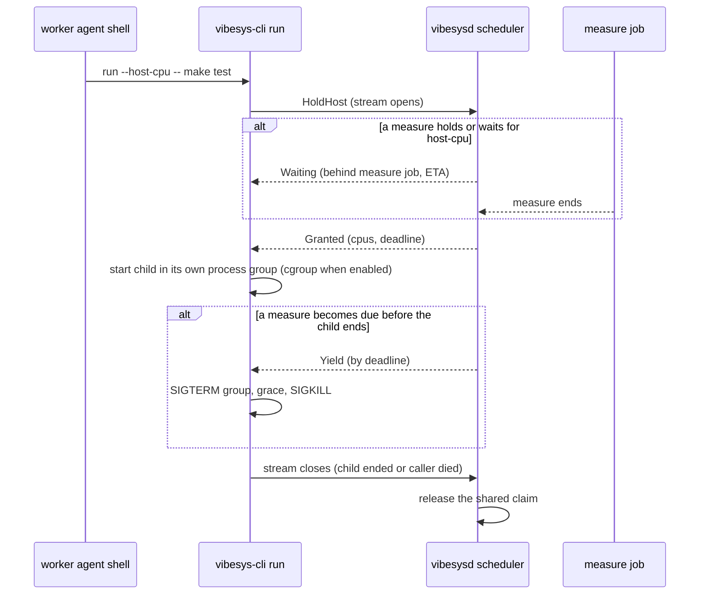

# Proposal: daemon-owned host work and containers

This page is a design proposal for `vibesysd` (the CLI daemon) and the skills that drive it. Nothing
on it is built yet except what "Today" says. When a part lands, its facts move to the pages that
own them ([The vibesys-cli task environment](cli-task-environment.md), `cli/README.md`,
[Sandboxing and confinement](sandboxing.md)) and this page shrinks. When every part has landed,
the page is deleted.

It covers two problems with one cause: the daemon owns the measurement, but not the other work on
the same machine. Agents start that work themselves, so nothing schedules it, limits it or cleans
up after it.

Vocabulary is the one in [Sandboxing and confinement](sandboxing.md#vocabulary): **agent
confinement** restricts the agent CLI process, a **command runner** executes a command and
isolates nothing, the **run environment** is where evaluations execute, and the **trust boundary**
keeps the evaluator and the run's state out of the agent's reach. Two more terms:

- **Host work** is CPU-, memory- or disk-heavy work an agent starts on the machine outside a
  daemon job: test suites in a container, compiles, local profiling.
- A **host-bound measure** is a measure whose number depends on the host's CPUs, not only on the
  accelerator: a serving benchmark whose tokenizer, scheduler, audio codec or load generator runs
  on the host.

## Today

What the daemon already does, so the design builds on it rather than beside it:

- A measure claims its placement exclusively (`cli/internal/schedule/placement.go:PlacementDemand`),
  so no other daemon job of any user runs beside it. A lease (`cli/internal/lease`) extends this
  across daemons.
- Every container the daemon starts carries the labels `io.vibesys.cli.owner`, `.scope` and `.run`,
  runs as the invoking user (`--user uid:gid`), and is removed on every path. Its first process
  waits for the end of its standard input, which the daemon's supervisor holds, so the container
  stops when the supervisor dies. Before a run, the daemon removes leftover containers of its scope
  (`cli/internal/environment/docker`, package comment).
- Each result records `MachineLoad`: the one-minute load average, CPU busy fraction and free memory,
  sampled once (`proto/vibesys/cli/v1/environment.proto:MachineLoad`). Nothing acts on it.
- A Slurm placement whose node is exclusive is `Isolated`: the node already keeps a measure apart.

None of this reaches work an agent starts with its own shell.

## Problem 1: host work biases host-bound measures

### Evidence

In a multi-day optimization campaign on a Trainium2 TTS-serving task, a measure held the whole
accelerator node for 3 to 4 hours, while several worker agents on the same host ran CPU test suites
in Docker, local profiling, and builds of the candidate in their worktrees. The workload is
host-bound: its throughput depends on host threads that feed the accelerator, and the load
generator runs on the same CPUs. So:

- A sample taken while a worker compiled and one taken while workers were idle measure different
  machines. With a relative noise floor of a few percent and gains of the same size (for example
  "2 vs 2 samples, 6.8% gain"), host contention alone can decide a verdict.
- The daemon cannot tell which samples overlapped host work. `MachineLoad` is one point sample per
  result, and it does not say whose load it was.
- Nothing prevents the overlap. The daemon's exclusive claim covers only daemon jobs. Skills ask
  workers to measure through the daemon but say nothing about their other work, and asking would
  not be enforcement anyway.

### Goals

- A host-bound measure can hold the host's CPUs exclusively, the way it already holds its
  placement.
- Worker host work waits behind such a measure, instead of competing with it.
- Where the daemon cannot prevent contention, it records how much there was, per sample, so a
  verdict can be checked against it.
- Each mechanism is stated as enforced, detected or advisory, in the sandboxing page's terms.

### Non-goals

- Isolating the agent CLI's own work (its model calls, file edits). It uses little CPU.
- Hard real-time isolation (IRQ affinity, `isolcpus`, frequency pinning). Those are operator
  choices about the machine, outside the daemon.
- macOS. cgroups are Linux-only, and macOS hosts here run Metal tasks under Seatbelt.

### Design

Four layers, each usable without the next. The first is advisory; the second and third are
enforced for what they cover; the fourth detects what the others miss.

#### Layer 1: the host CPU is a scheduled resource

The scheduler already counts claims on named resources and keeps an exclusive claim alone
(`cli/internal/schedule:Claim`). A new resource, `host-cpu`, is the CPUs of the machine the daemon
runs on.

- A measure on a placement whose `host_isolation` is `exclusive` (operator config) claims
  `host-cpu` exclusively, beside its placement claim. The default stays `none`, so nothing changes
  for a machine whose operator does not ask.
- Every check, command and image build that runs on this machine claims `host-cpu` shared.
- The new **host hold** (below) claims it shared.
- The scheduler's FIFO order already keeps a later shared claim behind an earlier exclusive one
  (`WAIT_KIND_BEHIND`), so a queued measure is not starved by a stream of short holds.
- Across daemons, an exclusive claim takes the `host-cpu` lease on `locallease` as it takes the
  placement's. Shared claims take no lease today, so another user's daemon would not see them;
  see Open questions.

#### Layer 2: host work goes through the daemon

```text
vibesys-cli run --host-cpu [--cpus N] [--timeout d] [--purpose text] -- <argv...>
```

The wrapper asks the daemon for a host hold, runs the command as its own child once the hold is
granted, and releases the hold when the command ends. The command stays in the caller's agent
confinement, its working directory and its environment: the daemon never runs agent code on the
agent's behalf, so the wrapper opens no path around the trust boundary.



- `--timeout` is required and capped by the operator (`max_hold_seconds`, default 1800). It bounds
  how long a due measure waits for running holds. By default the measure waits for them;
  with `yield_holds = true` the daemon asks them to yield instead.
- The hold lives as long as the stream. A caller that dies closes it, so a lost wrapper never
  keeps the host held, the same rule the daemon's supervisors follow.
- `--cpus N` asks for N CPUs. With layer 3 enabled, the child gets them as its cgroup's `cpu.max`.
  Without it, N is only counted by the scheduler.
- Holds appear in `jobs` and `daemon status` with their run, agent and purpose, so a lead can see
  what its workers are doing to the host.

On its own this layer is **advisory**: an agent that does not use the wrapper is not held back.
The skills that start host work (`vibesys:implement-hypothesis`, `vibesys:profile-revision`,
`vibesys:combine-candidates`) gain one rule: CPU-heavy local work goes through
`vibesys-cli run --host-cpu`.

#### Layer 3: cgroups the daemon owns

On Linux with cgroup v2 and a delegated user subtree (the user's systemd manager delegates one by
default), the daemon creates and owns two cgroups under its own:

| cgroup | Holds | Limits the daemon sets |
| --- | --- | --- |
| `measure` | The containers and host processes of jobs that claim `host-cpu` exclusively. | `cpuset.cpus` = the operator's `measure_cpus`. |
| `agent-work` | Host holds, daemon-owned agent containers (Problem 2 below) and, when the orchestrator places them there, the agent sessions themselves. | `cpuset.cpus` = all CPUs while no exclusive measure runs; narrowed to `agent_cpus` while one runs; `cpu.max` per hold. |

Docker containers are children of the Docker daemon, not of the process that asked for them, so a
container lands in a daemon cgroup only through `docker run --cgroup-parent`, which the daemon's
docker environment passes. Where the Docker engine runs under systemd's cgroup driver, the parent
must be a systemd slice; the daemon names one per user (`vibesys-<uid>.slice`).

Within a measure, the task's two containers can be kept apart too. A task declares
`[resources] loadgen_cpus = 4`, and the daemon gives the task's container (the judge and the load
generator) that many CPUs of `measure_cpus` with `--cpuset-cpus`, and the candidate's server the
rest. A load generator that competes with the server it measures is the same bias at a smaller
scale.

This layer is **enforced** for every process in those cgroups: the kernel holds the CPU sets. It
covers host holds, daemon-owned containers and orchestrator-launched agents. It does not cover a
process the agent starts outside them, such as a `docker run` against a reachable Docker socket,
which is why Problem 2 matters here as well.

#### Layer 4: contention is recorded per sample

Each benchmark sample records a `HostContention`: the CPU time spent outside the measure's cgroup
during the sample, as a share of the host's CPUs, and the share used by `agent-work`. Both come from
`/proc/stat` and the cgroups' `cpu.stat`, read at the start and end of the sample. This replaces
nothing in `MachineLoad`; it adds the overlap that a point sample misses.

`compare` and `promote` do not change their statistic. With `max_host_contention` set in the
operator config, a sample above it is flagged, and `compare` reports `contended` samples beside
its verdict. Whether a contended sample should be excluded is an open question. This layer is
**detection**, as the accuracy gate is for Landlock: it does not prevent contention, it makes it
visible after the fact.

#### Enforced, detected and advisory

| Mechanism | Covers | Status |
| --- | --- | --- |
| `host-cpu` exclusive claim | Daemon jobs of every user, through the lease | Enforced |
| `vibesys-cli run --host-cpu` | Agents that use it | Advisory |
| `measure` and `agent-work` cgroups | Daemon jobs, host holds, daemon-owned containers, orchestrator-launched agents | Enforced by the kernel |
| Load generator CPU split | The task's two containers | Enforced by the kernel |
| `HostContention` per sample | Every sample | Detected, not prevented |
| Skill rules | Every agent that follows them | Advisory |

### Interfaces

```proto
// operator.proto: per placement on this machine
message HostIsolation {
  enum Mode {
    MODE_UNSPECIFIED = 0;   // none
    MODE_NONE = 1;
    MODE_EXCLUSIVE = 2;     // a measure claims host-cpu exclusively
  }
  Mode mode = 1;
  string measure_cpus = 2;             // cpuset list, such as "0-47"
  string agent_cpus = 3;               // such as "48-63"; disjoint from measure_cpus
  uint32 max_hold_seconds = 4;         // default 1800
  bool yield_holds = 5;                // ask holds to yield when a measure is due
  optional double max_host_contention = 6;
}

// service.proto
rpc HoldHost(HoldHostRequest) returns (stream HoldHostResponse);

message HoldHostRequest {
  CallContext context = 1;
  string purpose = 2 [(buf.validate.field).string.max_len = 200];
  uint32 cpus = 3;
  google.protobuf.Duration limit = 4 [(buf.validate.field).required = true];
}

message HoldHostResponse {
  oneof event {
    HostHoldWaiting waiting = 1;   // a WaitReason, as for a queued job
    HostHoldGranted granted = 2;   // hold id, cpus, deadline, cgroup to join (or none)
    HostHoldYield yield = 3;       // a measure is due; end by this time
  }
}

// result.proto: per sample
message HostContention {
  double outside_share = 1;       // CPU time outside the measure's cgroup / (CPUs x wall time)
  double agent_work_share = 2;
  bool contended = 3;             // above max_host_contention
}
```

The cgroup a hold joins is handed to the wrapper as an opaque token it passes back to the daemon,
which moves the child in. The contract names no path, in line with
[process boundaries](process-boundaries.md).

### Alternatives considered

- **Route all worker compute through daemon jobs** (`submit command`). Command jobs run on a clean
  checkout of a commit, so a worker would commit before every test run, and the job's output comes
  back through `logs`. That is right for anything that must be reproducible, and too slow for an
  edit-compile-test loop. The host hold keeps the loop and still queues behind measures.
- **Have the daemon run the agent's command for it.** The daemon runs outside agent confinement,
  so this would let an agent run unconfined commands through it. The wrapper keeps the command in
  the agent's confinement.
- **Freeze the agents' cgroup during a measure** (`cgroup.freeze`). That stops host work
  completely, and also stops the agent sessions mid-turn, which then time out against their model
  provider. Narrowing their CPU set achieves the isolation and keeps them alive.
- **Static partitioning only** (agents always on `agent_cpus`). Simple and enforced, but it gives
  up a large share of the machine for builds whenever no measure runs, which is most of the time.
- **Pause scheduling of measures until the host is quiet** (a pre-sample check of busy CPU, like
  the Neuron resource's check that no other process holds its cores). It needs a threshold, and
  under steady host work a measure would wait indefinitely. Recording (layer 4) gives the same
  information without stalling.
- **Make host isolation a task key.** It changes numbers, so it could be part of the result's key.
  But it is a property of the operator's machine, as the placement is, and placements are
  deliberately not part of the key. It is recorded with each result instead.

## Problem 2: leaked containers and files

### Evidence

From the same campaign:

- Workers ran CPU tests as `timeout <limit> docker run ...`. When `timeout`, or the agent harness's
  own command time limit, killed the `docker` client, the container kept running: the client's
  death does not stop a container, and a SIGTERM forwarded to a PID 1 that installs no handler is
  ignored. Hung test containers ran for days, each holding CPU and memory beside every later
  measure, which is Problem 1 again.
- Containers ran as root and wrote into bind-mounted worktrees. The files they left were owned by
  root, so `git worktree remove` and `rm -rf` failed for the user and for every agent, and the
  worktrees stayed.

The daemon's own containers have neither problem: they are labeled, tied to their supervisor, run
as the invoking user and are removed on every path. The containers here were started by agents,
outside the daemon.

### Goals

- Every container an agent starts is labeled with its run and agent, bounded in time, and removed
  when its caller dies, when its time is up, or when its run ends.
- Containers write files the user can remove.
- A worktree that does hold root-owned files can be removed.
- What can be done today with flags is said separately from what needs the daemon.

### Non-goals

- Taking Docker away from agents that need it for things the daemon cannot express (building a
  candidate image by hand, `docker compose`). Those stay allowed where the run environment allows
  Docker, and are covered only by the sweep.
- Rootless Docker or user-namespace remapping as a requirement. They help, but the operator chooses
  them.

### Cheap now: flags and skill text

No daemon change. A skill reference, shared by the skills that run containers, gives the one
command shape to use:

```sh
cid=$(docker run -d --init --user "$(id -u):$(id -g)" -e HOME=/tmp \
  --label io.vibesys.agent.run="$VIBESYS_RUN" --label io.vibesys.agent.agent="$VIBESYS_AGENT" \
  <image> <argv...>)
trap 'docker rm -f "$cid" >/dev/null 2>&1' EXIT INT TERM
docker logs -f "$cid" &
timeout <limit> docker wait "$cid"   # prints the exit code; exits 124 at the limit
```

| Part | Fixes |
| --- | --- |
| `-d` and `timeout ... docker wait` | The time limit is on the container's life, not on a client whose death leaves it running. |
| `trap ... docker rm -f` | The container is removed on every path the shell survives: success, failure, the time limit, Ctrl-C. |
| `--init` | PID 1 is an init that forwards SIGTERM, so a stop actually stops the command. |
| `--user uid:gid`, `HOME=/tmp` | Files written to the worktree are the user's. |
| `--label ...` | A shell killed with SIGKILL runs no trap, so the lead sweeps by label at the end of the run: `docker ps -aq --filter label=io.vibesys.agent.run=<run> \| xargs -r docker rm -f`. |

Removing root-owned files today needs root, which a container gives:
`docker run --rm -v "$wt:$wt" <small image> chown -R "$(id -u):$(id -g)" "$wt"`, then
`git worktree remove`. This is a recipe for the operator, not something to put in an agent's hands
by default.

All of this is **advisory**: an agent that writes `docker run` without the flags still leaks.

### Needs the daemon: containers the daemon owns

```text
vibesys-cli run --container --image <ref> [--host-cpu] [--cpus N] [--memory M] --timeout d -- <argv...>
```

The daemon starts the container through the same docker environment and `Engine` its jobs use, so
it inherits their rules (labels, `--user`, removal on every path, the first process tied to the
supervisor's standard input) and adds:

| Concern | Rule |
| --- | --- |
| Labels | `io.vibesys.cli.owner`, `io.vibesys.cli.scope=agent`, `.run`, `.agent`, `.deadline` (Unix seconds), `.repository` (a digest of the repository path). |
| Lifetime | Removed when the caller's stream closes (the wrapper died or was killed), at `--timeout`, at the run's end, and on the daemon's start sweep. No path leaves it running. |
| User | The invoking user's uid and gid, always. A command that needs root gets `--root`, which is allowed only with the caller's checkout mounted read-only; the daemon then gives the container a writable scratch directory and, after the run, makes everything in it the user's. |
| Mounts | Only the caller's own checkout (a linked worktree of a repository the daemon knows, resolved as `CallContext` is), at its own path, and the task's operator mounts read-only. No other host path, no `--privileged`, no host network, no devices. Hidden state paths of the checkout (`.vibesys/state/runs`, `.vibesys/state/local`) are masked, as the Docker run environment masks them for an agent. The list comes from `Project.state.sandbox_paths()` in Python, so the daemon needs it as a contract (see Open questions). |
| CPU | `--cgroup-parent` the `agent-work` cgroup, so Problem 1's layer 3 covers it; with `--host-cpu` it also takes a host hold and waits behind measures. |
| Output | Streamed back to the wrapper, which writes it to its own standard output and error and exits with the container's exit code. |

At a run's end, `EndRun` removes the run's agent containers and ends its standing allocations. It
replaces `EndRunAllocations`, which the orchestrator already calls when a run ends; the old RPC
stays as an alias for one release.

`daemon status` also lists containers that are not the daemon's but mount a checkout of a
repository it knows, with their age. It reports them and never removes them: they may be the
user's own.

#### Worktree cleanup

```text
vibesys-cli worktree remove <path>
```

The daemon refuses unless `git worktree list` of a repository it knows names the path as a linked
worktree, and the path is not that repository's main checkout. It then runs a short-lived root
container over that one path to give every file to the user, and runs `git worktree remove
--force`. This is the only place the daemon starts a root container on purpose, and it can reach
nothing but the worktree it was asked to remove.

#### Enforced or advisory

Whether daemon ownership is enforced depends on whether the agent can reach the Docker socket.
A reachable Docker socket lets an agent run unconfined commands
([Sandboxing: known limits](sandboxing.md#known-limits)).

| Agent confinement | Docker socket in reach | Status of `run --container` |
| --- | --- | --- |
| Default Docker run environment (agent in a container) | No: not mounted | Enforced: the daemon is the only way to start a container. |
| Bubblewrap on the host | No: pathname sockets are hidden | Enforced. |
| Landlock, or no confinement (skill-only sessions) | Yes | Advisory, plus the sweep: labeled containers are reaped; unlabeled ones are reported. |

The wrapper reaches the daemon through its runtime directory, which agent confinement already
exposes to agents that call `vibesys-cli`, so no new path is opened to the agent.

### Interfaces

```proto
// service.proto
rpc RunContainer(RunContainerRequest) returns (stream RunContainerResponse);
rpc EndRun(EndRunRequest) returns (EndRunResponse);
rpc RemoveCheckout(RemoveCheckoutRequest) returns (RemoveCheckoutResponse);

message RunContainerRequest {
  CallContext context = 1;
  string image = 2 [(buf.validate.field).string.min_len = 1];
  repeated string argv = 3 [(buf.validate.field).repeated.min_items = 1];
  string checkout = 4;                     // the caller's checkout; refused unless it is one
  bool checkout_read_only = 5;
  bool root = 6;                           // requires checkout_read_only
  bool host_cpu = 7;
  uint32 cpus = 8;
  uint64 memory_bytes = 9;
  google.protobuf.Duration limit = 10 [(buf.validate.field).required = true];
  map<string, string> env = 11;
  string request_id = 12;
}

message RunContainerResponse {
  oneof event {
    HostHoldWaiting waiting = 1;
    ContainerStarted started = 2;          // name, labels, deadline
    OutputChunk output = 3;                // stream, bytes
    ContainerEnded ended = 4;              // exit code, or the cause: timeout, caller gone, run ended
  }
}

message EndRunRequest { string run_id = 1; }
message EndRunResponse {
  repeated string removed_containers = 1;
  EndRunAllocationsResponse allocations = 2;
}

message RemoveCheckoutRequest { CallContext context = 1; string checkout = 2; }
message RemoveCheckoutResponse { uint64 files_reowned = 1; }
```

## Owners

| Piece | Owner |
| --- | --- |
| `host-cpu` resource, shared and exclusive claims | `cli/internal/schedule` (pure), wired in `cli/internal/production` |
| `host-cpu` lease | `cli/internal/lease/locallease` |
| Host holds, `RunContainer`, `EndRun`, `RemoveCheckout` | `cli/internal/app` |
| cgroups: creating, CPU sets, moving a member in, `cpu.stat` | a new `cli/internal/environment/cgroup` package behind an interface, with a fake and a contract suite, Linux only |
| Container labels, user, mounts, removal | `cli/internal/environment/docker` (extends its plan of names and labels) |
| `HostContention` per sample | `cli/internal/flowrun`, from the cgroup package |
| Operator keys | `proto/vibesys/cli/v1/operator.proto`, `cli/internal/operator` |
| Wrapper commands | `cli/cmd/vibesys-cli` |
| Placing agent sessions in `agent-work` | the orchestrator, which asks the daemon for the cgroup token when it starts a sidecar |
| Skill rules | `vibesys:implement-hypothesis`, `vibesys:profile-revision`, `vibesys:combine-candidates`, `vibesys:optimize` (sweep at run end) |

## Migration and rollout

Each step is useful alone, and each is off until the operator or the skill opts in.

1. **Skill text** (days): the container command shape, the end-of-run sweep by label, and the
   rule to bound host work. No CLI change.
2. **`host-cpu` claims and `vibesys-cli run --host-cpu`**: a placement with
   `host_isolation.mode = "exclusive"` gets exclusive measures; other machines see no change.
3. **`HostContention` recording**: a new optional field on results. The store format rises with it
   (or with the [task-version adoption](task-version-adoption.md) work), so an older program refuses the store instead of dropping the
   field.
4. **Daemon-owned containers, `EndRun`, `worktree remove`**, then the skill rule switches from the
   flag recipe to `vibesys-cli run --container`.
5. **cgroups**, behind `host_isolation.measure_cpus` and `agent_cpus`; the daemon refuses to start
   with them set where cgroup v2 delegation is missing, naming what is missing.
6. **Orchestrator places agent sessions in `agent-work`**.

## Effort

| Part | Estimate |
| --- | --- |
| Skill text for flags and sweep | 1 to 2 days |
| `host-cpu` resource, lease and host holds | 1.5 engineer-weeks |
| `HostContention` recording and `compare` flagging | 1 engineer-week |
| `RunContainer`, `EndRun`, start sweep, unowned-container report | 2 engineer-weeks |
| `worktree remove` | 3 days |
| cgroup package, CPU sets, load generator split | 2 to 3 engineer-weeks, mostly testing across Docker cgroup drivers |
| Orchestrator placement of sessions | 1 engineer-week |

## Open questions

- Shared claims take no lease today, so another user's daemon on the same machine cannot see this
  daemon's host holds. Should `Leases` gain a shared mode (`flock` `LOCK_SH`), or is per-user
  isolation enough for one-user campaign machines?
- Should a sample above `max_host_contention` be excluded from the measurement and re-run, or only
  flagged? Excluding is stronger and costs hours on a 3-hour measure.
- Should `host_isolation` default to `exclusive` for a local placement once the feature is proven?
- Should a due measure preempt running holds (`yield_holds`) by default, or wait out their
  `--timeout`?
- Which images may `run --container` use: any local image, or only the task's harness and candidate
  images and an operator list? An arbitrary image is arbitrary code, but it runs with the same
  mounts the agent already has.
- Are skill-only sessions (no orchestrator) worth placing in `agent-work` through a
  `vibesys-cli` command the lead runs at start? Nothing would stop an agent from leaving it.
- The hidden state paths are owned by `vs-project` (Python). Should they become a field of a
  shared contract the daemon reads, or should `run --container` refuse a checkout that contains
  them unless they are empty?
