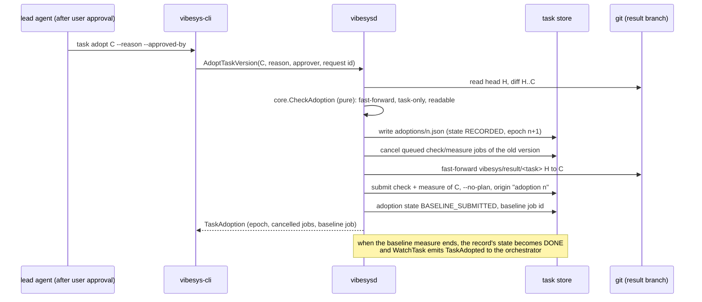

# Proposal: adopting a new task version during a run

This page is a design proposal for `vibesys-cli` and `vibesysd` (the CLI daemon). Nothing on it is
built yet. When a part lands, its facts move to the pages that own them (`cli/README.md` for the
commands and the store, the `vibesys:optimize` and `vibesys:state` skills for the agent rules) and
this page shrinks. When every part has landed, the page is deleted.

Terms used here, all from `cli/README.md`:

- The **task** is `.vibesys/tasks/<task>/` as a commit holds it: manifest, `objectives.toml`,
  checker, benchmark and `Dockerfile`.
- The **task version** is the digest of every file and link in that directory. A result is keyed
  by commit, task version, schema version and environment, so results of two task versions are
  never pooled or compared.
- The **result branch** is `vibesys/result/<task>`. Only `promote` moves it, and only forward.
  Its head's tree holds the task that every candidate is measured under.
- A **run** is one optimization (`VIBESYS_RUN`). Its store is shared per repository and task, not
  per run.

## Problem

A multi-day optimization campaign on a Trainium2 TTS-serving task took 3 to 4 hours for one
`measure`, so the campaign could afford about 6 measures a day across all workers. Partway through
the 78-hour campaign, the user approved shortening the benchmark's sweep. That edit is a change under `.vibesys/tasks/<task>/`, so:

1. **It could not be measured.** `submit check|measure` refuses a commit whose task differs from
   the result branch head's, with a `conflict` that names the paths
   (`cli/internal/app/flows.go:refuseChangedTask`). The only commit that would pass that check is
   the head itself.
2. **It could not be promoted.** `promote` needs a `better` verdict of the new commit against the
   head. Every saved result of the head is under the old task version, so the comparison is
   refused as `stale`. Nothing can be `better` than a head under a version nobody measured it
   under.
3. **So the branch was recreated.** The only way forward was to move or recreate
   `vibesys/result/<task>` with git. The `vibesys:optimize` skill forbids this ("never check it
   out or create it again after it exists"). The daemon treats a branch moved by hand as
   *diverged*: it does not write over it, and it records no promotion for it.
4. **History lost its link.** After the switch, each plan's linked jobs held numbers under the old
   version with nothing saying they were superseded. `plan view --json` gives a linked job no
   `verdict`, which reads the same as "not measured". The frontier dropped its members
   (`retired`), and the store had no record of why, when, by whom, or which commit carried the
   change. A chart of the head's number shows a jump at the switch that is the benchmark
   changing, not the code.
5. **Queued work is wasted.** A measure already queued for a candidate built on the old head
   still runs for hours under the old version, and its result can never be compared with the new
   head.

The same campaign also measured with worker agents competing for the host; that is the subject of
[daemon-owned host work](host-work-ownership.md).

The campaign needed a supported path that keeps the branch's history and the store's records
intact, and makes the change of yardstick a recorded fact.

## Goals

- One command adopts a new task version on the result branch, with a stated reason and approver.
- The new head gets a baseline measurement under the new version without anyone asking.
- `compare`, `promote` and `frontier add` keep refusing to mix versions, and their refusals say
  which adoption superseded the old numbers.
- `show`, `plan view`, `result` and the orchestrator's projection keep old results readable,
  each labeled with the task epoch it belongs to.
- Queued and running jobs, open plans and frontier members have a defined fate.
- The store records each adoption durably and survives a crash between its steps, as promotion
  does.

## Non-goals

- Converting old numbers to the new version. The daemon never treats a result under one task
  version as evidence under another. It may show a ratio between the two for people, labeled as
  such (the bridge, below).
- Letting agents change the task. The rule that a worker never edits `.vibesys/` stays. Adoption
  is an operator decision that an agent may carry out only after a person approves it.
- Changing the result branch name, or keeping a second branch per version.
- Rewriting history or the store's older records.

## Design

### The model: task epochs

A **task epoch** is a stretch of the result branch's history during which one task version is in
force. The epoch starts when the branch is created (epoch 1, with the task the base commit holds)
and changes only through an adoption. Epochs are numbered by the daemon and never renumbered.

The epoch of a result is derived, not stored on it: it is the epoch whose task version the
result's task version equals. A version that comes back (an adoption that reverts an earlier
change) starts a new epoch with the old version, and results under that version pool again, as
they do today, because the measurement is the same.

### The command

```text
vibesys-cli task adopt <commit> --reason <text> --approved-by <text> [--cancel-running] [--json]
```

The daemon accepts the commit only when all of these hold. It checks all of them and reports
every one that fails, as `promote` reports every refusal reason.

| Rule | Refusal kind |
| --- | --- |
| The commit contains the current head (a fast-forward). | `not_descendant` |
| Every change from the head to the commit is under `.vibesys/tasks/<task>/`. | `changes_outside_task`, naming up to 10 paths |
| The commit changes the task (its task version differs from the head's). | `no_task_change` |
| The task at the commit reads, with every rule `submit` applies. | `task_unreadable`, with the reader's message |
| No other adoption of this task is in progress. | `adoption_in_progress`, naming it |

Requiring "only task files" keeps an adoption from smuggling code past the judge: the head's code
and the new head's code are identical, which is also what makes the bridge meaningful.

The command is a daemon call (`AdoptTaskVersion`). The CLI only parses and prints.

### The sequence

Adoption follows the pattern promotion already uses (`core.NextPromotionStep`). A pure function,
`core.NextAdoptionStep(record, head, jobs)`, names the next effect from the adoption record and
what the daemon sees. The daemon performs that effect and asks again. A crash at any point leaves a
state the same question answers. The record is written first, so the branch is never ahead of the
record.



| Step | Effect | Idempotent because |
| --- | --- | --- |
| record | Write `adoptions/<n>.json` with state `RECORDED`. | The request id is deduplicated, and a second adoption is refused while one is open. |
| cancel | Cancel queued check and measure jobs whose task version is not the new one, with the cancel reason `task_version_superseded`. With `--cancel-running`, cancel running ones too. | Cancelling a final job changes nothing. |
| move | Fast-forward the branch from `H` to `C`. | The step compares the branch with `H` and `C` first. |
| baseline | Submit a check and a measure of `C` with `--no-plan` and the task's default samples. | A measure of the same commit, task version and environment joins the existing job (`CanJoin`). |
| done | When the baseline measure ends, set the state to `DONE`, or to `BASELINE_FAILED` with the job id. | A pure fold of the job's final state. |

A branch someone moved by hand during an adoption is diverged, as for promotion: the adoption
stops at that step and `task adoptions` reports it.

### Fate of other work

| Item | What happens | Why |
| --- | --- | --- |
| Queued check and measure jobs under the old version | Cancelled with `task_version_superseded`. | Their results could never be compared with the new head. In the campaign, each one cost 3 to 4 hours. |
| Running jobs under the old version | Left to finish by default; their results are saved and labeled with the old epoch. `--cancel-running` cancels them. | Cutting a 3-hour measure 2 hours in throws away evidence that is still readable. The default is open (see Open questions). |
| Command jobs | Untouched. | They are never scored. |
| A new submission of a commit with the old task | Refused as today, and the message names the adoption: `the task was changed by adoption 2 at <commit>; rebase onto it`. | The existing check (`refuseChangedTask`) already refuses it. |
| Open and chosen plans | Statuses unchanged. `PlanView` marks each linked job with its epoch, and a job of an earlier epoch with `superseded_by_adoption`. | A plan is still a valid idea. Its evidence is under the old yardstick, and the reader is told so. The daemon writes no comment: comments are the agents'. |
| Workers' candidate branches | Unchanged. A candidate must be rebased onto the new head before it is measured: its tree holds the old task, so `submit` refuses it, and `promote` already refuses a commit that does not contain the head. | The `vibesys:combine-candidates` skill already rebases a candidate onto a head. |
| Frontier (multi-objective tasks) | Members are retired, as a task switch already retires them, and the adoption record lists them. A rebased member is offered again with `frontier add`. | A member's commit holds the old task, so it cannot be measured under the new one without a new commit. The daemon does not make commits. |
| Declared bounds | Kept, and each one is shown with the epoch it was declared in. | A bound is derived from the hardware, not from the benchmark. It may need a new declaration when the workload changed, which the agent decides. |

### What reads show

- `result`: before the baseline ends, `NO_CURRENT_RESULT_REASON_REBASELINING`, naming the
  baseline job and the adoption. That replaces the bare `head_not_measured`, so a lead waits
  instead of submitting a duplicate measure.
- `show <commit>`: already prints one line per task version. Each line gains its epoch number and,
  for an earlier epoch, `superseded by adoption n`.
- `compare` and `promote`: the `stale` reason names the adoption that superseded the version, and
  the commit to rebase onto.
- `task adoptions [--json]`: every adoption, oldest first, with its reason, approver, origin,
  changed paths, cancelled jobs, baseline job and state.
- The orchestrator's search projection: each objective's measured history carries the epoch of
  each point, so a chart draws one series per epoch and marks the adoption, instead of drawing a
  jump as if it were a gain.

### The bridge

The new head `C` has the same code as the old head `H`. Once `C`'s baseline ends, the daemon can
derive, per objective, the old head's number under the old version, the same code's number under
the new version, and their ratio. That **bridge** shows people how much the yardstick moved. It is
computed when read, from saved results, and never stored, so it has one source of truth. It never
enters a verdict, a promotion or the frontier. Showing it as an annotation on a chart is enough to
keep a progress report honest across the switch.

### Who may adopt

Changing the benchmark mid-run can make every later number look better without any code getting
faster. It is a trust-boundary decision, and an agent must not take it on its own.

- **Enforced:** the rules in the table above (task files only, fast-forward). Nothing else can
  enter through an adoption.
- **Recorded:** `reason`, `approved_by`, and the call's `RecordOrigin` (run, agent, daemon time).
  The record cannot be edited later.
- **Advisory:** that a person actually approved it. Run and agent identity is stated by the caller
  and not authenticated (as for plans), so `--approved-by` is a claim. The `vibesys:optimize` skill
  gains a rule: adopt only after the user approves in so many words, and quote the approval in
  `--approved-by`. When the orchestrator runs the search, the operator's control inbox can carry an
  `adopt_task` control so that the approval comes from the operator's channel and not from the
  agent; see Open questions.

### Interfaces

Sketches. Field numbers and validation are indicative. The final messages go through the `proto`
check group.

```proto
// adoption.proto
enum AdoptionState {
  ADOPTION_STATE_UNSPECIFIED = 0;
  ADOPTION_STATE_RECORDED = 1;            // record written; branch not moved yet
  ADOPTION_STATE_MOVED = 2;               // branch at the new head; baseline not submitted
  ADOPTION_STATE_BASELINE_SUBMITTED = 3;
  ADOPTION_STATE_DONE = 4;                // the baseline measure succeeded
  ADOPTION_STATE_BASELINE_FAILED = 5;     // the new task does not run: the lead stops and reports
  ADOPTION_STATE_DIVERGED = 6;            // the branch was moved by hand mid-adoption
}

message TaskAdoption {
  uint64 seq = 1 [(buf.validate.field).uint64.gt = 0];   // n: epoch n+1 starts here
  uint64 epoch = 2;
  string previous_head = 3;
  string head = 4;
  string previous_task_version = 5;
  string task_version = 6;
  repeated string changed = 7;              // task-relative names of what changed
  string reason = 8 [(buf.validate.field).string = {min_len: 1, max_len: 4000}];
  string approved_by = 9 [(buf.validate.field).string = {min_len: 1, max_len: 500}];
  RecordOrigin origin = 10 [(buf.validate.field).required = true];
  AdoptionState state = 11;
  repeated string cancelled_job_ids = 12;
  string baseline_check_job_id = 13;
  string baseline_measure_job_id = 14;
  repeated FrontierMember retired = 15;
}

enum AdoptRefusalKind {
  ADOPT_REFUSAL_KIND_UNSPECIFIED = 0;
  ADOPT_REFUSAL_KIND_NOT_DESCENDANT = 1;
  ADOPT_REFUSAL_KIND_CHANGES_OUTSIDE_TASK = 2;
  ADOPT_REFUSAL_KIND_NO_TASK_CHANGE = 3;
  ADOPT_REFUSAL_KIND_TASK_UNREADABLE = 4;
  ADOPT_REFUSAL_KIND_ADOPTION_IN_PROGRESS = 5;
}

message AdoptRefusalReason {
  AdoptRefusalKind kind = 1;
  string message = 2;
}

// service.proto
rpc AdoptTaskVersion(AdoptTaskVersionRequest) returns (AdoptTaskVersionResponse);
rpc ListAdoptions(ListAdoptionsRequest) returns (ListAdoptionsResponse);

message AdoptTaskVersionRequest {
  CallContext context = 1;
  string commit = 2;
  string reason = 3;
  string approved_by = 4;
  bool cancel_running = 5;
  string request_id = 6;                    // deduplicated, as every write
}

message AdoptTaskVersionResponse {
  oneof outcome {
    TaskAdoption adopted = 1;
    AdoptRefusal refused = 2;               // every reason that applies
  }
}

message ListAdoptionsResponse {
  repeated TaskAdoption adoptions = 1;
  repeated TaskBridge bridges = 2;          // derived when read, one per finished adoption
}

message TaskBridge {
  uint64 adoption_seq = 1;
  repeated BridgeObjective objectives = 2;  // old head under old version, same code under new
}

// Additions to existing messages
// NoCurrentResultReason: NO_CURRENT_RESULT_REASON_REBASELINING, with the adoption and job named.
// LinkedJob (plan.proto): uint64 epoch; uint64 superseded_by_adoption.
// WatchTask facts: TaskAdopted { TaskAdoption adoption }.
```

### Owner and data flow

| Piece | Owner | Notes |
| --- | --- | --- |
| `CheckAdoption`, `NextAdoptionStep`, epoch of a task version | `cli/internal/core` | Pure: no clock, no I/O, as `NextPromotionStep` is. |
| `adoptions/<n>.json`, epoch lookup | `cli/internal/store` (`Store` interface), `ledger`, `filestore`, `memstore` | Store format 10 to 11. A store of format 10 opens with no adoptions, every result in epoch 1. A program of format 10 refuses a store of 11, so it never ignores an adoption. |
| The sequence and the cancel step | `cli/internal/app` | Runs the pure step function and performs the effect, as for promotion. |
| Command and printing | `cli/cmd/vibesys-cli` | Parses, calls, prints. |
| Skill rules | `vibesys:optimize`, `vibesys:state`, `vibesys:measure` | "Ask the user, then `task adopt`, then wait for the baseline; never recreate the branch." |
| Epoch-aware charts | orchestrator projection, desktop app | Reads `epoch` from the projection; computes nothing. |

Data flows one way: the CLI calls the daemon, the daemon writes the store and moves the branch,
and the orchestrator learns of the adoption from `WatchTask` like any other fact.

## Alternatives considered

- **Keep recreating the branch by hand, and document it.** That is what the campaign did. It
  leaves no record, makes the daemon see a diverged branch, and keeps the rule against touching
  the branch unenforceable.
- **Let `promote` accept a task-only change with no verdict.** That puts two meanings on one
  command and makes "promoted" stop meaning "measured better". An adoption is a different fact
  and deserves its own record.
- **Re-measure every old result under the new version automatically.** In the campaign that would
  have cost 3 to 4 hours per commit. The head is the only commit that needs a number to go on,
  and it is the only one measured. A lead that wants a candidate's number under the new version
  rebases it and measures it.
- **Normalize old numbers by the bridge ratio and keep comparing.** A shorter sweep changes which
  operating points are weighted, not just the scale, so one ratio does not carry across code
  changes. The bridge is shown, never used.
- **Key results by an "approved equivalent" version.** That lets a person declare two versions
  comparable. It is the same as normalizing, with a weaker record.
- **One result branch per task version** (`vibesys/result/<task>@<n>`). Every reader of the branch
  name would change, and the history of the code would be split across branches for a change that
  touched no code.

## Migration and rollout

1. Store format 11 and the core functions, with the store contract suite extended to adoptions,
   and crash tests that cut every effect of the sequence before and after it took place, over the
   in-memory filesystem and the fake repository, as promotion's tests do.
2. `task adopt`, `task adoptions`, the new `result` reason and the `stale` message. Store format 10
   stores open unchanged. A campaign that already recreated its branch has a single epoch and
   keeps working.
3. Skill rules in `vibesys:optimize` and `vibesys:state`, in the same release as the command, since
   a skill must not name a command the installed CLI lacks.
4. Epoch-aware projection and charts in the orchestrator and the desktop app.
5. Optional: the operator `adopt_task` control.

## Effort

| Part | Estimate |
| --- | --- |
| Core rules, sequence and store format 11, with tests | 1.5 engineer-weeks |
| Daemon RPCs, CLI commands, read changes (`result`, `show`, `plan view`, `stale` message) | 1 engineer-week |
| Skill rules and their evaluation | 2 to 3 days |
| Projection and chart epochs | 1 engineer-week |

## Open questions

- Should running old-version jobs be cancelled by default? Keeping them preserves evidence;
  cancelling frees the machine for the baseline hours earlier. The campaign would have preferred
  cancelling, because the baseline was what the next decisions needed.
- Should the baseline take more samples than the task's default, since every later verdict leans
  on it?
- Should an adoption require the orchestrator's operator channel when a run is managed, instead of
  `--approved-by` text?
- Should declared bounds be marked for review after an adoption that changes the workload, not
  only the sample count?
- Should the frontier offer to carry members over when the adoption changed only `samples` or the
  noise floor? Those keys change the version but not what one sample measures.
