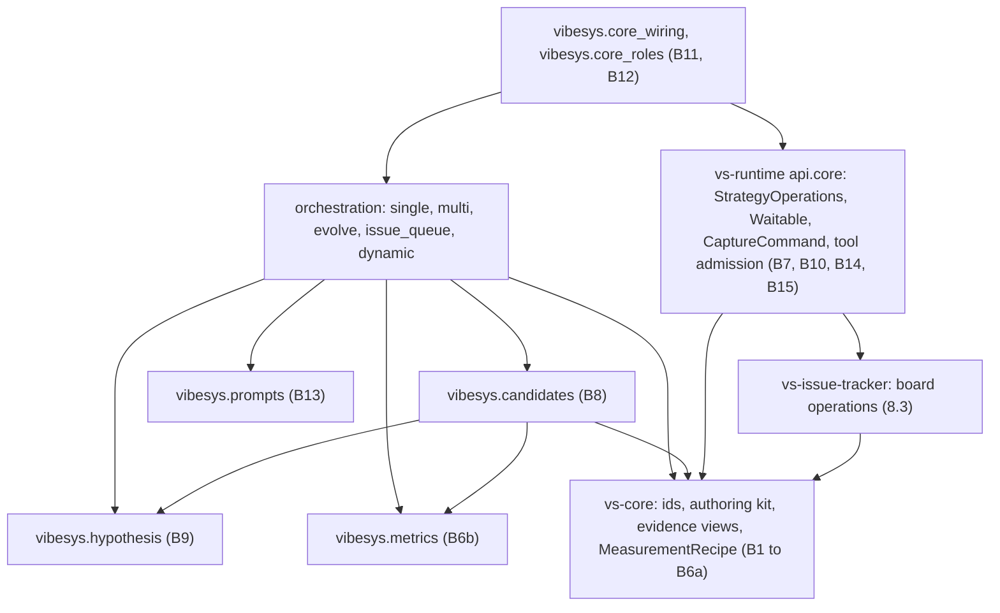

# Running single, multi, evolve and issue_queue on the vs-core lifecycle

Design for issue #1953, phase 1 of roadmap #1952. This note maps the four strategies that
still run as imperative loops (`single`, `multi`, `evolve`, `issue_queue`) onto the pure
`vs-core` lifecycle that `dynamic` already uses. It changes no code. Where a statement is a
decision, it is written in the present tense as the design; where a part does not exist yet,
the status table in section 1.3 says so, and section 11 lists what needs the maintainer's
answer.

## 1. Scope, vocabulary and status

### 1.1 What is being ported

| CLI selection | Plugin id (persisted in the run manifest) | Strategy package | Legacy entry |
|---|---|---|---|
| `--outer-loop agent --inner-loop single-agent` | `single-agent` | `orchestration/single` | `orchestrate` |
| `--outer-loop profile-guided --inner-loop single-agent` | `profile-guided-single-agent` | `orchestration/single` | `orchestrate_profile_guided` |
| `--outer-loop agent --inner-loop multi-agent` (default) | `multi-agent` | `orchestration/multi` | `orchestrate` |
| `--outer-loop profile-guided --inner-loop multi-agent` | `profile-guided-multi-agent` | `orchestration/multi` | `orchestrate_profile_guided` |
| `--outer-loop evolve` | `evolve` | `orchestration/evolve` | `orchestrate` |
| `--outer-loop plain` | `plain` | `orchestration/issue_queue` | `orchestrate` |
| `--outer-loop dynamic` | `dynamic` | `orchestration/dynamic` | already on core |

The mapping is made in `entrypoints/cli/loops.py` (`_agent_policy_descriptor`,
`_plain_policy_descriptor`, `_evolve_policy_descriptor`). It does not change: every port keeps
its CLI selection, its plugin id and `config_version`, and its option names (section by
section below). A preset that differs only by options stays one strategy class with two
plugin registrations, as it is today.

### 1.2 Vocabulary

Readers who know the product but not `vs-core` need these terms.

- **Strategy**: a pure object with `decide(view) -> Proposal` (the next ordered decisions plus
  the new strategy state) and `on_event(view, event) -> state`. No clock, I/O, asyncio or
  randomness: time comes from `view.run.now_at`, and any randomness is a seeded generator
  state stored in the strategy state.
- **CoreView**: the read-only projection of core state that a strategy sees (attempts,
  sessions, measurements, settlements, controls, adoption).
- **Decision**: what a strategy asks for: `RequestTurn`, `StartAttempt`, `Measure`,
  `Withdraw` (with a `Settle` disposition), `ProposeWinner`, `Stop`, `Operation`. Each has a
  `DecisionId` the strategy derives from its own state, so a replay re-proposes the same id and
  core deduplicates it by id and payload digest.
- **Attempt**: the unit of candidate work. It owns one concurrency slot, a workspace (an
  isolated child of a base revision, or the exclusive run root), a budget and a session scope,
  and it ends in exactly one **settlement** (assessments, `eligible`, `retention`, outcome).
- **Operation**: a strategy-declared request for I/O that is not a turn or a measurement
  (render a prompt, verify a revision, read evidence). An owner in a library executes it; the
  outcome returns as `OperationResult`.
- **Adoption**: publishing the selected retained candidate as a commit on a run-owned
  publication branch. Core runs it after `ProposeWinner` and reports `AdoptionResult`,
  including the published commit. Publication never changes the operator's files or index.
  An independent optional step fast-forwards only the run's own clean checked-out branch;
  another branch, dirty tree, divergence or Git's overwrite refusal produces a typed skip.
  Git protects untracked and ignored files. Repeating adoption reuses its publication,
  including after a resume. Shared Git and workspace contract suites enforce these rules.
- **Suspension**: a turn that ends by waiting for an evaluation job. Core publishes
  `TurnSuspended`, later `ResumeAuthorized` once, and the strategy asks the resumed turn.
  If the turn's workspace checkpoint is declined or fails, core instead ends the turn with
  `YieldPublicationFailed` (a named reason) and the strategy treats it as a failed turn.
  If the evaluations end in an attempt history that can never back a resume, core ends the
  wait with `ResumeRefused` (a named reason) instead of `ResumeAuthorized`.
- **Shell**: the async host in `vs-runtime` that executes core's requests and feeds outcomes
  back as events. **Durable boundary**: one atomic commit of state plus the records it implies.

Core events the strategies fold, with the consequence of each: `AttemptReady` (slot and
workspace held, begin turns), `TurnResult` (reply or typed failure), `TurnSuspended`, `YieldPublicationFailed`,
`ResumeAuthorized` and `ResumeRefused` (wait, failed wait, resume, and refused resume), `MeasurementResult` (trusted evidence ids),
`OperationResult`, `AttemptExhausted` (budget spent), `AttemptSettled`, `AdoptionResult`,
`RequestBlocked` (effect unknown), `Rejected` (decision refused), `ControlChanged` (operator
stop), `RunEnded`.

### 1.3 Status

| Part | Status | Phase |
|---|---|---|
| Core lifecycle, attempts, settlement, adoption, suspension, exclusive root, `wip` retention | built (`vs-core`) | n/a |
| Agent evaluation tool bridge, per-candidate budgets, the `waiting_for_evaluation` reply (declared privately in `dynamic`) | built (`docs/design/core-agent-evaluation-bridge.md`) | n/a |
| `dynamic` on core, its scenario, recovery-matrix, liveness, chaos and smoke tests | built | n/a |
| Tests of assumptions A1 to A4 (section 11) | built; A2 and A4 hold since B16, A3 holds since B15 (section 11.1) | 2 |
| Decision transcript test of `dynamic` (3.4) | built (`test_decision_transcript.py`, 96 scenarios) | 2 |
| Exclusive-root executor fixes (B16, section 3.1) | built (`test_exclusive_root_attempts.py`); prerequisite of every port that runs without candidate sandboxes | 2 |
| Shared building blocks B1 to B15 (section 3) | built, with `dynamic` moved onto each (section 3.6); B9 and B13 were built with the `single` port | 2, 3 |
| Promoted runtime shell test kit (T1) and plugin-keyed loop harness (T2) | T1 built (`vs_runtime.api.testing`); T2 is a seam (3.6) | 2 |
| Strategy conformance suite C1 to C9 (9.2) | built (`tests/system`, on the skeleton search); `dynamic` and `single` are its subjects | 3 |
| `CaptureCommand` operation (profile-guided attribution, B14) | contract and owner built; no strategy uses it yet | 3 |
| Immutable hypothesis state, or the JSON-field bridge (8.4) | JSON-field bridge built (`vibesys.hypothesis.rounds`); immutable state is phase 6 | 3 |
| `single` and `profile-guided single` strategy | built (section 9.3 records the outcome) | 3 |
| Issue-tracker operations and `FakeIssueTracker` contract suite | built (`vs_issue_tracker.api`: `ReadBoard`, `ApplyIssueChanges`, `LogProgress`, keyed writes, `FakeIssueTracker`; owner `vs_runtime.IssueBoardOwner`) | 3 |
| `issue_queue` strategy | built (section 7.8) | 3 |
| `ValidateLocal` operation (`vs_core.api.ValidateLocalBase`, owner `ValidateLocalOwner`) | built | 4 |
| `multi` and `profile-guided multi` strategy (section 9.5.1 records the outcome) | built | 4 |
| Immutable population state, `ExportPatch` operation, `evolve` strategy (section 9.6.1 records the outcome) | built | 5 |
| Removal of the legacy loop runtime and evaluation service | unbuilt | 6 |
| Limits extension for a resumed run with a larger round budget | issue #2013 (Q3) | n/a |

### 1.4 Rules every port follows

These restate `CLAUDE.md` and `software-design` for this work; the sections below apply them.

1. `decide` and `on_event` are pure functions of strategy state, `CoreView` and static config.
   Config is an input, not state: restarting with the same options reproduces every decision.
2. Strategy state holds only policy memory that core cannot know. Lifecycle and accounting
   facts (attempt phases, slot use, charges, session phases, the evidence ledger,
   settlements) are read from `CoreView`, never copied. Where a copy is unavoidable (a round
   record keeps the metric rows it accepted) the copy is of a fact core already committed and
   a property test checks the two agree.
3. One external fact is one event. Live execution, recovery inspection and replay all fold
   the same event through the same code.
4. Every agent reply is parsed at the boundary into a typed model that rejects unknown keys.
   An option the run does not offer is absent from the schema.
5. Agent-bound text is rendered from templates through the render operation. Python passes
   data, never prompt text.
6. State is a tree of strict, frozen, tuple-only `Value` models, so it passes
   `validate_immutable_schema` and round-trips through the envelope codec.
7. Role ids are `<strategy>-<role>` (`single-implementer`), declared by the plugin, and an
   `[agent.roles.<id>]` model override in `agent.toml` is keyed by exactly that declared id.
   An override that names an undeclared id, including a legacy id such as `implementer`, is
   refused before the run opens with an error naming `agent.roles.<id>`. This is how
   `dynamic` works today (design question Q6; pinned by
   `tests/vibesys/orchestration/dynamic/test_role_overrides.py`), and each port follows it
   without a legacy alias. The cost is that a user's existing `[agent.roles.implementer]`
   entry must be renamed when the run moves to the ported strategy; the refusal names the key.

## 2. What `dynamic` already does

`dynamic` is the worked example. (Update: `dynamic` has since been rewritten as a flow in
`search/`, with its state machine deleted; the pieces listed below describe the state-machine
form the other ports started from. See `docs/contributing/flows.md`.) At the time of this
analysis `strategy/` held the pure strategy, `core_policy/` held limits, reply schemas,
projection and prompts, and `src/vibesys/dynamic_core.py` plus `dynamic_roles.py` did the thin
wiring. One workstream is one attempt.

| Step of one workstream | Decision or request | Answering event |
|---|---|---|
| verify the parent revision | `Operation(VerifyParentRevision)` | `OperationResult(ParentVerification)` |
| start | `StartAttempt(ISOLATED_CHILD, base=parent, budget)` | `AttemptReady` |
| render the role prompt | `Operation(RenderRoleArtifacts)` | `OperationResult(RenderedArtifacts)` |
| implement | `RequestTurn(paid, WRITE_CANDIDATE)` | `TurnResult`; optionally `TurnSuspended`, `ResumeAuthorized` |
| read the checkpoint | none (candidate is `turn_candidate(view, ...)`) | the view shows the retained revision |
| review | `RequestTurn(free, READ_ONLY)` on the candidate | `TurnResult` |
| measure | `Measure(accuracy -> benchmark)` | `MeasurementResult` |
| read evidence | `Operation(InterpretEvidence)` | `OperationResult(EvidenceReadings)` |
| settle | `Withdraw(attempt, Settle(...))` | `AttemptSettled` |
| select and finish | `ProposeWinner`, then `Stop(drain)` | `AdoptionResult`, `RunEnded` |

The pieces the ports reuse, by file in `src/vibesys/orchestration/dynamic/search/`:

- `_draft.py`: `Draft` (ordered decisions, state update, earliest wake time) and the pure
  builders `run_scope`, `attempt_scope`, `session_for`, `request_turn`, `measurement_plan`.
- `_ids.py`: the identity grammar (`component` percent-encoding, id constructors, the inverse
  of core's `operation:<decision>` identity).
- `_state.py`: `Step` (NEEDED, RENDERING, RENDERED, AWAITING, SUSPENDED, RETAINING),
  `TurnRecord` (charge, corrections, drops, backoff, yield, resume), `RunPhase`, the baseline,
  hypothesis, round and winner records.
- `_attempt_events.py`: correction, lost-turn re-ask with backoff, yield and resume, the
  held-reply-until-checkpoint rule (`RETAINING`), failure with slot refund, exhaustion.
- `_settlement.py`, `_baseline.py`, `_run.py`: assessments and eligibility, the one input
  measurement, winner choice and the SEARCHING, SELECTING, ADOPTING, STOPPING, FINISHED flow.
- `_evidence.py`, `_rows.py`, `_operations.py`: trusted-evidence filtering, decoded metric
  rows, the four operation contracts.

What `dynamic` does not need and the ports do:

1. A serial search that continues one hypothesis across rounds, with cadence-based review and
   official evaluation (provisional candidates that no framework measurement covers).
2. Run-scoped turns that write agent memory (the designer's roadmap) rather than only reply.
3. A trusted command run for profile-guided attribution, and the trusted local-validation run.
4. Roles that use a profiler diagnostics tool (core refuses every tool except `evaluation`
   today; `src/vibesys/run/core_services.py`, `_refuse_unbridged_tools`).
5. A population policy with a seeded generator, concurrent children, and admission in slot
   order.
6. An external work source (the issue board) that agents also change.

## 3. Shared building blocks

Rule for placement: generic lifecycle protocol (what a correct caller of core must do) lives
in `vs-core`; mechanism another product on `vs-runtime` would need lives in a library;
VibeSys policy that two or more strategies share lives in a package beside
`vibesys.orchestration` that never imports it (`architecture.md`); strategy-specific code stays
in its strategy package. Only blocks with two or more users are listed. "Today" says where the
code sits in `dynamic`.

### 3.1 Table

| # | Block | Today | Owner | Users | `dynamic` must |
|---|---|---|---|---|---|
| B1 | Identity grammar: `component`, `IdScheme(namespace)` for decision, invocation, session, attempt and item ids, and the inverse of `operation:<decision>` | `dynamic/search/_ids.py` (hard-coded `dyn`) | `vs_core.api.ids` (core defines the identity rules and the `operation:` form) | dynamic, single, multi, evolve, issue_queue | use `IdScheme("dyn")`; a test pins that every id is byte-identical to today's |
| B2 | Decision builders and `Draft[S]`: scopes, `TurnShape`, `request_turn`, `operation`, `session_for`, `workspace_for`, `due(turn)` and wake time | `_draft.py` | `vs_core.api.authoring` (pure, no policy) | all five | keep only its prompt-specific `render_request` |
| B3 | `MeasurementRecipe`: evaluator, workload and environment digests, recipe artifact, ordered stages with budgets, queue allowance, submission limit; `plan(candidate, purpose, now_at)` | `_draft.measurement_plan` and `AgentEvaluationPolicy.plan` in `vs-runtime` (two copies of one fact) | `vs_core.api.evaluation` | dynamic, single, multi, evolve, and the runtime agent bridge | delete its copy; the bridge's `AgentEvaluationPolicy` wraps the same value |
| B4 | `TurnChain[C]`: charge class, corrections, lost-turn re-ask with doubling backoff, yield, suspend, resume, `chain_length(...)` for limits. `C` is the strategy's prompt-context type, so core keeps no prompt knowledge | `TurnRecord` in `_state.py`; `_correct`, `_ask_again`, `_yielded`, `on_suspended`, `on_resume` in `_attempt_events.py`; `_planner.py` | `vs_core.api.authoring` (the protocol rules: a resume is asked once, a correction names its predecessor) | all five | replace its `TurnRecord` and handlers |
| B5 | `AttemptTrack`: attempt id and generation, `ready`, `Step`, `awaiting`, `settle_sent`, failure, stop handling, refund rule (an unadmitted attempt that fails refunds its slot, an admitted one must settle), hold-reply-until-checkpoint (`RETAINING`) | `AttemptRecord` fields and `fail`, `on_ready`, `on_exhausted`, `on_blocked`, `on_rejected`, `settle_retained` | `vs_core.api.authoring` | all five | embed an `AttemptTrack` in `AttemptRecord` |
| B6a | Evidence views: `trusted_keys`, `ledger_refs`, `turn_candidate` | `_evidence.py` | `vs_core.api.evidence_views` (pure functions of core types) | dynamic, single, multi, evolve | import them |
| B6b | Decoded readings: `MetricRow`, `PartialRow`, `AcceptedReading`, `reading_of`, `accept_readings` | `_rows.py`, `_evidence.py` | `vibesys.metrics` (shared policy sibling) | dynamic, single, multi, evolve | import them |
| B7 | `StrategyOperations(namespace, context_type)`: registrations, schema refs and runtime role mapping for render, verify, interpret and retain | `_operations.py`; `_ROLE_OF_KIND` in `dynamic_core.py` | `vs_runtime.api.core` (it owns `OperationRole` and the owners) | all five | build from the kit with namespace `dynamic`, so the persisted kind names (`dynamic.render_role_artifacts`, ...) do not change |
| B8 | Candidate lifecycle policy: (a) `settle_for` (assessments, eligibility, retention, outcome), (b) the input baseline stage, (c) the run phases SEARCHING, SELECTING, ADOPTING, STOPPING, FINISHED with `choose_winner`, `selection_of`, `on_adoption` and the three run endings | `_settlement.py`, `_baseline.py`, `_run.py` | new package `vibesys.candidates` beside `orchestration` | (a): dynamic, single, multi, evolve; (b): dynamic, single, multi (evolve builds from a cold start); (c): all five | move the three modules; a small `CandidateConfig` carries the knobs they read |
| B9 | Hypothesis round machine: the serial hypothesis search glue for `HypothesisSearch` (next round, plan validation and one correction, `start` with parent and rollback base, cadence, `close_round`, `best`) and the `RecordInput` builder from core facts | `HypothesisSearch` exists; the glue is in `single/orchestration.py` and `multi/orchestration.py` (two near-copies) | `vibesys.hypothesis` | single, multi | none; it already shares `cadence` |
| B10 | `Waitable[R]`: reply union of a result and `waiting_for_evaluation`, with its discriminator | `ImplementerReply`, `JudgeReply`, `WaitingForEvaluation` in `dynamic/models.py` | `vs_runtime.api.core` (the bridge parses the same wire form) | all five | import it |
| B11 | Core-path role factory and capability sets (`CONTINUATION`, `MEASURING`, the evaluation tool) | `dynamic_roles.py` | `vibesys.core_roles` (thin product wiring) | all five | call the factory |
| B12 | Core wiring: store the evaluation recipe, read the evaluation identity, derive stage budgets and flags (`EvaluationInputs`), `agent_evaluation_policy`, the workspace-mode and sandbox check, plugin registration and `RuntimeRecordProjector` | `dynamic_core.py` | `vibesys.core_wiring` (thin product wiring) | all five | shrink to a caller |
| B13 | Core-protocol prompt templates and contexts: reply correction, resume, wait-unrecorded, agent-evaluation notes, environment notes, run context | `dynamic/core_policy/prompts/*.j2`, `strategy/_prompts.py` | `vibesys.prompts` (shared templates) | all five | import them |
| B14 | `CaptureCommand` operation: run a configured argv in a revision's workspace with a timeout and return bounded output | none; two copies of the legacy call in `single/attribution.py` and `multi/attribution.py` | contract in `vs_runtime.api.core`, owner in `vs_runtime` | single, multi (profile-guided) | none |
| B15 | Stateless tool admission: a role may name a tool server that holds no run state (profiler diagnostics) | none; `_refuse_unbridged_tools` rejects all but `evaluation` | `vs_runtime.api.core` (`AgentTool` declares its class), `vibesys.run.core_services` | multi, evolve, issue_queue | none |
| B16 | Exclusive-root executor: ending an exclusive-root attempt releases the root, and granting the root restores the plan's base while preserving the configured artifact directories (A2, A4) | none; `RuntimeWorkspaceRequests` rejects the discard of a root attempt and `_ensure_root` binds without restoring | `vs_runtime` workspace executor (`_workspace_requests.py`, `_workspace_receipts.py`) | single, multi, issue_queue (the serial strategies on a host without candidate sandboxes) | none (`dynamic` always uses isolated children) |
| T1 | Runtime shell test kit: `ScriptedExecutors`, `run_shell`, restart-at-boundary | `tests/vibesys/orchestration/dynamic/search/_shell.py`, `_executors.py`, `_run.py` (about 1,000 lines) | `vs_runtime.api.testing` | all five | import it |
| T2 | Whole-loop harness and invariants: `_harness.py`, `_chaos.py`, `loop_invariants.py`, smoke e2e | `tests/composition/dynamic/`, `tests/support/loop_invariants.py`, `tests/e2e/test_dynamic_loop_smoke_e2e.py` | `tests/system/` and `tests/support/` parametrized by plugin id | all five | become one parametrization |

### 3.2 Contracts of the blocks that carry new rules

- **B2/B4/B5 together are the strategy authoring kit.** It is pure and imports only core
  types. It is the answer to "cost per new strategy": a strategy declares its phases, its
  turn table and its settle policy, and gets correct handling of corrections, lost turns,
  suspension, checkpoints, refunds, stop and exhaustion without rewriting it. Each
  transition returns the new track and never proposes a decision; `decide` proposes, as in
  `dynamic` today.
- **B3** makes a trusted measurement and an agent's tool measurement share one identity by
  construction. `dynamic_core.py` already promises this in the docstring of its agent
  evaluation policy ("an agent measurement and a trusted one share one identity"), but two
  functions build the plan today and only a review keeps them equal.
- **B7** keeps one operation per runtime role. A strategy with its own namespace gets its own
  kinds, so two strategies never collide in one registry, while the request and outcome models
  and the runtime owners are the same code.
- **B8(a)** decides eligibility from evidence only: a candidate is winner-eligible when every
  configured gate has a trusted passed reading, review did not reject it, no failure is
  recorded, and it beats the baseline beyond noise (when a baseline was measured). A measured
  candidate whose accuracy passed is retained as a buildable parent even if its benchmark
  failed.
- **B15** narrows the existing refusal: `evaluation` is bridged, a stateless diagnostics
  server is admitted, and a server that writes run state (the issue board) stays refused until
  it is bridged or replaced (8.3).

### 3.3 Not extracted

Used by one strategy only, so they stay in that strategy: the parent catalog and portfolio
plan validation (`dynamic`), the population policy and selectors (`evolve`), issue-board
rendering and policy (`issue_queue`), and the pre-round decision and local validation
(`multi`).

### 3.4 Refactoring `dynamic`

The extraction is behavior-preserving and lands before any port, as separate refactor commits
(two hats). Evidence that nothing changed: the existing dynamic suite passes unchanged
(`test_scenarios`, `test_recovery_matrix`, `test_liveness`, `test_state_codec`,
`test_real_core`, `test_concurrent_shell`, the composition and chaos tests), plus one new
transcript test that runs the scenarios before and after and compares every decision id and
payload digest, because those ids are persisted in run envelopes.

### 3.5 Module direction

Arrows point from user to dependency. Every new module declares its edges in `tach.toml` in
the PR that adds it, and no edge points up. Modules named `vs_core.api.*` above are
re-exported by `vs_core.api`; callers import only the package API.

### 3.6 Phase 2 outcome

The blocks as built. Every row's `dynamic` use passed its whole suite and the unchanged decision
transcript golden (3.4) at the commit that introduced it.

| # | Status | Owner and public interface as built | PR |
|---|---|---|---|
| B1 | built | `vs_core.api`: `IdScheme(namespace, role_prefix)`, `component`, `attempt_id`, `item_id`, `attempt_ref`, `decision_of_operation` | #1973 |
| B2 | built | `vs_core.api`: `Draft[S]`, `run_scope`, `attempt_scope`, `declared_operation`, `workspace_for`, `session_for`, `TurnShape`, `request_turn`, `invocation_for`, `turn_decision_id` | #1977 |
| B3 | built | `vs_core.api`: `MeasurementRecipe`, `StageBudget`; `AgentEvaluationPolicy.from_recipe` and `.measurement` | #1977 |
| B4, B5 | built | `vs_core.api`: `TurnChain[C]`, `AttemptTrack[T]`, `Step`. `dynamic`'s records subclass them, so its persisted state keeps one flat shape | #1974 |
| B6a | built | `vs_core.api`: `trusted_keys`, `ledger_refs`, `turn_candidate` | #1973 |
| B6b | built | `vibesys.metrics`: `MetricRow`, `PartialRow`, `EvidenceReading`, `AcceptedReading`, `reading_of`, `accept_readings` (new `tach` edge to `vs_core`) | #1983 |
| B7 | built, owner moved | `vs_core.api`: `StrategyOperations`, the `*Base` request models and shared outcomes; `vs_runtime.api.core.operation_roles` maps them to `OperationRole`s | #1983 |
| B8 | built | `vibesys.candidates.api`: `CandidateConfig`, settlement (`settle_for`, `FinishedAttempt`), the input baseline (`propose`, `on_*`), the run phases (`choose_winner`, `proposal`, `stop`, `after_adoption`) | #1984 |
| B9 | built with `single` | `vibesys.hypothesis.rounds`: `Ledger`/`EncodedLedger` (two JSON strings in the strategy state), `next_round`, `planning`, `start`, `official_reason`, `pareto_conflict`, `note_attempt_failure`, `close_round(ClosingFacts)`, `archive_view`, `validate_plan` | #2022 |
| B10 | built, owner moved | `vs_core.api`: `Waitable[R]`, `WaitingForEvaluation`, `WaitingForDependency`; the agent-visible JSON schemas are unchanged | #1983 |
| B11 | built | `vibesys.core_roles`: capability sets, `RoleKind` presets, `core_role` | #1985 |
| B12 | built | `vibesys.core_wiring`: `ResolvedRun`, `EvaluationInputs`, `evaluation_inputs`, `agent_evaluation_policy`, `operation_catalog`, `require_candidate_sandboxes` | #1985 |
| B13 | built with `single` | `vibesys.prompts.core_protocol`: the six templates, `_revision.j2`, and the contexts `ResumePrompt`, `ReplyCorrectionPrompt`, `WaitUnrecordedPrompt`; `CorePolicy.prompt_fallback_roots`; `CORE_PROTOCOL_DIR` | #2022 |
| B14 | built | Contract `vs_core.api.CaptureCommandBase`, `CommandCapture` (optional member of `StrategyOperations`); owner `vs_runtime.api.core.CaptureCommandOwner`; role `OperationRole.CAPTURE_COMMAND` | #1992 |
| B15 | built | `AgentTool.stateless`; `StatelessToolServers`, `CombinedToolServers`; `CoreResources.stateless_tool_servers`; admission in `vibesys.run.core_services` | #1992 |
| B16 | built | by the workspace executor change that preceded this list | n/a |
| T1 | built | `vs_runtime.api.testing`: `ScriptedExecutors`, `Run`, `HostOptions`, `Script`, `request_executors`, on `vs_core.api.testing` (the host that drove them, `drive_shell`, went with the old shell; `vs_dst` hosts a world on the step loop) | #1993 |
| T2 | seam | `tests/support/loop_spec.py`: `LoopSpec` keyed by plugin id (CLI selection and envelope codec). The harness and chaos driver stay under `tests/composition/dynamic` until a second strategy draws the split | #1993 |

Why B7 and B10 are in `vs-core`, not `vs-runtime` as the table in 3.1 first said: the pure strategy
package may not import `vs-runtime` (the purity ratchet admits no new `io-import`), and these are
data contracts between a pure strategy and the runtime's executors. `vs-core` is the pure home both
can import; the runtime keeps the mapping from operations to the roles it performs.

## 4. Strategy: single (plain and profile-guided)

### 4.1 The loop today

`single` runs one hypothesis per round in the run's root workspace, serially. Per round: a
designer agent writes a plan (one correction on a bad plan); the framework starts the
hypothesis (parent commit, optional rollback to an earlier round's revision); one combined
agent implements, self-reviews and profiles in one reply, retried up to
`max_retries_per_round` times; the framework runs the official accuracy and benchmark gates
when the cadence says so; the round closes into a `RoundRecord`. At the end the best trusted
record is restored into the root. Memory is a set of files in the workspace (`roadmap/`,
`progress/`, a Pareto archive, plan JSON) written by the framework and read by the agents.
The profile-guided preset runs a configured attribution command before each plan and feeds
its ranked bottlenecks to the designer through `ProfileFocus`.

### 4.2 Mapping: loop step to core request and answering event

| Legacy step (`single/orchestration.py`) | Core decision or request | Answered by |
|---|---|---|
| `initialize`: load `SingleState`, adopt metric space, write files, commit | none: a fresh run is recovery over an empty log; initial strategy state | n/a |
| `control.checkpoint()` at each round | none; stop arrives as an event, pause is core admission control | `ControlChanged` |
| input baseline (`workspace.trusted_input_baseline`) | `Measure(purpose=baseline)` once (B8b) then `InterpretEvidence` | `MeasurementResult`, `OperationResult` |
| profile-guided: `run_attribution` | `Operation(CaptureCommand)` in run scope (B14) | `OperationResult`, then `ProfileFocus.observe` |
| designer turn, one correction on `InvalidPlanError` | `Operation(RenderRoleArtifacts)` then `RequestTurn(free, run scope, WRITE_ARTIFACTS)`; correction is `RequestTurn(charge=correction, predecessor)` | `OperationResult`, `TurnResult` |
| continue the active hypothesis (no designer turn) | none | n/a |
| `search.start`, `_apply_rollback` (`try_restore`) | `StartAttempt(ISOLATED_CHILD, base=parent revision, budget)`; rollback is the choice of `base`, so no restore can fail | `AttemptReady` or `Rejected` |
| `_mark_paid` then the combined turn | `RequestTurn(paid, WRITE_CANDIDATE)` after a render operation | `TurnResult`; wait: `TurnSuspended`, `ResumeAuthorized` |
| invalid reply, `TurnFailed`, verdict FAIL, then retry | next paid `RequestTurn` carrying the feedback, until `paid_invocation_limit` | `TurnResult`, then `AttemptExhausted` when spent |
| Pareto guard flips PASS to FAIL | pure, inside `on_event` | n/a |
| `official_due`, then accuracy and benchmark with `SettlingMeasurement` | `Measure(accuracy -> benchmark)` in the attempt scope; infrastructure failures are resubmitted by core within `submission_limit` | `MeasurementResult` |
| read the numbers | `Operation(InterpretEvidence)` | `OperationResult(EvidenceReadings)` |
| accuracy receipt reuse for an unchanged revision | strategy plans only the benchmark stage when the ledger already holds trusted accuracy evidence for that candidate | read from `view.measurements` |
| `_close_round`: snapshot, `build_round_record`, `close_round`, profile focus | `Withdraw(attempt, Settle(...))` after `turn_candidate` is visible | `AttemptSettled`, then the pure fold |
| `_finish`: best record, retain, restore | `ProposeWinner(RetainedCandidate)`, or a no-winner `Stop` | `AdoptionResult` |
| `conclude(run, ending)` | `Stop(drain, RunResultProposal)` | `RunEnded` |

### 4.3 State

`SingleStrategyState` (schema `single.strategy-state`, version 1), all frozen values:

| Field | Meaning |
|---|---|
| `phase`, `stopping` | `RunPhase` (B8c) and the operator-stop latch |
| `baseline` | `BaselineState` (B8b), measured once |
| `search_json` | the serialized `HypothesisState` (hypotheses, round records, profile guidance); decoded by the round machine (B9). See 8.4 for why it is a JSON field first |
| `planner` | designer track: `Step`, awaiting decision id, `TurnChain`, plan-correction count, last error |
| `round` | the one open round: number, hypothesis id, plan JSON, base revision, `AttemptTrack`, `work` phase, feedback, official reason, last combined response, evidence keys, accepted readings, `revalidation_required` |
| `notes` | warnings the run shows an operator (replaces `observations.warning`) |
| `unreachable` | a decision the strategy wants but core cannot take yet, with the missing contract named |

`work` phases: START, IMPLEMENT, MEASURE, INTERPRET, SETTLE, DONE. `Step` values are the
shared ones (B5). The round number is derived from the number of closed rounds, not stored.
Dropped from the legacy `SingleState`: `last_paid_attempt` (core's charge ledger records
each paid turn atomically with its dispatch), `accuracy_receipt` (the evidence ledger),
`last_response` (kept inside `round` only until the next designer prompt is rendered).

### 4.4 Candidates, attempts and adoption

- One round is one attempt, serial (`Limits.max_parallel = 1`). The workspace mode is
  `ISOLATED_CHILD` when the run environment can open candidate sandboxes and `EXCLUSIVE_ROOT`
  otherwise. B12 chooses once, in config. `dynamic` refuses environments without candidate
  sandboxes, but these loops run there today and must keep doing so. Today the executor cannot
  serve a serial `EXCLUSIVE_ROOT` run (assumption A2 is false, 11.1), so B16 comes first. The attempt budget is
  `paid_invocation_limit = max_retries_per_round`, `retry_limit = max_corrections +
  max_turn_drops`.
- A continued hypothesis starts a new attempt in the next round on the previous round's
  retained candidate (its parent if that round retained nothing), exactly as `dynamic` treats
  `continue_hypothesis`.
- A round that ran the official gates and passed settles `eligible` when review passed and,
  with a measured baseline, the headline beats it. A round no gate measured (its review was deferred) settles `eligible=False` with `retention="candidate"`: a
  buildable parent that can never be adopted (assumption A1, to verify in Phase 2: core accepts
  such a settlement and a later `StartAttempt` may use it as `base`). The fallback if core
  refuses is `retention="wip"`, and the last fallback is to measure every round.
- `single` declares no `LOCAL_VALIDATION` authority: the combined agent's self-review gates
  its own retries but is not independent evidence, so eligibility rests on the trusted
  gates (`required_assessments` = correctness, and benchmark when configured).
- Adoption happens once, at the end: `HypothesisSearch.best` over the closed records picks the
  record, and the strategy proposes the settlement id that record kept. No winner proposes the
  trusted baseline when it was measured, else a failed `Stop`. Core restores and verifies the
  root (replacing `restore`, `retain`, `snapshot`).

### 4.5 Roles and capabilities

| Role id | Access | Required capabilities | Tools |
|---|---|---|---|
| `single-orchestrator` (designer) | `LIMITED`, may write `roadmap/` | none | none |
| `single-implementer` (combined implement, review, profile) | `READ_WRITE` | `CONTINUATION` plus `MCP_SERVERS` | `evaluation` |

Only the combined agent runs candidate code, so it alone gets the evaluation tool and
mid-turn trusted evaluation in every environment; its reply type is `Waitable[...]` (B10).
The role ids are strategy-scoped like `dynamic-*`; see Q6 for per-role model configuration.

### 4.6 CLI options

Kept with the same names and meaning: `--max-rounds`, `--max-retries-per-round` (becomes
`paid_invocation_limit`), `--judge-every` (accepted, unused by `single`, as today),
`--constraint`, `--modality`, `--interface`, `--objective` and the
metric space, the profile-guided input from the bundle. `--max-in-flight`,
`--max-unmeasured-turns` stay documented as dynamic-only. `--turn-drop-backoff-seconds`
becomes a loop-wide option because a lost provider connection is now a strategy event for
every loop; its help text drops "Dynamic loop". Corrections (one) and drops (two) keep the
defaults the legacy `structured_turn` and runtime gave. `--max-rounds` growth on resume is Q3.

### 4.7 Crash and replay

Every transition is one event folded into state that commits atomically with its records, so
the legacy commit points (initialize, start hypothesis, checkpoint, close round) disappear.
After a crash the shell replays unfinished records under their recorded ids, the strategy is
rebound to the committed state, and `decide` re-proposes identical decisions, which core
deduplicates. Two cases need care and have properties (section 9): a reply delivered before
its checkpoint is visible is held (`RETAINING`) and must be acted on once; a designer plan
whose validation failed is corrected with a new serial, never the same id. Runs created by
the legacy loop cannot be resumed on the core path (as for `dynamic`,
`reject_legacy_resume`); the diagnostic code generalizes from the dynamic-only name.

## 5. Strategy: multi (plain and profile-guided)

### 5.1 The loop today

`multi` is `single` with four specialist roles. Per round: an optional profile-guided
attribution; a pre-round designer turn decides whether profile evidence is wanted; an
optional profiler turn writes evidence; a designer plan turn (fresh session, one correction);
`start`; then up to `max_retries_per_round` attempts of: implementer turn (one conversation
per hypothesis, a continuation prompt when `next_step` is set), a judge turn when the
cadence or a fresh Pareto claim requires it (fresh read-only session; Pareto guard), a
trusted local-validation run of the implementer's recipe file, approval of the candidate and
performance claims, and the official gates by cadence. It closes the round like `single`.

### 5.2 Mapping

Rows that match `single` (start, paid turn, official gates, interpret, settle, adoption,
stop) are the same decisions with `multi` roles. The differences:

| Legacy step (`multi/orchestration.py`, `turns.py`) | Core decision or request | Answered by |
|---|---|---|
| pre-round turn (`PreRoundDecision`) | `RequestTurn(free, run scope)` by `multi-orchestrator` | `TurnResult` |
| profiler turn (`ProfilerSummary`), failure is advisory | `RequestTurn(free, run scope, READ_ONLY)` by `multi-profiler`; a failed turn becomes a note and the plan proceeds | `TurnResult` |
| plan turn and correction | as `single` | `TurnResult` |
| implementer turn, continuation prompt when `next_step` | paid `RequestTurn(WRITE_CANDIDATE)`; the strategy picks the template (first or continuation) from `HypothesisRecord.next_step` | `TurnResult` |
| `_review`: `review_due`, judge turn | free `RequestTurn(READ_ONLY)` on `turn_candidate`, only when `review_due` | `TurnResult` |
| Pareto guard on the judge reply | pure, inside `on_event` | n/a |
| `_validate_local` (trusted recipe run) | `Operation(ValidateLocal(candidate, recipe artifact path))` (new) | `OperationResult(LocalValidationReport)` |
| `_approve_candidate`, `_approve_perf`, gate bookkeeping | pure state update of the active hypothesis | n/a |
| official gates failed, `revalidation_required` | next paid turn; the flag selects the shorter judge cadence | `TurnResult` |

### 5.3 State

`MultiStrategyState` has the fields of 4.3 and replaces `planner` with a `run_turns`
pipeline of three tracks (`PRE_ROUND`, `PROFILE`, `PLAN`), each a `TurnChain`. Its `work`
phases are START, IMPLEMENT, REVIEW, VALIDATE, MEASURE, INTERPRET, SETTLE, DONE; REVIEW and
VALIDATE are skipped by the same pure conditions the legacy code uses. The implementer
conversation per hypothesis is not state: continuity across rounds is carried by the
continuation prompt and the hypothesis record (see Q1, a behavior difference).

### 5.4 Candidates, attempts and adoption

As `single` (4.4): one attempt per round, one adoption at the end. The implementer, the
judge, the local validation and the official gates all happen inside the round's attempt on
the same base. The judge's verdict is also a declared `LOCAL_VALIDATION` assessment (as in
`dynamic`), so `EvidenceRequirements` names the `multi-judge` role as its authority and
requires the configured gates. A round that skipped review (sparse policy) is not eligible.

### 5.5 Roles and capabilities

| Role id | Access | Required capabilities | Tools |
|---|---|---|---|
| `multi-orchestrator` | `LIMITED` (`roadmap/`) | none | none |
| `multi-profiler` | `READ_ONLY` | none | `profiler` (stateless, B15) |
| `multi-implementer` | `READ_WRITE` | `CONTINUATION` plus `MCP_SERVERS` | `evaluation` |
| `multi-judge` | `READ_ONLY` | `CONTINUATION` plus `MCP_SERVERS` | `evaluation` |

The profiler keeps its diagnostics server because the profiler guide
(`extending-profilers.md`) defines that server as the profiler's evidence tools; dropping it
would change what the agent can do. It holds no run state, so it is not a second writer.

### 5.6 CLI options

As `single`, plus `--judge-every` with its documented meaning (review every N rounds;
implemented candidates and the final round always). `profile-guided` takes the same input and
runs `CaptureCommand` before the pre-round turn.

### 5.7 Crash and replay

As `single`. Extra hazards with properties: the three run-scoped turns each have their own
serial and decision id, so a crash between pre-round and plan re-enters at the right track;
the advisory profiler turn must not be re-asked after its failure was folded (the failure is
state); `ValidateLocal` is an idempotent write keyed by round and retry, and its report
artifact is the durable proof, so a replay reads it instead of re-running the recipe.

## 6. Strategy: evolve

### 6.1 The loop today

`evolve` keeps a population of individuals (each a retained revision plus fitness). A cold
start (`bootstrap`) tries up to `bootstrap_max_attempts` times to produce one passing
individual, seeding a failed attempt's work-in-progress revision into the next try. Then for
each generation it proposes `children_per_generation` (parent, inspirations) pairs from the
population as it stood at the generation start (deterministic: a seeded generator state is
part of the population), builds each child (mutator turn, judge turn, accuracy, benchmark,
advisory profiler turn, snapshot), and admits the outcomes in slot order. Children run
serially in the root or, with `--max-parallelism > 1`, concurrently in candidate workspaces.
The best individual is adopted at the end. Two selectors exist (`vibesys`, `openevolve`).

### 6.2 Mapping

| Legacy step (`evolve/orchestration.py`) | Core decision or request | Answered by |
|---|---|---|
| `initialize`: choose selector, load state, open root sessions | none; selector and seed are config; initial `PopulationState` | n/a |
| `needs_bootstrap`, then `_bootstrap` attempt k | `StartAttempt(item=bootstrap.k, base=seed WIP revision or run baseline, budget paid=1)` | `AttemptReady` |
| `wip_seed` and `try_restore` | choose `base`; a failed bootstrap attempt settles with `retention="wip"` and its revision is the next base (assumption A1) | `AttemptSettled` |
| `_proposals(generation_start)` | pure in `decide`: `PopulationSearch.propose` on `generation_start` | n/a |
| per slot: restore parent, or `create_candidate(parent.commit)` | `StartAttempt(ISOLATED_CHILD or EXCLUSIVE_ROOT, base=parent.commit)`; core admits up to `Limits.max_parallel` | `AttemptReady` |
| `_mutate` | render operation, then `RequestTurn(paid, WRITE_CANDIDATE)` | `TurnResult` (+ suspension) |
| `_judge` | `RequestTurn(free, READ_ONLY)` on the candidate | `TurnResult` |
| accuracy, benchmark with `SettlingMeasurement` | `Measure(accuracy -> benchmark)`; configured gates only | `MeasurementResult` |
| infrastructure failure: slot earns no individual | settle `failed`, flag `unmeasured`; the slot is skipped, not admitted | `AttemptSettled` |
| `_profile` (advisory) | `RequestTurn(free, READ_ONLY)` after the gates passed; failure is a note | `TurnResult` |
| `workspace.snapshot`, `export_patch` when the selector needs code | the candidate is the turn's retained checkpoint; `Operation(ExportPatch)` only for `openevolve` | `OperationResult` |
| `search.admit` in slot order, `admitted_slots` commit | pure fold of `AttemptSettled`, held until every lower slot is settled | n/a |
| `end_generation`, `generation_start` commit | pure transition when all slots are admitted | n/a |
| `workspaces.adopt(best.commit)` | `ProposeWinner(RetainedCandidate)` | `AdoptionResult` |
| `RunStatus.SUCCEEDED` or `FAILED` (bootstrap exhausted) | `Stop(drain)` with the matching result | `RunEnded` |

### 6.3 State

`EvolveStrategyState` (schema `evolve.strategy-state`, version 1):

| Field | Meaning |
|---|---|
| `phase`, `stopping` | `BOOTSTRAP`, `GENERATION`, then the shared SELECTING, ADOPTING, STOPPING, FINISHED |
| `population` | immutable `PopulationState`: individuals, `next_id`, `generation`, generator state, selector state |
| `generation_start` | the population as it stood when the generation began, so proposals are a pure function of it; `None` between generations |
| `slots` | for the open generation or bootstrap: slot number, the proposal (parent id, inspiration ids, policy parent, target island), `AttemptTrack`, `work` phase (START, MUTATE, JUDGE, MEASURE, INTERPRET, PROFILE, SETTLE, DONE), summary, judge feedback, accepted readings, settlement id, `admitted` |
| `notes`, `unreachable` | as in 4.3 |

Dropped: `admitted_slots` (the prefix of admitted `slots`), `last_recorded_bootstrap` (the
count of settled bootstrap slots). The generator state stays inside `PopulationState` and
`propose` stays a pure function of it, so trajectories for a given `--seed` are unchanged.

Making the population immutable is a model change in `evolve/population/models.py`:
`Individual.metrics` and `OpenEvolveSelectorState.files` are dicts today and become tuples of
pairs. The `openevolve` selector keeps each individual's patch text; inline, a 1,000-member
population would be rewritten into every envelope commit, so patch text moves to content
addressed artifacts and the state holds `ArtifactRef`s. This is a Phase 5 task with its own
size check (a property: serialized state grows linearly in individuals and never in patch size).

### 6.4 Candidates, attempts and adoption

- One child is one attempt; one individual is one settlement. `Individual.commit` is the
  settlement's candidate revision. A failed child is a failed individual (feedback kept for
  `failure_lessons`); it does not retry the mutation, so the budget is
  `paid_invocation_limit = 1`, `retry_limit = max_corrections + max_turn_drops`.
- `Limits.max_parallel = --max-parallelism`. Completion order is arbitrary, admission order
  is not: outcomes wait in `slots` until every lower slot is settled, then admit in slot order,
  which is the legacy parallel behavior and what makes replay deterministic.
- A passing child settles `eligible=True` (gates passed, judge `PASS`, `LOCAL_VALIDATION`
  authority is the `evolve-judge` role) with `retention="candidate"`. Adoption: `best` picks an
  individual; its settlement id goes into `ProposeWinner`. A run whose bootstrap never passes
  stops with failure and no selection, as it returns `FAILED` today.
- Fitness comes from decoded trusted readings. When no benchmark is configured the legacy loop
  falls back to the profiler's self-reported metric; that stays, marked as a self-report, and is
  never winner-eligible evidence by itself (core grants authority only to trusted evidence).

### 6.5 Roles and capabilities

| Role id | Access | Required capabilities | Tools |
|---|---|---|---|
| `evolve-mutator` | `READ_WRITE` | `CONTINUATION` plus `MCP_SERVERS` | `evaluation` |
| `evolve-judge` | `READ_ONLY` | `CONTINUATION` plus `MCP_SERVERS` | `evaluation` |
| `evolve-profiler` | `READ_ONLY` | none | `profiler` (stateless, B15) |

Legacy sessions are reused across candidates in serial mode. Sessions on core are owned by the
attempt, so each child starts a fresh conversation, which is what the parallel path already
does today. The mutator prompt already carries parent, inspirations and failed lessons.

### 6.6 CLI options

All kept: `--max-generations`, `--children-per-generation`, `--k-top-inspirations`,
`--k-random-inspirations`, `--selection-temperature`, `--seed`, `--search-policy`,
`--openevolve-*`, `--frontier-bias`, `--bootstrap-max-attempts`, `--max-parallelism`
(now `Limits.max_parallel`), `--keep-deployments` (must stay false), `--modality`, metric
space. `--turn-drop-backoff-seconds` is added as in 4.6. `--max-generations` growth on resume
is Q3.

### 6.7 Crash and replay

The hazards are the generation boundary and out-of-order completion. At a crash the committed
state holds `generation_start` and the settled slots, so a restart re-derives the same
proposals from `generation_start`, re-proposes the same `StartAttempt` ids for unsettled
slots, and admits in the same order. Properties (section 9) generate completion orders and
crash points and assert the final population equals the uninterrupted run's population, that
no individual id is allocated twice, and that `next_id` and the generator state advance
exactly once per admitted outcome.

## 7. Strategy: issue_queue (`--outer-loop plain`)

### 7.1 The loop today

`issue_queue` works through an issue board (a local JSON file, or GitHub issues). It
bootstraps one issue ("build the inference server"). Per round it drains the board: take the
next open issue, claim it, run the implementer, record the attempt, run the judge (which may
file one bug through the `issue-board` tool), set the issue closed or open, block an issue
after `max_attempts_per_issue`. After the drain a performance evaluator benchmarks the
result and files up to `max_issues_per_perf_eval` new issues. The run succeeds when the
board is empty and the evaluator filed nothing; it fails when every remaining issue is
blocked or the round budget is spent. It has no framework-measured evidence and no winner
selection: the root workspace simply accumulates the closed issues' work.

### 7.2 Mapping

The issue board is an external system that agents also change, so it enters core through
operations (8.3 recommends the design; the operations are named here).

| Legacy step (`issue_queue/orchestration.py`) | Core decision or request | Answered by |
|---|---|---|
| `initialize`: open sessions, tracker, refresh | none for sessions (attempt-owned); `Operation(ReadBoard)` | `OperationResult(BoardSnapshot)` |
| bootstrap issue | `Operation(ApplyIssueChanges[create, key=bootstrap])` | `OperationResult` |
| reopen blocked issues on resume | see Q8: needs a way to know a run was resumed after an operator stop | n/a |
| `board.next_open()`, claim as `IN_PROGRESS` | pure choice from the last snapshot; `Operation(ApplyIssueChanges[claim, key=issue.iteration.cycle])` | `OperationResult` |
| implementer turn | `StartAttempt(item=issue, base=tip revision, paid=max_attempts_per_issue)` then render and `RequestTurn(paid, WRITE_CANDIDATE)` | `AttemptReady`, `TurnResult` |
| `increment_attempts`, `append_progress` | `Operation(ApplyIssueChanges[attempt, key])`, `Operation(LogProgress)` | `OperationResult` |
| judge turn, optional `create_issue` tool call | `RequestTurn(free, READ_ONLY)` on the candidate; the reply carries `new_issues` (at most the cap, types a `Literal`) | `TurnResult` |
| `update_status` closed or open | `Operation(ApplyIssueChanges[set status, key])`; judge `FAIL` is the next paid turn in the same attempt | `OperationResult` |
| attempts exhausted: `BLOCKED` | `AttemptExhausted` then settle `failed` and `ApplyIssueChanges[block]` | `AttemptExhausted`, `OperationResult` |
| performance evaluator turn | `StartAttempt(item=perf.round, base=tip)` and `RequestTurn(free, WRITE_ARTIFACTS)` by `plain-perf-evaluator`; settle discards the revision | `TurnResult` |
| new issues from the evaluator | `Operation(ApplyIssueChanges[create...])` from the reply | `OperationResult` |
| stop conditions (blocked queue, empty and quiet, budget) | pure; `Stop(drain)` with the matching result | `RunEnded` |
| end of run, work left in the root | `ProposeWinner(RetainedCandidate(tip settlement))`, then `Stop` | `AdoptionResult` |

### 7.3 State

`IssueQueueStrategyState` (schema `plain.strategy-state`, version 1):

| Field | Meaning |
|---|---|
| `phase`, `stopping` | `RunPhase`, plus the cursor below |
| `cursor` | `round_idx`, and `DRAIN`, `PERF`, `NEXT_ROUND` (replaces `phase` and `current_issue_id` and the `_resume_point` heuristic) |
| `bootstrap_done` | whether the bootstrap issue was created |
| `board` | the last `BoardSnapshot` read: per issue id, status, attempt count, last judge review. A cache of the tracker, refreshed by `ReadBoard` after every batch of writes; never the source of truth |
| `work` | the open issue attempt: issue id, `AttemptTrack`, `work` phase (CLAIM, START, IMPLEMENT, REVIEW, RECORD, SETTLE, DONE), pending change keys |
| `perf` | the open performance attempt, same shape |
| `performance` | the existing `PerformanceRecord` history |
| `tip` | the revision and settlement of the last closed issue; the base of the next attempt and the adoption candidate |
| `notes`, `unreachable` | as in 4.3 |

### 7.4 Candidates, attempts and adoption

One issue is one attempt whose paid-turn budget is `max_attempts_per_issue`; a judge
rejection is the next paid turn on the same workspace, exactly as `dynamic` handles a review
rejection. A pass settles `eligible=True` with `retention="candidate"`, and `tip` advances to
it; `tip` starts as the run baseline. The judge is the declared `LOCAL_VALIDATION` authority (`plain-judge`), and
`required_assessments` is that kind only, since the loop has no trusted gates. The run adopts
`tip` at the end whenever an issue closed, whatever the exit status, so work done before a
budget stop is not lost (the legacy root keeps it); the result is `success` only when the
board drained quietly. If no issue ever closed there is nothing to adopt.

Because the root workspace stays at the baseline until adoption, every turn that needs the
cumulative code (implementer, judge, performance evaluator) is attempt-scoped on `base = tip`;
none is a run-scoped turn.

The issue count has no static bound today. Core needs `Limits.max_attempts` up front, so the
design adds one derived bound, `max_issues_per_round` (default `2 * max_issues_per_perf_eval
+ 2`), and defers issues beyond it to the next round; it is a new option (Q5).

### 7.5 Roles and capabilities

| Role id | Access | Required capabilities | Tools |
|---|---|---|---|
| `plain-implementer` | `READ_WRITE` | `CONTINUATION` plus `MCP_SERVERS` | `evaluation` when a gate is configured |
| `plain-judge` | `READ_ONLY` | `CONTINUATION` plus `MCP_SERVERS` | `evaluation` when a gate is configured |
| `plain-perf-evaluator` | `READ_WRITE` (isolated child) | `CONTINUATION` plus `MCP_SERVERS` | `profiler` (stateless, B15) |

The legacy judge and evaluator hold the `issue-board` tool and `READ_WRITE` access so they
can file issues; on core they file by reply (8.3, option I1), so neither needs the tool or
write access to the code. The evaluator keeps reporting `PerfMetrics` itself; replacing those
with trusted measurements would change what the loop measures, which is out of scope (Q9).

### 7.6 CLI options

Kept: `--max-rounds`, `--max-attempts-per-issue` (the paid-turn budget),
`--max-issues-per-perf-eval` (the evaluator's reply cap), `--tracker-backend`,
`--tracker-repository`, load levels from the bundle. Added: `--turn-drop-backoff-seconds`
(4.6) and `--max-issues-per-round` (7.4).

### 7.7 Crash and replay

Every board mutation is an idempotent write with a deterministic key built from issue id,
round and cycle, and the owner can answer `inspect(key)`, so a crash between the write and its
acknowledgement resolves to applied or not applied and never to a duplicate issue. This is
stronger than today, where the attempt event is written to the board before the cursor commits
and `_resume_point` guesses from the last history entry. `board` is a cache: after a restart
the first `decide` issues `ReadBoard` before trusting it. GitHub is the case that needs a
contract test: a created issue carries its key in a hidden marker so `inspect` can find it.

### 7.8 Phase 3 outcome

`issue_queue` runs on core as built. The mapping in 7.2 held; these are the places where the
build differs from it, and why.

- **Adoption needs a trusted accuracy proof.** Core adopts a retained candidate only when the
  ledger holds an accepted accuracy proof for exactly that revision (`vs_core/_adoption.py`,
  `_ineligible`). 7.4 assumed the judge's assessment was enough. Before it proposes the winner
  the strategy therefore measures the final tip once with the accuracy stage
  (`Measure(purpose=official)`, run scope). A run without an accuracy gate, or whose tip fails
  it, adopts nothing and ends in failure naming the reason, even when the board drained.
- **Reads, not snapshot echo.** A write makes the board cache stale and the strategy reads it
  again before any decision that depends on it, so a decision is never made from a board older
  than the last write (property Q3). `ApplyIssueChanges` therefore returns only where each
  change landed, not a snapshot. A blocked board request is sent again under a new decision
  identity and the same keys, read from the view (`OperationView.phase`), because a blocked
  record names its request, not its decision.
- **Progress is fire and forget.** `LogProgress` is proposed beside the write it records and its
  result is not awaited; replay is safe because the owner appends once per key.
- **Idempotence lives in the tracker records.** `IssueTracker.create`, `update_status` and
  `increment_attempts` take a `key` stored with the issue or event (GitHub also writes the
  create key into a hidden body marker). `IssueBoardOwner.inspect` reports a batch applied only
  when every key is recorded, and `execute` skips a change whose key is recorded.
- **Board text through the owner.** The bootstrap issue's body and the progress entries are
  rendered by the board owner from the strategy's templates (`BoardTexts`), because Python must
  not build agent-bound text. The human-readable Markdown mirror of the board moved from the
  workspace root to the run's portable state.
- **The evaluator writes in its own checkout.** 7.2 gave the evaluation `WRITE_ARTIFACTS`. A live
  run showed that grant reverts every file written outside a directory that already exists in
  the checkout, which failed the evaluator's turn when it saved its benchmark output. The
  evaluator now has `WRITE_CANDIDATE` in an isolated child that its attempt settles discarded,
  and its reply waits for the checkpoint like an implementer's.
- **One workspace mode.** Jobs run in isolated child workspaces; an environment that cannot
  open them is refused with `require_candidate_sandboxes`, as `dynamic` does. The
  `EXCLUSIVE_ROOT` choice of 4.4 is the `single` port's to make.
- **Profiler tool.** The evaluator declares the stateless `profiler` tool (B15). The host
  leaves it out of the role in a run whose selected profiler is `none`, and the evaluator's
  prompt then says no profiler is configured; otherwise it names the profiler and its execution
  path, and allows one profile per evaluation.
- **Core-protocol templates are copied.** The correction, resume and wait templates are
  duplicated from `dynamic` until B13 is built.
- **Reply contracts changed (Q10).** Replies no longer echo `issue_id`; the judge and the
  evaluator file issues in `new_issues` (a type `bug` list capped at one, and a list capped at
  `--max-issues-per-perf-eval`) instead of calling the `issue-board` tool, which is gone with
  its server and policy file. The judge is read-only.
- **Q3.** A larger `--max-rounds` on resume is refused (exact options). Core's limits are fixed
  in the committed state; the core issue for a validated limits-extension control event is
  #2013.

## 8. Hard cases and alternatives

All alternatives are scored on one rubric, 1 (poor) to 3 (good) per criterion, so totals run
from 4 to 12:

- **Guarantees (G)**: replay determinism, one writer per fact, typed unknown outcomes, bounded
  work, and whether a crash at any durable boundary can duplicate or lose an effect.
- **Facts (F)**: where facts live. 3 means one source of truth and minimal strategy state.
- **Cost (C)**: cost of the next strategy of the same kind.
- **Migration (M)**: cost to move from the current code, including test churn and any change
  of behavior (a behavior change scores low, because the roadmap says not to change what a
  strategy searches for).

### 8.1 Evolve: population and selection

- **E1. The population is strategy state.** An immutable `PopulationState` in the strategy
  state; core holds attempts, settlements and evidence; each individual row copies the
  settlement id, candidate revision and decoded metrics; admission is a pure fold in slot order.
- **E2. The population is derived from core.** Individuals are the settlements in
  `CoreView.settlements`, metrics are read from the evidence ledger; strategy state keeps only
  lineage and selector state.
- **E3. The population is an external store.** A `PopulationStore` behind an `Operation`;
  the strategy asks it to admit and to propose.
- **E4. E1 with counter-based randomness.** Each proposal draws from a generator seeded by
  (seed, generation, slot) instead of a persisted generator state.

| | G | F | C | M | Total | Reason |
|---|---|---|---|---|---|---|
| E1 | 3 | 2 | 3 | 2 | 10 | All state is in the committed envelope and admission is atomic with the settlement fold. Rows duplicate settlement facts, so a property pins that they agree. Policy tests carry over; the dict-to-tuple conversion and patch artifacts are the cost. |
| E2 | 3 | 3 | 1 | 1 | 8 | Metrics exist only as operation outcomes, so ranking inside a pure `decide` needs them cached, and the cache is E1's row. Selectors would be rewritten over core views. |
| E3 | 1 | 1 | 2 | 1 | 5 | A second writer: the store and the envelope must commit together, and a crash between them loses or duplicates an admission. |
| E4 | 3 | 3 | 3 | 1 | 10 | Removes generator state and order dependence, but changes the trajectory for a given `--seed`, so campaigns stop being comparable. |

**Choice: E1**, with E4 as a separate, later change that needs its own decision because it
alters search behavior.

### 8.2 Multi: role turn-taking

- **M1. Roles are phases of one attempt.** The designer, pre-round and profiler turns are
  run-scoped free turns before the attempt; implement, review and validate are phases of the
  round's attempt; a table maps each phase to role, access, workspace mode, reply schema and
  charge class. This is `dynamic`'s shape.
- **M2. One attempt per role turn.** The designer, implementer and judge each get an attempt,
  and a revision is handed between them.
- **M3. A declarative conversation script.** A shared interpreter runs a table of turns with
  guards; a strategy supplies only the table.
- **M4. Long-lived role sessions at run scope** (the legacy topology). Rejected: core does not
  allow a paid turn in run scope, and the implementer's turns are paid.

| | G | F | C | M | Total | Reason |
|---|---|---|---|---|---|---|
| M1 | 3 | 3 | 2 | 3 | 11 | Charges, workspaces and settlement stay per attempt; the judge reads the exact candidate; the legacy conditions (`review_due`, `official_due`) port line by line. A new strategy writes its own phase table and guards. |
| M2 | 2 | 2 | 2 | 1 | 7 | Two settlements per round break "one outcome per round" and attach the judge's assessment to a different attempt than the candidate's evidence. |
| M3 | 2 | 2 | 3 | 1 | 8 | Guards, corrections, suspension and retries make the interpreter a second strategy framework, and `orchestration-runtime.md` already says a team needs no framework DSL. |
| M4 | n/a | n/a | n/a | n/a | n/a | Core refuses it. |

**Choice: M1.** The authoring kit (B2, B4, B5) carries the repeated parts, so M1's remaining
per-strategy cost is the phase table and the guards.

### 8.3 Issue_queue: the issue source as core operations

The board is an external system that the loop and the agents change. Operations in the
options below are owned by `vs-issue-tracker` (request and outcome models, which need only
`vs-core` types) and executed by an owner in `vs-runtime` over the existing `IssueTracker`
interface (new edges `vs_issue_tracker -> vs_core` and `vs_runtime -> vs_issue_tracker`; both
point down; confirm with `scripts/check_tach.py`).

- **I1. Operations only.** `ReadBoard` (query) returns a snapshot; `ApplyIssueChanges`
  (idempotent write) applies a batch of keyed changes: claim, record attempt, set status,
  block, create; `LogProgress` appends keyed progress. Agents never touch the board: judge and
  evaluator replies carry `new_issues`, whose count and types are bounded by the reply schema
  (an option the role may not use is absent from the schema), and the strategy turns them into
  keyed creates. Agents read the board from the prompt (the focused issue in full, the rest as
  a list) and from the rendered markdown views that `render_all` already produces.
- **I2. A bridged tool.** The board tool calls become core inputs, like the evaluation bridge:
  core admits each call by call id, enforces the cap, and the tool answers from the
  transition.
- **I3. The tool server unchanged.** The server keeps writing the board and a policy file; the
  strategy learns what happened by reading the board.
- **I4. Core owns the board.** Issues live in the run state and GitHub is a publish target.

| | G | F | C | M | Total | Reason |
|---|---|---|---|---|---|---|
| I1 | 3 | 3 | 3 | 2 | 11 | Every write is a keyed idempotent operation folded as an event, so recovery is replay and a duplicate cannot be created; the tracker stays the source of truth with the strategy holding a cache. The pattern fits any external work source. Agents lose in-turn search and create calls; a violation returns as a correction turn instead of an in-turn refusal. |
| I2 | 3 | 3 | 2 | 1 | 9 | Strongest for mid-turn writes, but it needs a new generic core event family and a bridge, a design as large as the evaluation bridge. Worth building only if in-turn filing proves necessary. |
| I3 | 1 | 1 | 1 | 3 | 6 | A second writer outside core: a crash between the tool write and the state loses the link, and the cap lives in a file. `_refuse_unbridged_tools` rejects it for exactly this reason. |
| I4 | 3 | 2 | 2 | 1 | 8 | Changes what `--tracker-backend github` means: issues a person files during the run are not seen. |

**Choice: I1.** Contract suite: one suite per `IssueTracker` role in `vs-issue-tracker`, run
against `FakeIssueTracker`, the local board and the GitHub implementation (against a fake
GitHub in the default tier, the real service in a nightly tier), including keyed-write
idempotence and `inspect(key)`.

### 8.4 Single and multi: how the hypothesis ledger sits in the strategy state

The strategy state must be a tree of frozen, tuple-only values. `HypothesisState` and its
`RoundRecord` (about 40 fields, mutated in place by `HypothesisSearch` and by the legacy
loops) are not.

- **L1. A JSON field** holding the existing `HypothesisState`, decoded on demand by the round
  machine (B9), the same device `dynamic` uses for `held_plan_json` and `held_reply`.
- **L2. A new immutable ledger** shared with `dynamic`'s `HypothesisRecord` and `RoundRecord`.
- **L3. Make `HypothesisState` immutable** and embed it as typed fields.

| | G | F | C | M | Total | Reason |
|---|---|---|---|---|---|---|
| L1 | 2 | 3 | 2 | 3 | 10 | One ledger type and all `vibesys.hypothesis` tests carry over. The codec cannot see inside the field, so a schema change needs an explicit migration of the blob. |
| L2 | 3 | 2 | 2 | 1 | 8 | Two ledgers (the legacy read models and `dynamic`'s) until the legacy ones are deleted; `HypothesisSearch` is reimplemented. |
| L3 | 3 | 3 | 3 | 1 | 10 | Best end state, but the legacy loops mutate `Hypothesis` objects in place, so converting first would rewrite loops that are about to be deleted. |

**Choice: L1 in Phase 3, L3 in Phase 6** when the in-place mutators are gone. Because the
strategy state schema is free to change until the first release that enables a ported
strategy on core, the L3 contraction must land before that release; after it, it needs an
envelope migration.

## 9. Port order and acceptance per port

### 9.1 Order and reasons

| Roadmap phase | Port | Why here |
|---|---|---|
| 2 | Tests for assumptions A1 to A4 and the transcript test (built); B16 (exclusive-root executor); then blocks B1 to B15, T1 and T2 with `dynamic` refactored onto them | Nothing is ported until the shared parts exist and `dynamic` proves they preserve behavior. The four assumptions decide the shape of every port, so they are tested first. A2 failed, so extraction paused for the decision in 11.1. |
| 3, first | `single`, then `profile-guided single` | The smallest hypothesis-round machine. It proves the round machine (B9), the designer as a run-scoped turn that writes an artifact, cadence with provisional retention (A1) and the JSON-field ledger (8.4, L1). `multi` is `single` plus roles, so `single` must come first. |
| 3, in parallel | `issue_queue` | Independent of `single`: different modules and a different owner (`vs-issue-tracker`). It carries the only new external-system operations, the largest new surface, so it should not wait behind `multi` and `evolve`. |
| 4 | `multi`, then `profile-guided multi` | Adds the pre-round and profiler turns, the judge, `ValidateLocal` and stateless tool admission on top of `single`. |
| 5 | `evolve` | The largest model change (immutable population, patch artifacts), concurrency with slot-ordered admission, and a bootstrap chain on `wip` bases. It comes last so the conformance suite and the concurrency handling are at their most mature. |
| 6 | Shared legacy runtime and the evaluation service (section 10) | Only after the last strategy has left. |

A strategy's own legacy modules go in its port PR, because a plugin has exactly one of
`orchestrate` and `core`; a leftover `orchestrate` would be unreachable code. To keep an
oracle for differential tests, capture golden transcripts from the legacy loop (scripted
agents, recorded round records and endings) before the switch and commit them as data.

### 9.2 The conformance suite every port must pass

A single suite, parametrized by a strategy factory and a generator of executor scripts, lives
with the test kit (T1). It uses no async, sleeps, wall-clock or Fakes in the pure tier, per
the `testing` skill, and the shell tier uses the promoted runtime shell with scripted
executors. A "durable boundary" is one committed envelope. The crash points are the three: before the commit of a step, after the commit
and before dispatch, and after dispatch and before the observation is committed.

| # | Property | Generated input |
|---|---|---|
| C1 | `decide` is deterministic and idempotent; a replayed proposal is deduplicated and changes nothing | reachable (state, view) pairs |
| C2 | Crash and replay: for every durable boundary k and every crash point, restart from the stored envelope with a new strategy instance and executors that keep their world; the run reaches the same terminal result, the same set of decision ids, equal final strategy state, and no request identity executes twice | executor answers (`Succeeded`, `Running`, `Unknown`, `Retryable`, `Failed`), agent replies, k, crash point |
| C3 | Every reachable state round-trips the envelope codec and passes `validate_immutable_schema` | states reached by C1/C2 runs |
| C4 | Liveness (`vs_core.testing.liveness`): terminal, no open record, no orphan wait, bounded requests, no spin | answers with duplicate and reordered delivery (`Faults`) |
| C5 | An operator stop injected at any step ends `cancelled` with every attempt settled and nothing leaked | stop position |
| C6 | The derived `Limits` are never exceeded: attempts, turns, retries, measurement submissions | whole scenarios |
| C7 | An event for an unknown decision, attempt or invocation, or a duplicate, changes nothing | event streams with injected strays |
| C8 | Adoption safety: `ProposeWinner` names an eligible retained settlement and the best one by the metric space, judged by an independent oracle; a failed adoption stops without a winner | candidate sets with ties and noise |
| C9 | Every request kind the strategy issues is classified, as `test_recovery_matrix.py` does with `REQUEST_DISPATCH` | the registry |

### 9.3 Phase 3: single

- **Added properties.** S1: a round no gate measured is never a winner or
  a base. S2: differential test against the golden transcripts of the legacy
  loop: for generated per-round outcomes, round records, endings and the final record equal the
  transcript. S3: the attempt base is the best, a passed idea the plan names with
  `base_round`, or the input (the ledger records the base it is given). S4: a PASS with a dominated Pareto claim becomes FAIL on every path.
  S5: paid turns per round never exceed `max_retries_per_round`. S6: the attribution result is
  folded once under replay and `ProfileFocus` advances monotonically.
- **Kept tests.** `tests/vibesys/orchestration/single/`: `test_prompt_exact_text.py`,
  `test_prompts.py`, `test_goldens.py` (regenerated where evidence is now inline; the diff is
  reviewed), the pure parts of `test_designer.py` and `test_combined.py`;
  `tests/vibesys/orchestration/hypothesis/` and `profile_focus/` unchanged;
  `tests/vibesys/architecture/test_search_purity.py`. **Replaced** by strategy scenarios over
  T1: `test_plugin.py`, `test_profile_plugin.py`, `test_persistence.py`,
  `test_infrastructure_failure.py`.
- **Live run.** Smoke tier: `tests/e2e/test_single_loop_smoke_e2e.py` generalizes the dynamic
  smoke (real CLI, real agent CLI, executing Fake Slurm) with the same bundle. Live: three to
  six rounds of the standard example on the Slurm environment, once plain and once profile-
  guided. Closing criteria: `loop_invariants` clean; ending is `adopted` or `no improvement`;
  a `kill -9` of the host mid-turn followed by resume finishes with the same rounds; an operator
  stop ends `cancelled` with no leaked job or container; on Slurm at least one mid-turn
  `AgentMeasurementRequested` is admitted; wall time and cost are within 1.5 times of the
  legacy loop on the same example (a proposed bound, one summary line as in the smoke tier).

#### 9.3.1 Outcome of the `single` port

`single` and `profile-guided single` run as `vibesys.orchestration.single` (`strategy/` pure,
`core_policy/` limits, replies, projection and templates) wired by `vibesys.single_core` and
`vibesys.single_roles` (roles `single-orchestrator`, `single-implementer`). Deviations from the
mapping above, each deliberate:

- The final winner is `candidates.choose_winner` over the rounds core settled eligible, not
  `HypothesisSearch.best` over the records, so the adopted settlement is always one core can
  adopt. The ledger still decides hypothesis lifecycle, cadence, plateau and carry-over.
- A round that passed review but was not measured settles `candidate`, ineligible; a failed round
  that left a checkpoint settles `wip`, so a continued hypothesis builds on it.
- Prompts are domain-agnostic like `dynamic`'s (domain sections live in the bundle's objective),
  and the evidence the agent used to find in progress files is rendered from typed rows.
- Dropped because core has no service for them: skill-recommendation resolution and accuracy
  receipt reuse. The implementer attribution is a constant `core` (official evaluation was gated
  on a non-stub backend).
- Q3 (raising `--max-rounds` on resume) waits for the limits-extension control event, issue #2013.
- S4 (a dominated Pareto claim flips PASS to FAIL) is the existing `HypothesisSearch.pareto_conflict`
  contract tests plus the strategy's single call site; S2 (a differential test against legacy
  transcripts) was not built because the legacy loop was removed in the same change and its
  rendering differs by design (Q10).

### 9.4 Phase 3: issue_queue

- **Added properties.** Q1: replaying any prefix of `ApplyIssueChanges` yields the same board,
  for every `IssueTracker` implementation (the contract suite). Q2: no reply can create more
  issues than the cap or a disallowed type. Q3: after recovery the first decision is
  `ReadBoard`. Q4: the stop decision (blocked queue, quiet board, budget) equals the legacy
  decision table on generated boards. Q5: issues processed per round never exceed
  `max_issues_per_round`. Q6: a crash between a board write and its acknowledgement resolves
  by `inspect(key)` to applied or not applied.
- **Kept tests.** `test_artifact_goldens.py`, `test_prompt_goldens.py`,
  `tests/vibesys/agent_run/test_issue_render.py`, the `vs-issue-tracker` library tests. The
  tool-server tests (`tests/entrypoints/test_issue_board_tools_server.py`) go with the server.
  **Replaced:** `test_plugin.py`, `test_persistence.py`, `test_goldens.py` (loop goldens).
- **Live run.** Smoke with the local tracker; live with `--tracker-backend local` on the
  standard example for three rounds, and once with `--tracker-backend github` against a
  scratch repository, because only the real service proves GitHub's keyed-write semantics.
  Criteria as in 9.3, plus: the board and the progress log match the run's events, and a
  `kill -9` between a board write and its acknowledgement leaves no duplicate issue.

### 9.5 Phase 4: multi

- **Added properties.** M1: for generated cadences and outcomes, the roles asked in each round
  equal the legacy decision table (`review_due`, `official_due`, `continuation_requested`).
  M2: an advisory profiler failure never fails the round. M3: `ValidateLocal` runs at most
  once per (round, retry) under replay. M4: a failed official gate forces the next paid turn
  and the shorter review cadence. M5: the pre-round, profiler and plan tracks re-enter at the
  right track after a crash between them.
- **Kept tests.** `multi/test_contracts.py`, `test_prompt_contracts.py`,
  `test_prompt_exact_text.py`, `test_goldens.py`, `test_profiler_template_contract.py`,
  `test_profiler_engine_agnostic.py`, `test_interface_contracts.py`, `tests/vibesys/loops/
  test_profiler.py`. **Replaced:** `test_plugin.py`, `test_profile_plugin.py`,
  `test_persistence.py`, `test_infrastructure_failure.py`, `test_resilience.py`.
- **Live run.** As 9.3 with `--inner-loop multi-agent`, with a profiler enabled, plain and
  profile-guided; also confirm the judge asked for the evaluation tool at least once.

#### 9.5.1 Outcome of the `multi` port

`multi` and `profile-guided multi` run as `vibesys.orchestration.multi` (`strategy/` pure,
`core_policy/` limits, replies, projection and templates) wired by `vibesys.multi_core` and
`vibesys.multi_roles` (roles `multi-orchestrator`, `multi-profiler`, `multi-implementer`,
`multi-judge`). It shares the attribution, plan view, plan acceptance and `plan.j2` with `single`
through `vibesys.serial_search`, and the reviewed-round functions (`review_due`, approving claims,
closing a round) live with the round machine in `vibesys.hypothesis.reviewed`. Deviations from the
mapping above, each deliberate:

- The judge reads the candidate under `READ_ONLY_REVISION` at the revision the implementer's turn
  retained, in the attempt's own workspace. Core attributes a reviewer's verdict to a candidate only
  under that mode (`_read_only_view`), so the judge's `LOCAL_VALIDATION` assessment counts. Each review
  is a fresh conversation (a session named by the paid turns spent so far); the implementer keeps
  one conversation for the round's retries.
- A round whose review was deferred by the sparse policy, whose judge never produced a valid verdict,
  or whose candidate the judge rejected is never winner-eligible; a deferred or unreviewed round
  keeps its checkpoint as work in progress. A judge that gives no valid verdict ends the round
  without another paid implementer turn.
- The routing (pre-round) turn is skipped when the run has no profiler: its answer would have to be
  "no". The routing and profiler turns are advisory: a lost, unparsable or failed one is a note in
  the strategy state and the plan goes on. The attribution and the plan are the run's contract and
  fail the search.
- `ValidateLocal` is optional. A run that cannot offer it (no isolated candidate workspaces) approves
  on the judge's verdict and records a `validate-local-not-offered` note; a refused or failed
  validation run is a note too, since nothing is wrong with the candidate.
- Prompts are domain-agnostic as `single`'s are: the evidence the loop kept in progress files (history,
  frontier, notices, the implementer's claims for the judge, the profile) is rendered from typed
  rows, the validation recipe contract is rendered from its schema, and the profiler prompt is the
  per-kind shared template (the profiler writes nothing in the project: its reply is the
  evidence). The run's domain pack is rendered once by the plan (`domain_sections`) into one slot of each role's
  prompt, and skill-recommendation resolution is not rendered; the modality and interface texts
  are.
- Properties M1 to M4 are tests of the strategy on the production shell (the roles asked per round
  against the cadence table, advisory failures, one `ValidateLocal` per paid turn, a gate failure
  keeping the next review); M5 is the conformance crash sweep over the profile-guided subject,
  which crashes between every pair of the capture, routing, profile and plan commits.

### 9.6 Phase 5: evolve

- **Added properties.** E1: for any completion order of K slots the final population is
  identical. E2: a crash between the last admission and the generation transition resumes to
  the same population. E3: for a seed, the proposals equal the legacy `PopulationSearch`
  oracle for both selectors. E4: individual ids are unique and dense, and the generator state
  advances once per admitted outcome. E5: serialized state grows linearly in individuals and
  never in patch size. E6: the bootstrap chain respects `bootstrap_max_attempts` and seeds each
  retry from the previous attempt's `wip` revision.
- **Kept tests.** `evolve/population/` (all), `test_models.py`, `test_prompts.py`,
  `test_prompt_exact_text.py`, `tests/vibesys/architecture/test_search_purity.py`.
  **Replaced:** `test_plugin.py`, `test_persistence.py`, `test_infrastructure_failure.py`.
- **Live run.** Two generations of the standard example with `--max-parallelism 2`, once with
  each selector; criteria as 9.3, plus: the admitted order equals slot order in the event log
  whatever the completion order was.

#### 9.6.1 Outcome of the `evolve` port

`evolve` runs as `vibesys.orchestration.evolve` (`strategy/` pure, `core_policy/` limits, replies,
projection and templates) wired by `vibesys.evolve_core` and `vibesys.evolve_roles` (roles
`evolve-mutator`, `evolve-judge`, `evolve-profiler`; the profiler's tool is declared `stateless`).
The population policy (`evolve/population/`) is unchanged in algorithm; its models are now `Value`s
(metric rows and the OpenEvolve database files are tuples of pairs), so the whole population is part
of the committed strategy state. Deviations from the mapping above, each deliberate:

- Alternative E1 holds, with the generator state inside the immutable population. The legacy loop
  threads the generator through a generation's proposals and discards the result, so every
  generation starts from the generator state the run began with; the port keeps exactly that, which is
  why a given `--seed` reproduces the legacy populations (recorded in
  `tests/vibesys/orchestration/evolve/fixtures/legacy_trajectories.json`). The state therefore does
  not advance the generator once per admitted outcome, as property E4 as first written assumed; the
  properties assert dense unique ids and the recorded trajectories instead.
- Slots start in slot order, and a slot starts only while fewer than `--max-parallelism` children are in
  flight, so no start waits in core's admission queue and an operator stop meets only attempts that
  are in flight or not yet started. Outcomes are admitted in slot order; a settled child waits in its
  slot until every lower slot is recorded. A skipped slot (an unretained parent, a child never
  admitted, a candidate the machinery could not measure, an operator stop) earns no individual.
- The `openevolve` selector needs each passing child's code for its diversity and duplicate checks, and
  the policy is a pure function of the strategy state, so the patch text cannot be a reference that
  only an effect can read. The patch is obtained by the new `ExportPatch` operation (contract
  `vs_core.api.ExportPatchBase`, owner `vs_runtime.api.core.ExportPatchOwner`) and stays in the
  OpenEvolve database inside the state. State size for that selector therefore grows with the
  patches the database keeps (bounded by `--openevolve-population-size`); with the default selector
  it grows linearly in individuals and never in patch size (`test_properties.py`). Moving the database
  to content-addressed artifacts needs the selection step itself to become an operation, which is a
  follow-up.
- A mutation whose checkpoint core declines is a failed child (`TurnCandidateFailed`); a mutation that changed nothing checkpoints the unchanged tree and is reviewed and measured, as the legacy loop did. A failed cold start that left a
  checkpoint settles `wip`, and the next cold start builds on it (`repair_seed`).
- The mutator's failure lessons come from the population at the time the slot is asked (only a cold
  start reads them); the proposals come from `generation_start`.
- A run whose task configures neither an accuracy nor a benchmark gate has no trusted reading to
  adopt, so none of its children is winner-eligible and the run ends with no selection.
- Prompts are domain-agnostic as `single`'s and `multi`'s are (the domain sections are not rendered);
  the judge and the mutator learn about the evaluation tool from the shared protocol text.
- `--turn-drop-backoff-seconds` is accepted by `--outer-loop evolve`. Q3 holds: a resumed run uses
  its recorded options.
- Properties: E1 and E3 are the trajectory tests (`strategy/test_trajectory.py`, serial and with
  drawn completion orders, both selectors); E2 is the conformance crash sweep over the serial and the
  concurrent subjects (`tests/system`); E4 to E6 are `strategy/test_properties.py`.

### 9.7 Phase 2 acceptance

Status: the A1 to A4 spikes, the transcript test and B16 are merged; extraction of B1 to B15
is unblocked.

`dynamic`'s whole suite passes unchanged; the transcript test (3.4) shows identical decision
ids and payload digests; `scripts/check_tach.py`, `check_purity.py` (no baseline entry for
`vs-core`), `check_ci.sh` pass; the spikes for A1 to A4 are vs-core or vs-runtime tests that
fail on `main` if the assumption is false; the conformance suite runs against `dynamic`
first, which is its first customer.

## 10. Deletion list

### 10.1 With each port (that strategy's own legacy code)

| Port | Delete |
|---|---|
| single | `single/orchestration.py`, `files.py`, `designer.py`, `combined.py`, `attribution.py` (the pure attribution parser stays in `vibesys.profile_focus`), the `memory_paths` declaration |
| multi | `multi/orchestration.py`, `turns.py`, `files.py`, `attribution.py` |
| evolve | `evolve/orchestration.py`, `_compare_resume` in `evolve/plugin.py` |
| issue_queue | `issue_queue/orchestration.py`, `tool_server.py`, `entrypoints/issue_board_tools_server.py`, `IssueToolPolicy` and the policy-file handling, `_issue_board_tool` in `launch/composition.py` |

### 10.2 At the end (Phase 6), once the last strategy has left

Each item is deleted when no importer remains outside the deletion set; the check is the
module-graph query `scripts/check_tach.py` plus a repository search for each name, run at
deletion time. The list below is what a search at the merge base shows as reachable only from
the legacy path; treat it as the starting set, not the final one.

- **Evaluation service** (`core-agent-evaluation-bridge.md`, "Legacy modules made dead"):
  `libs/vs-evaluation/.../agent_service.py` (`EvaluationAgentService`); the tools
  `evaluation_status`, `validate_evaluation_wait`, `evaluation_availability` and
  `cancel_evaluation` in `agent_mcp.py`; the legacy parts of `agent_models.py`,
  `agent_wire.py`, `scope_state.py` and `settlements.py` that only the service uses;
  `src/vibesys/run/evaluation_backend.py` admission and budget (the evaluation-identity and
  snapshot helpers survive: `dynamic_core` and B12 use `semantic_evaluation_identity`);
  `_evaluation_tool`, `_EVALUATION_ROLES` and `AGENT_TOOL_BINDINGS["evaluation"]` in
  `src/launch/composition.py`; the evaluation service install, socket and lifecycle code in
  `src/vibesys/run/host.py` (`_install_evaluation_service`, `_evaluation_socket`,
  `start_evaluation_service`, `close_evaluation_service`).
- **Loop runtime**: the `Run` bundle and its capability protocols as policy sees them
  (`Run`, `State`, `Control`, `Observations`, the loop-facing `Evaluation` protocol with
  `AccuracyEvaluation`, `BenchmarkEvaluation`, `SettlingMeasurement` and the verdict types),
  `OrchestrationPlugin.orchestrate`, `core_driven` and `memory_paths`, the legacy state model
  (`OrchestrationPlugin.state`) and the plugin-state projector path; `open_product_run_host`
  and `_ProductHostFactory.prepare` in `src/vibesys/run/host.py`; `FakeRun` and the run fakes in
  `vs_runtime.api.testing`.
- **Loop handling of waits**: `WaitingForEvaluation` handling in the legacy loops,
  `src/vibesys/run/profiler_agent.py` and `validated_turn.py`.
- **Shared orchestration helpers**: `orchestration/attempts.py` (the paid-attempt marker),
  `orchestration/structured_turn.py` (corrections are now B4 and the strategies'),
  `orchestration/resume.py` unless Q3 keeps a round-budget variant, `orchestration/memory.py`,
  and `orchestration/progress.py` if no template still points at progress files.
- **Tests of the legacy path**: `tests/vibesys/orchestration/test_attempts.py`,
  `test_root_workspace_api.py`, `test_explicit_agent_sessions.py`, `test_explicit_state.py`,
  `test_memory.py`, `test_structured_turn.py`, `test_correction_runtime_roles.py`, and the
  libs tests of the evaluation service (`libs/vs-evaluation/tests/test_agent_service.py`,
  `test_scope_release.py`, `test_tool_server_properties.py`).
- **Docs**: `orchestration-runtime.md` documents the `Run` contract and is rewritten as the
  strategy contract (plugin declaration, roles, `CorePolicy`, the authoring kit);
  `architecture.md` text that mentions the legacy policy contract.
- **Contraction**: the L3 change of 8.4, if it did not land earlier.

## 11. Open questions

Defaults below are what the work proceeds with unless overridden; none blocks Phase 2.

| # | Question | Default |
|---|---|---|
| Q1 | The ports change four behaviors the core path implies: conversation context for a continued hypothesis is carried by a continuation prompt instead of one provider conversation; serial `evolve` starts a fresh conversation per child; `issue_queue` roles start fresh per issue; the loops need resume-capable agent drivers, as `dynamic` does. Accept? | accept |
| Q2 | Should `single` and `multi` measure the input once (B8b) so adoption must beat the trusted input and the ending is `adopted`, `no improvement` or `no trusted result` as for `dynamic`? It adds one measurement per run. | yes |
| Q3 | Raising `--max-rounds` or `--max-generations` on resume works today (the shared round-budget resume policy, since deleted with the last plugin that used it). Core limits are fixed in the committed state, so the ports resume with exact options (as `dynamic` does) until core grows a validated limits-extension control event. Accept the regression for now? | accept, file the core issue |
| Q4 | Runs created by the legacy loops cannot resume after the cutover, as for `dynamic` (`reject_legacy_resume`). | accept |
| Q5 | `issue_queue` needs a static bound on issues per round for `Limits.max_attempts`; the design adds `--max-issues-per-round`. | add it |
| Q6 | Role ids are strategy-scoped (`single-implementer`) like `dynamic-*`, but legacy ids (`implementer`) are what per-role model configuration names. How do `agent.toml` role overrides address `dynamic-*` today, and should the ports share that rule? | match `dynamic` |
| Q7 | Admit the profiler diagnostics server as a stateless tool on core sessions (B15), or drop it from the ports as `dynamic`'s profiler has none? Dropping changes what the profiler agent can do. | admit |
| Q8 | `issue_queue` reopens blocked issues "on resume". Core recovery is crash-only and has no distinct resume signal for a strategy. Drop the behavior, or add a core signal? | drop, revisit if missed |
| Q9 | `issue_queue`'s evaluator reports its own `PerfMetrics`. Keep that, or replace it with trusted measurements (a change to what the loop measures)? | keep |
| Q10 | Prompt text changes: progress files, the Pareto archive and plan JSON are no longer files the agent is pointed at but evidence rendered into the prompt, because attempt workspaces are isolated children of a revision. Goldens regenerate and the diff is reviewed. | accept |

Assumptions that Phase 2 tests before any port relies on them (each fails on `main` if false):
**A1** core accepts a settlement with `retention="candidate"`, `eligible=False` and no
assessments (and, as fallback, `retention="wip"`), and a later `StartAttempt` can use that
revision as `base`; **A2** `EXCLUSIVE_ROOT` restores its base and serves a serial run on a host
without isolated candidate sandboxes; **A3** a stateless tool server can be offered to a core
session without a second writer of run state; **A4** a run-scoped `WRITE_ARTIFACTS` turn can
write the configured artifact directory (`roadmap/`) in the run root, and that file survives
until the next designer turn.

### 11.1 Results of the assumption tests

| # | Result | Test | Consequence |
|---|---|---|---|
| A1 | true | core's half tested the step/project API that the flows replaced and was removed with it; `libs/vs-runtime/tests/test_serial_strategy_workspaces.py::test_a_retained_candidate_is_a_base_for_the_next_attempt` (real Git) | none: the cadence design in 4.4 stands, and the `wip` fallback also works |
| A2 | true since B16 (it was false: two gaps) | `libs/vs-runtime/tests/test_serial_strategy_workspaces.py`, `test_exclusive_root_attempts.py` | none: B16 is built |
| A3 | true since B15 | `tests/vibesys/run/test_core_stateless_tools.py` | B15 as designed (built): the session resolver already takes any `ToolServerSource`, and the only gate is `_refuse_unbridged_tools`; the issue board stays refused (pinned by the second test in that file) |
| A4 | true, including across a root restore that declares its artifact directories (`memory_paths`) | `libs/vs-runtime/tests/test_run_scoped_artifacts.py` | the roadmap written by a `WRITE_ARTIFACTS` run-scoped turn is kept and is visible at the next designer turn; the root restore keeps the plugin's declared `memory_paths` (`roadmap`, `progress`), and B16's grant restore uses it |

**A2 gaps (fixed by B16).** (1) Core ends every settled attempt with a `DiscardWorkspace` request and
documents that, for an exclusive-root attempt, it releases the hold on the root. The executor
rejects that request (`_discard` in `_workspace_requests.py`: "the exclusive root workspace is
run-owned and cannot be discarded") and nothing else clears the holder recorded by
`acquire_root`. A second exclusive-root attempt is then answered `HELD` (`UNKNOWN`) for as long
as the run lasts. (2) `_ensure_root` records the binding and reports the plan's base as the
revision but does not touch the tree, so a retry or a next attempt starts from the previous
attempt's edits instead of its base. The legacy loops restore explicitly, which is why this
went unnoticed. Both are executor defects, not core defects: core and the Phase 1 mapping are
right.

**B16, the changed plan.** The fix is in the owner of the mechanism, `vs_runtime`'s workspace
executor, and `dynamic` does not use it, so it can land independently of B1 to B15:

1. A discard of an exclusive-root binding succeeds and releases the hold: it clears
   the recorded holder only when it still names that attempt generation, so a stale
   generation cannot release a newer one, and replay is idempotent. It does not delete files.
2. Granting the root restores it to `plan.base` before the observation succeeds, preserving
   the plugin's artifact directories (the preserve-aware `restore_for_agent` already exists for
   session access), and proves the result with `matches_revision`. A crash between the restore
   and the binding record is recovered by the same replay rule as the candidate path.
3. The three tests marked strict expected failures in `test_serial_strategy_workspaces.py` and
   `test_run_scoped_artifacts.py` lose their marker in that change, and gain a case for a
   third and a fourth attempt.

The alternative is to drop `EXCLUSIVE_ROOT` and require candidate sandboxes for the ported
strategies. That removes B16 but makes `single`, `multi` and `issue_queue` refuse environments
they run in today, which contradicts the scope in 1.1. The default is B16.

**Decision requested.** Phase 2's instruction was to stop extraction when an assumption fails.
Extraction of B1 to B15 does not depend on B16 (`dynamic` is unaffected), so the proposal is to
land B16 and the extraction as independent changes, B16 first because it gates Phase 3.
